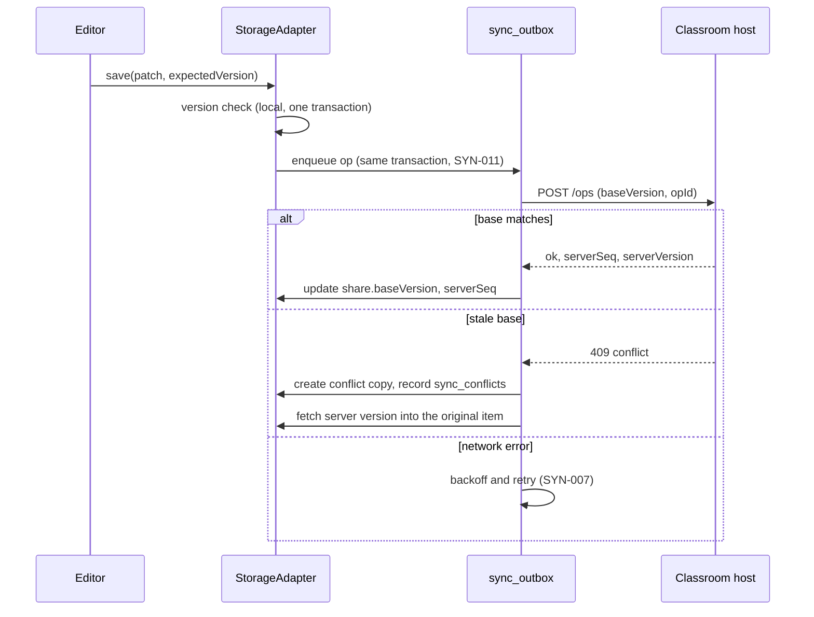

# Database and Sync Architecture

This document records the current local database (IndexedDB version 3) and its migration chain with evidence, and proposes the data model, migration rules, native SQLite plan, classroom-host data model and synchronisation design for the Advanced Edition. It covers brief §6 "Local-first architecture", "Synchronization" and "Database": stable IDs, timestamps, ownership, permissions, migration versions, reversible-where-practical migrations protected by backups, local Wi-Fi and optional remote sync, conflict detection and recovery, version tracking and retry. It ends with a decision proposal on CRDT (Yjs) versus optimistic concurrency. It owns the data requirements SYS-030 … SYS-059 and the sync requirements SYN-001 onwards. Everything marked "proposed" needs owner approval; nothing here has been built.

**Status: AE-P1 draft for owner approval (2026-11-15)**

Related documents in this folder:
[SYSTEM_ARCHITECTURE](SYSTEM_ARCHITECTURE.md) ·
[MODULE_DEPENDENCY_MAP](MODULE_DEPENDENCY_MAP.md) ·
[SECURITY_AND_PRIVACY_PLAN](SECURITY_AND_PRIVACY_PLAN.md) ·
[DEPENDENCY_AND_LICENCE_PLAN](DEPENDENCY_AND_LICENCE_PLAN.md) ·
[ACCEPTANCE_CRITERIA](ACCEPTANCE_CRITERIA.md) ·
[RISK_REGISTER](RISK_REGISTER.md) ·
[RELEASE_STRATEGY](RELEASE_STRATEGY.md) ·
[ADVANCED_EDITION_PRODUCT_ROADMAP](ADVANCED_EDITION_PRODUCT_ROADMAP.md) ·
PRDs most affected: [M04 Notebook](MODULE_04_DIGITAL_NOTEBOOK_PRD.md) · [M05 PDF Studio](MODULE_05_PDF_STUDIO_PRD.md) · [M06 Classroom Hub](MODULE_06_CLASSROOM_HUB_PRD.md) · [M07 Collaboration](MODULE_07_COLLABORATION_PRD.md) · [M08 File Manager](MODULE_08_FILE_MANAGER_PRD.md)

Conventions: status words Done, Partial, Stub, Absent, Unverified (canonical planning brief §0.2). "Done" means done for v0.2, verified by tests and the local run of 2026-11-15 (RELEASE_GAPS.md §11); it is not "Advanced-complete". AE-P1 … AE-P16 are Advanced Edition phases; "v0.2 Phase n" is the earlier programme. Libraries not installed are **candidates, licence to verify**, without version numbers. Database version numbers after v4 are indicative and are assigned at implementation.

---

## 1. Summary

| Topic | Today | Proposed |
|---|---|---|
| Web storage | IndexedDB `digital-classroom-os`, `SCHEMA_VERSION = 3`, 10 stores (Done) | v4 in AE-P3: metadata fields, folders, tags, tombstones, activity; later versions add notebook, pdf, search index, sync and classroom cache stores |
| Native storage | Absent; shells would use webview IndexedDB | D-12: Option A webview IndexedDB, or Option B SQLite behind the same `StorageAdapter` after the conformance suite (SYS-010) passes |
| Migrations | Append-only, transactional, behind a verified safety copy (Done, IndexedDB only); no down-migrations | Same rules for every adapter; "reversible where practical" defined in §4 (D-07) |
| Backup | Format 2, one JSON file, base64 attachments (Done) | Format 3: ZIP container with a JSON manifest and binary entries; format 2 still readable |
| Identity and ownership | `ownerDeviceId` only | Optional `ownerUserId`; accounts only on a classroom host (ADR-0020) |
| Permissions | Absent | Server-side grants on the classroom host; client caches for display only |
| Sync | Stub (no sync code; `packages/sync-engine` is a README stub) | Hybrid (ADR-0021): item-level operation queue with conflict copies; Yjs live co-editing only for items shared for co-editing |
| Conflict handling | Local optimistic concurrency (Done) | Same model across devices, with server sequence numbers and conflict copies; never a silent overwrite |

---

## 2. Current database (evidence at `edc2672`)

### 2.1 Stores

Database `digital-classroom-os` (`apps/web/src/lib/platform.ts:4`), `SCHEMA_VERSION = 3` (`packages/local-storage/src/indexeddb.ts:46`), schema type at `indexeddb.ts:58-72`, migrations at `indexeddb.ts:245-274`.

| Store | Key | Indexes | Added | Holds |
|---|---|---|---|---|
| `documents` | `id` | — | v1 (frozen) | `WorkspaceItem` (document) |
| `diagrams` | `id` | — | v1 (frozen) | `WorkspaceItem` (diagram) |
| `document_versions` | `id` | `by_item` → `itemId` | v1 (frozen) | `ItemVersion` |
| `diagram_versions` | `id` | `by_item` → `itemId` | v1 (frozen) | `ItemVersion` |
| `meta` | `key` | — | v1 (frozen) | key/value: `deviceId`, `migratedFrom`, `upgradeSafetyBackup` (written in `indexeddb.ts`), `lastBackupAt`, `lastAttachmentCleanUpAt` (written by the app, `apps/web/src/lib/storage.ts:219`, `:283`) |
| `item_index` | `id` | `by_kind` → `kind` | v2 | `ItemSummary` (item without content, plus `sizeBytes`), so lists never read content (`indexeddb.ts:690-700`) |
| `drafts` | `key` = `kind:itemId:session` | — | v2 | unsaved edits per editor session (`types.ts:68-83`; key format `indexeddb.ts:308`) |
| `attachments` | `id` | `by_sha256` (unique) | v2 | binaries and alias records (alias type `indexeddb.ts:74-84`; reference walk to `:111`) |
| `presentations` | `id` | — | v3 | `WorkspaceItem` (presentation) |
| `presentation_versions` | `id` | `by_item` → `itemId` | v3 | `ItemVersion` |

Outside IndexedDB: preferences, theme and open tabs in `localStorage` (`dcos.preferences`, `dcos.theme`, `dcos.openTabs`), and emergency drafts in `localStorage` (`dcos-emergency-draft:<kind>:<id>`, `storage.ts:49`; capped at 2 × 1024 × 1024 characters, `EMERGENCY_DRAFT_MAX_CHARS`, `storage.ts:16`). None of these are in backups.

### 2.2 Records

`WorkspaceItem` (`packages/local-storage/src/types.ts:9-29`):

| Field | Meaning | Note for sync |
|---|---|---|
| `id` | UUID v4 (`ids.ts:1-11`) | stable across devices; kept on backup import except for "(restored)" copies |
| `kind` | closed union of 3 kinds (`types.ts:5`) | — |
| `title`, `content` | content is per-kind JSON with its own `schemaVersion` | — |
| `version` | integer, +1 on every content or title change | per item, per device; **not** globally comparable (R-008) |
| `createdAt`, `updatedAt` | ISO 8601, device clock (`ids.ts:13-15`) | `updatedAt` ignores favourite and trash changes (`types.ts:17`) |
| `deletedAt` | soft-delete marker (ADR 0010) | purge leaves no tombstone |
| `ownerDeviceId` | device that created the item | the only ownership field |
| `favorite`, `templateId`, `lastSnapshotAt`, `restoredFrom?` | metadata | favourite changes move neither `version` nor `updatedAt` (`indexeddb.ts:808-827`) |

Not present: folder, tags, owner user, last opened, metadata timestamp, origin of last change.

`ItemVersion` (`types.ts:35-50`): id, itemId, kind, version, title, content, createdAt, reason (`manual | auto | restore | create`), optional `blobRefs` (images over 16 KB moved out to attachments as `dcos-blob:<id>`). Up to 50 per item (`indexeddb.ts:54`); one automatic snapshot at most every 10 minutes (`indexeddb.ts:48`).

`Attachment` (`types.ts:86-96`): id, sha256, mimeType (trusted from the caller), sizeBytes, data, createdAt, lastUsedAt. No size cap. Clean-up runs in one transaction under a Web Lock with a 24 h grace period (`indexeddb.ts:1096`), and counts references from items, versions, drafts and `extraReferences` (`apps/web/src/lib/storage.ts:162`).

### 2.3 Migration chain

| From → to | Commit / phase | What it did | Evidence |
|---|---|---|---|
| 0 → 1 | v0.1.0 (20d3f4d) | documents, diagrams, their version stores, meta | `indexeddb.ts:246-252` |
| 1 → 2 | ff53b49 "Release 0.2 stabilisation" (2026-11-13), before v0.2 Phase 3; v0.2 Phase 3 (2669868) then hardened storage without changing this migration (`git log -S` on `indexeddb.ts`) | item_index (backfilled from existing records, read only), drafts, attachments | `indexeddb.ts:253-264`; `indexeddb.test.ts:516` |
| 2 → 3 | v0.2 Phase 7 (edc2672) | presentations, presentation_versions; purely additive | `indexeddb.ts:265-273`; `kinds.test.ts:174-300` |

Protection around every upgrade (Done for IndexedDB):

1. Only one tab upgrades: Web Lock `dcos-upgrade:<db>` (`indexeddb.ts:372-378`; without Web Locks the task runs unlocked, `:374`).
2. A full copy of the old database is made and verified (`copyDatabase`, `indexeddb.ts:381`; `isCompleteCopy`) under the name `digital-classroom-os-backup-v<old>[-n]`; earlier copies are never replaced.
3. If the copy fails, no upgrade runs and the app shows the recovery screen (`needs-backup`): export read-only, retry, or upgrade without the copy only after a backup file was downloaded in this session (`types.ts:215-241`; `indexeddb.ts:511-549`).
4. An error inside a migration aborts the whole upgrade transaction; the database stays at the old version.
5. Builds made for an older version fail closed with `VersionError` and change nothing (`kinds.test.ts:269`).
6. Real-browser evidence: `scripts/upgrade-test.mjs` (v0.1.0 tag and 650cf63 → v3, downgrade, simulated full disk at `:621-681`), 82/82 on 2026-11-15, Chromium only, not in CI (RELEASE_GAPS.md:261, final run; :253 is the earlier run the same day).

Gap: `apps/web/src/lib/storage.ts:318` sets `upgradeRecovery` to `null` for any adapter that is not `IndexedDbAdapter`, so a second adapter currently has no recovery screen.

### 2.4 Content schemas (separate from the database version)

| Kind | Current schema | Evidence | Rule |
|---|---|---|---|
| document | 3 | `packages/document-studio/src/migrate.ts:13`; frozen vocabularies `compat.ts:12`, `:68` | stored under the lowest schema its content needs |
| diagram | 3 | `packages/diagram-studio/src/types.ts:221`; ADR 0012 | chosen per save |
| presentation | 1 | `packages/presentation-studio/src/types.ts:16`; frozen `compat.ts:14` | grouping, timeline, exit effects need 2 |
| backup ceiling | `{ document: 3, diagram: 3, presentation: 1 }` | `packages/local-storage/src/backup.ts:14` | an item or version of an unknown kind is skipped and counted as `unsupported` (`backup.ts:76`, `:103`); content above its kind's ceiling rejects the whole import with `InvalidBackupError` (`backup.ts:82`, `:108`) |

Content newer than the build opens in a protected read-only view. Upgraders are pure functions (`migrate.ts:18-23`).

### 2.5 Concurrency and coordination

- `save()` reads, checks `expectedVersion`, and writes in one transaction; a mismatch throws `ConflictError` (`indexeddb.ts:735-776`; `errors.ts:4`; ADR 0003). Recovery choices: "Keep my edits as a copy" or "Discard mine, load latest" (`apps/web/src/components/EditorFrame.tsx:287`, `:296`; `apps/web/src/lib/storage.test.tsx:89`).
- Tabs coordinate through `BroadcastChannel('dcos-storage')` (`storage.ts:172`) and Web Locks (ADR 0009).
- Autosave 600 ms; retries 1/3/10 s; quota retry 2 s (`storage.ts:689-692`). These are local retries only.

### 2.6 Backup format 2

`{ format: 'dcos-backup', formatVersion: 2, schemaVersion, appVersion, exportedAt, deviceId, items[], versions[], attachments[] (base64), missingAttachments? }` (`BackupFile`, `types.ts:115-136`; `formatVersion`, `appVersion` and `attachments` are optional in the type; `backup.ts:6`). Import validates everything first and imports nothing if anything is malformed; never overwrites: unknown ids are added, identical items skipped, divergent items added as "(restored)" copies with `restoredFrom`; re-hashes attachment bytes (`indexeddb.ts:934`). Not encrypted, not signed (ADR 0002, Decision item 5; BACKUP_AND_RECOVERY.md:28).

### 2.7 Gaps that block sync and the new modules

| Gap | Effect | Fixed by |
|---|---|---|
| No tombstones (purge is a hard delete, `purge`/`purgeMany`, `indexeddb.ts:842-846`) | deletions cannot propagate | SYS-034, ADR-0015 (v4) |
| Metadata changes do not move any timestamp | favourite, trash and folder changes cannot be ordered across devices | SYS-033 (`metaUpdatedAt`) |
| Per-device integer versions only | no cross-device ordering | SYN-004, SYN-006 (server sequence) |
| `deviceId` is a random id kept in the `meta` store (`indexeddb.ts:661-678`), so a new one is generated if the database is evicted or deleted (inferred from the code; not tested) | not a durable identity | ADR-0020 (`ownerUserId` on hosts) |
| Diagram node/edge ids are `n-`/`e-` + 8 hex (`diagram-studio/src/editor/mutations.ts:13`) | collision-prone when merging (R-015) | SYS-031 (AE-P5) |
| `sizeBytes` is a JSON character count of content only (`indexeddb.ts:296-299`) | misleading storage overviews (R-040) | SYS-041 |
| Backup is one JSON string with base64 | cannot hold large PDFs (R-024) | SYS-045 (format 3) |
| Stale SQLite DDL (docs/DATABASE.md:49-125: no presentations, drafts, item_index; different attachments model) | divergence if reused (R-012) | SYS-050 |

---

## 3. Target data model (proposed)

### 3.1 Data requirements SYS-030 … SYS-059

| ID | Requirement | Status today | Phase |
|---|---|---|---|
| SYS-030 | Every persistent record has a stable id: UUID v4 for items, versions, attachments, folders, tags, activity entries, operations and conflicts | Done for items, versions, attachments (`ids.ts`; attachments `indexeddb.ts:1032`) | AE-P3 for new records |
| SYS-031 | Ids of sub-objects that may be merged (diagram nodes and edges, slide elements, notebook pages, annotations) have at least 122 random bits; existing short ids stay readable | Partial (presentation elements use `crypto.randomUUID`, but fall back to `Date.now` plus `Math.random` where it is missing, `presentation-studio/src/create.ts:16-18`; diagrams use 8 hex characters, `diagram-studio/src/editor/mutations.ts:13`) | AE-P5 (diagrams), AE-P7/P8 for new kinds |
| SYS-032 | Every record has `createdAt` and `updatedAt` (ISO 8601, UTC); device time is advisory and never decides a conflict on its own | Partial | AE-P3 |
| SYS-033 | Items have `metaUpdatedAt`, moved by favourite, trash, restore, folder and tag changes; content changes keep moving `version` and `updatedAt` | Absent | AE-P3 (D-35) |
| SYS-034 | Purging an item writes a tombstone `{ kind, id, purgedAt, lastVersion, originDeviceId }`; tombstones are kept at least as long as any sync peer may need them (retention proposed: 180 days, owner to approve) | Absent | AE-P3 (D-35) |
| SYS-035 | Items have `lastOpenedAt`, written as a metadata-only change that moves neither `version`, `updatedAt` nor `metaUpdatedAt` | Absent | AE-P3 (D-32) |
| SYS-036 | Items have `folderId: string \| null` and `tagIds: string[]`; a missing value reads as root and no tags | Absent | AE-P3 (D-11) |
| SYS-037 | Items may have `ownerUserId` (missing = the device's own user, ADR 0002); shared items record `hostId` and server ids separately from local ids | Absent | AE-P3 field; AE-P9 use |
| SYS-038 | Every kind has a content schema number, frozen vocabularies and pure upgraders; the backup ceiling map lists every kind | Done for 3 kinds | AE-P7, AE-P8 |
| SYS-039 | Database migrations are append-only, transactional and preceded by a verified safety copy, on every adapter | Done (IndexedDB only) | AE-P3 rule; AE-P14 for native |
| SYS-040 | Every migration is tested from every earlier released database version in a real browser, and the upgrade test runs in CI (scheduled or manual) | Partial (Chromium, local only) | AE-P3 (D-38) |
| SYS-041 | Storage size is reported in bytes, including attachments and versions, per item and per kind | Partial (character count) | AE-P3 data; AE-P11 UI |
| SYS-042 | Attachments have a per-attachment size cap and MIME sniffing in `putAttachment`; the stored MIME type is the sniffed one | Absent | AE-P3 |
| SYS-043 | The attachment reference walk covers every kind, every new store and every reference mode in §3.5 | Partial (3 kinds) | each phase that adds a store |
| SYS-044 | Organisation entities (folders, tags) take part in trash, backup and restore | Absent | AE-P3 |
| SYS-045 | Backup format 3 (ZIP container) is written by new builds; formats 1–2 stay readable; all-or-nothing validation and never-overwrite import are kept | Absent | AE-P3 design; AE-P8 required |
| SYS-046 | The activity store is capped (proposed: 5,000 entries, oldest dropped) and holds no content | Absent | AE-P3 |
| SYS-047 | Server-authoritative classroom entities are cached in a `classroom_cache` store keyed by host and entity id, and are never treated as workspace items | Absent | AE-P9 |
| SYS-048 | Derived stores (item_index, search index) can be rebuilt from the item stores at any time, and a rebuild is offered when they are missing or inconsistent | Partial (item_index backfill only at v2) | AE-P3 |
| SYS-049 | `scripts/upgrade-test.mjs` derives its store lists from the kind registry instead of hard-coded lists (`:64-65`) | Absent | AE-P3 |
| SYS-050 | Any SQLite schema (native or host) is generated from or checked against the IndexedDB model; the DDL in docs/DATABASE.md:49-125 is not reused | Absent (the stale DDL is the only SQLite schema in the repository) | AE-P3 (docs), AE-P9, AE-P14 |
| SYS-051 | Older builds that meet a newer database fail closed and change nothing; the newer-data screen explains what to do | Done (fail closed: `kinds.test.ts:269`; upgrade test 82/82, RELEASE_GAPS.md:261). The explanation screen is Unverified in AE-P1: BACKUP_AND_RECOVERY.md:75-77 says v0.1.0 stays on "Loading…" | keep; AE-P3 re-verify |

Numbers SYS-052 … SYS-059 are reserved.

### 3.2 Item record at DB v4 (ADR-0015, proposed)

```ts
interface WorkspaceItem<C = unknown> {
  // unchanged v1–v3 fields
  id: string; kind: ItemKind; title: string; content: C; version: number;
  createdAt: string; updatedAt: string; deletedAt: string | null;
  ownerDeviceId: string; favorite: boolean; templateId: string | null;
  lastSnapshotAt: string | null; restoredFrom?: { itemId: string; version: number; updatedAt: string };
  // v4 additions (all optional on read; written by v4 builds)
  metaUpdatedAt?: string;        // SYS-033
  lastOpenedAt?: string | null;  // SYS-035
  folderId?: string | null;      // SYS-036
  tagIds?: string[];             // SYS-036
  ownerUserId?: string;          // SYS-037; missing = this device's user
  share?: {                      // present only for items explicitly shared (AE-P9/P10)
    hostId: string; serverItemId: string; serverSeq: number; baseVersion: number;
    mode: 'item-sync' | 'live';  // COL-IF-001 (MODULE_07 §9): item-level sync, or live co-editing
    role?: 'owner' | 'view' | 'comment' | 'edit'; sharedAt?: string; // MODULE_07 §6.2
  };
}
```

Migration v3 → v4 is additive at the store level (new stores, new indexes). Existing item records are not rewritten in the upgrade transaction: missing fields are read with defaults. A lazy write-back on the next save is allowed. This keeps the upgrade small (PERF-014) and the v3 safety copy sufficient.

### 3.3 Store plan

| Store | Key | Indexes | Proposed DB version | Phase | Purpose |
|---|---|---|---|---|---|
| `folders` | `id` | `by_parent`, `by_role` | v4 | AE-P3 | `{ id, name, parentId, role: 'folder' \| 'subject', colour?, createdAt, updatedAt, metaUpdatedAt, deletedAt, trashedWith?, ownerDeviceId }`; `trashedWith` records which folder's trash action trashed it (MODULE_08 §6.4) |
| `tags` | `id` | `by_name` (unique, case-folded) | v4 | AE-P3 | `{ id, name, colour, createdAt, updatedAt, metaUpdatedAt }` |
| `tombstones` | `[kind, id]` | `by_purgedAt` | v4 | AE-P3 | SYS-034; `kind` is an item kind or `'folder'` for purged folders (MODULE_08 §6.4) |
| `activity` | `id` | `by_at` | v4 | AE-P3 | SVC-ACT entries (no content) |
| `item_index` | `id` | add `by_folder`, `by_tag` (multiEntry), `by_lastOpened` | v4 (index additions) | AE-P3 | list queries for M08/M09 |
| `previews` | `[kind, itemId]` | — | v4 or with AE-P11 | AE-P11 | `{ kind, itemId, version, attachmentId }`: thumbnail images are SVC-BLOB attachments; derived and rebuildable (SYS-048; MODULE_08 §6.2) |
| `notebooks`, `notebook_versions` | `id` | `by_item` | v5 (indicative) | AE-P7 | ADR-0025 |
| `search_docs` + `search_index` | `search_docs`: `kind:itemId`; `search_index`: per candidate library | — | v5 (indicative, with notebook) | AE-P7 | SVC-SEARCH; layout in MODULE_09 §6.2; derived, rebuildable, excluded from backups (SYS-048) |
| `pdfs`, `pdf_versions` | `id` | `by_item` | v6 (indicative) | AE-P8 | ADR-0017, ADR-0023 |
| `classroom_cache` | `[hostId, entityType, entityId]` | `by_host`, `by_type` | v7 (indicative) | AE-P9 | SYS-047 |
| `sync_outbox` | `id` | `by_item`, `by_status` | v7 | AE-P9 | SYN-007, SYN-011 |
| `sync_state` | `hostId` | — | v7 | AE-P9 | cursor (last server sequence), session state (no secrets on the web; tokens per ADR-0020) |
| `sync_conflicts` | `id` | `by_item` | v7 | AE-P9 | SYN-005 |
| `collab_updates` | `[itemId, seq]` | `by_item` | v8 (indicative) | AE-P10 | Yjs updates for co-edited items (§8) |

Alternative to evaluate (ADR-0015): batch notebook and pdf stores into one migration, and the sync and cache stores into one, to reduce the number of live upgrades. Each upgrade reaches every Pages visitor at once (R-002, R-003), so fewer, well-tested upgrades are preferred.

### 3.4 Organisation model (ADR-0016)

- A folder has exactly one parent (`parentId`, null = root); folders nest. Moving a folder that would create a cycle is refused.
- An item is in at most one folder (`folderId`). Tags are many-to-many (`tagIds`).
- A subject is a folder with `role: 'subject'`; Notebook subjects (NBK-FR-002), File Manager folders (FIL-FR-001/002) and the Dashboard subject overview (DSH-FR-013) use the same records.
- A classroom subject on a host can be mapped to a local subject folder; the mapping is stored in `classroom_cache`, not in the folder (options open in D-11).
- Trashing a folder trashes its subtree (items keep `folderId`); restoring restores the subtree. Purging a folder writes tombstones for the folder and every purged item.
- Folder, tag and favourite changes are metadata-only and move `metaUpdatedAt`.

D-11 can still choose tags only or multiple parents; the store plan above changes only in the `folders` shape.

### 3.5 References in stored content (ADR-0018)

| Mode | Stored as | Attachment walk | Example |
|---|---|---|---|
| `link` | `ItemRef` with `itemId`, `kind`, cached `title` | none | File Manager shortcut, assignment material, search result, dashboard tile |
| `embed-copy` | today's embedded content plus optional `sourceRef: ItemRef` | preview ids as today | diagram in a document or slide (ADR 0013/0014) |
| `snapshot` | `ItemRef` with `version` and `attachmentId` of a packaged copy | the packaged attachment | classroom submission |

Every reference mode is reachable by the attachment clean-up (SYS-043). A dangling reference renders "missing item"; it is never removed silently.

### 3.6 Blobs and PDFs (ADR-0017)

- Keep ADR 0008: SHA-256 content addressing, unique `by_sha256`, alias records, 24 h grace clean-up.
- A PDF item stores `sourceAttachmentId` (immutable original bytes). Annotations are item content (schema-versioned JSON). A page operation (rotate, rearrange, merge, split, extract, compress) writes a **new** attachment; the previous one stays referenced from version history, which preserves the original (PDF-FR-018).
- Same bytes imported from two modules = one attachment record ("avoid duplicate storage").
- New limits in `putAttachment`: size cap (proposed default: 200 MB per attachment on the web, owner to confirm under D-20) and MIME sniffing (SYS-042).
- Web: evaluate OPFS (Origin Private File System) as a candidate store for very large blobs, behind the same attachment API. Native: blobs as files in the app-data directory named by SHA-256, with metadata in SQLite.
- Document pictures moving out of content into attachments (TD-2) is decision D-08 and means DOCUMENT_SCHEMA 4; it is the first non-additive content migration and is treated as high risk (R-004).

---

## 4. Migration rules

### 4.1 Rules (apply to IndexedDB, SQLite and the host database)

1. **Append-only.** Shipped migrations are never edited; a new one is appended and the version bumped (`indexeddb.ts:241-244` comment). (SYS-039)
2. **Additive first.** Prefer new stores, new indexes and new optional fields. A field is never renamed or reshaped in place; a new field is added and the old one is read as a fallback.
3. **Safety copy before every upgrade**, verified, never replacing an earlier copy; if it cannot be made, no upgrade runs (§2.3). (SYS-039)
4. **Transactional.** A migration that fails leaves the database at the old version.
5. **No awaiting non-IndexedDB work inside an IndexedDB migration** (the transaction would commit early); heavy backfills run after the upgrade as resumable background jobs on derived stores only.
6. **Fail closed.** Older builds refuse newer databases and content; they never write to them.
7. **Content schema bumps are per item and lazy**: an item is rewritten under a new schema only when the user saves it with a feature that needs it (current practice, `compat.ts` vocabularies).
8. **Every migration ships with**: a unit test from every earlier version, a real-browser upgrade test from the last released build, a PERF-014 measurement for the 1,000-item fixture, and a backup round trip.
9. **Live-site rule**: a migration reaches every Pages visitor at once (R-002). A build with a migration is deployed only after CI is green (D-02) and the upgrade test has passed on the exact commit.

### 4.2 "Reversible where practical" (D-07)

There are no down-migrations today (BACKUP_AND_RECOVERY.md:75-77). Proposed definition for owner decision D-07:

| Migration type | Reversal mechanism | Proposed requirement |
|---|---|---|
| Additive store or index (v4, v5 …) | Older builds cannot open the database (VersionError). The safety copy (`digital-classroom-os-backup-v<old>`) can be exported from Settings → Storage as a backup file (`exportSafetyCopy`, `apps/web/src/pages/settings/SettingsPages.tsx:164`). Importing that file into an older build needs a separate origin or browser profile, because the older build cannot open the upgraded database on the same origin; this path is Unverified (never tested). | Accept "safety copy + backup, older builds fail closed" as reversible. |
| Additive optional field | A v3 build's backup import copies the whole item record (`{ ...i }`, `packages/local-storage/src/backup.ts:84-85`) and normalises only the fields it knows, so unknown v4 fields are kept and ignored. Read-back behaviour in the v3 editors is not tested. | Verify with a backup round trip into the previous release for every new field. |
| Non-additive content change (TD-2 pictures to attachments; ownerUserId backfill) | A down-converter that produces the previous content schema where it is lossless, plus the safety copy | Require an explicit down-converter and a round-trip test, or an owner waiver recorded in the phase report. |
| Host database (SQLite) | Alembic-style candidates are not chosen; proposed: numbered SQL scripts with a paired "down" script where lossless, and a file copy of the database before each migration | Required for the host from AE-P9. |

### 4.3 Backups around migrations

- Before the v3 → v4 upgrade, the app already makes the safety copy. Proposed addition: when the device has items and no backup export in the last N days (preference `backupReminderDays`), the upgrade screen offers a one-click backup file download before upgrading. This adds friction only once per upgrade.
- Safety copies are listed, exportable and deletable in Settings → Storage today (`SettingsPages.tsx:150-180`; `SettingsPages.test.tsx:83-85`). Proposed: show their size and age, and suggest deleting copies older than two upgrades.

### 4.4 Upgrade path for native builds

If D-12 chooses SQLite: on first launch, the native app reads any webview IndexedDB data through the existing `exportBackup` path, writes it into SQLite through `importBackup` (never-overwrite), verifies counts and hashes, keeps the webview database untouched, and records the migration in `meta`. If verification fails, the app keeps running on the webview IndexedDB adapter and reports it.

### 4.5 Backup format 3 (proposed)

```
classroom-os-backup-<date>.dcosbackup   (ZIP, written with fflate, already installed)
├── manifest.json        { format: 'dcos-backup', formatVersion: 3, schemaVersion, schemaByKind,
│                          dbVersion, appVersion, exportedAt, deviceId, counts, sha256 of every entry }
├── items/<kind>/<id>.json
├── versions/<kind>/<itemId>/<versionId>.json
├── org/folders.json, org/tags.json
├── tombstones.json
└── blobs/<sha256>        (raw bytes, stored uncompressed when already compressed, e.g. PDF/PNG)
```

- Streams entries instead of building one string, so large PDFs do not hit memory limits (R-024).
- Validation is all-or-nothing against the manifest hashes before anything is written. Import never overwrites (same rules as format 2).
- New builds still read formats 1 and 2. Older builds cannot read format 3; the export dialog offers "format 2 (for older versions)" while all content fits it.
- Encryption with a passphrase is decision D-34 (proposed: required for any backup that contains classroom data once that exists). Signing is not proposed; the manifest hashes give integrity, not authenticity.
- Preferences, tabs and drafts in backups: D-34.

---

## 5. Native SQLite plan (ADR-0019, D-12)

### 5.1 Options

| | Option A: webview IndexedDB | Option B: SQLite adapter (brief preference) |
|---|---|---|
| New code | none | Rust command layer or plugin (Tauri), plugin (Android), TypeScript adapter |
| Candidates | — | Tauri: `tauri-plugin-sql` or a custom layer over `rusqlite`; Android: `@capacitor-community/sqlite` (all licences to verify) |
| Eviction risk | webview may evict data; no file-system storage | app-data directory, not evicted |
| Large blobs | IndexedDB / OPFS limits | files in app-data |
| Migration machinery | existing (Done) | must be reimplemented and pass SYS-010 |
| Brief §3 | does not meet "SQLite for native local storage" | meets it |

Proposed path: ship the first native builds (AE-P14) on Option A only if Option B has not passed the conformance suite in time, and record that as a disclosed limitation. Option B is adopted only after it passes SYS-010 with the same suite that IndexedDB passes.

### 5.2 SQLite adapter requirements

| Concern | IndexedDB today | SQLite design (proposed) |
|---|---|---|
| Schema version | `SCHEMA_VERSION` | `PRAGMA user_version`, same number sequence as the IndexedDB model |
| Safety copy | `copyDatabase` | `VACUUM INTO '<name>-backup-v<old>.sqlite'` or the SQLite backup API, verified by row counts and an integrity check, before the migration transaction |
| Atomic save with version check | one IndexedDB transaction | `BEGIN IMMEDIATE`; `UPDATE … WHERE id = ? AND version = ?`; zero rows → `ConflictError` |
| Cross-window coordination | BroadcastChannel + Web Locks | a single adapter in the native process; change events forwarded to every window |
| Attachments | `attachments` store with `by_sha256` | `attachments(sha256 UNIQUE, …)` metadata + files `blobs/<sha256>`; clean-up deletes files only after the metadata transaction commits |
| Upgrade recovery | `UpgradeRecovery` | the same interface implemented for SQLite, so `storage.ts:318` no longer returns null |
| Durability | browser-managed | WAL mode, `synchronous=NORMAL` or `FULL` (to measure), `foreign_keys=ON` |

### 5.3 Table mapping (to be generated from the IndexedDB model in AE-P3; not the old DDL)

| IndexedDB store | SQLite table(s) | Note |
|---|---|---|
| `documents`, `diagrams`, `presentations`, later `notebooks`, `pdfs` | one `items` table with a `kind` column, or one table per kind | decision in AE-P3; one table simplifies queries, per-kind tables mirror IndexedDB exactly |
| `*_versions` | `item_versions` (`item_id`, `version`, `reason`, `content`, `blob_refs` JSON) | |
| `item_index` | not needed (a view or indexed columns on `items`) | `size_bytes` computed in bytes (SYS-041) |
| `drafts` | `drafts` (key `kind:item_id:session`) | |
| `attachments` | `attachments` + files | aliases become rows with `alias_of` |
| `meta` | `meta` | |
| v4+ stores | `folders`, `tags`, `item_tags`, `tombstones`, `activity`, `sync_outbox`, `sync_state`, `sync_conflicts`, `classroom_cache`, `collab_updates` | |

---

## 6. Classroom host data model (proposed; ADR-0020/0021)

The classroom host is an optional FastAPI process with SQLite on a teacher or school machine (D-13). It is the only place with accounts. It is authoritative for classroom entities and for the server copy of shared items. Personal items never reach it unless the user submits or shares them.

| Table | Key fields | Notes |
|---|---|---|
| `users` | id, username/email, password_hash (Argon2id), role (`admin`/`teacher`/`student`), created_at, disabled_at | CLS-FR-040/060/061 |
| `sessions` | id, user_id, token_hash, created_at, expires_at, revoked_at, client_kind | opaque tokens stored hashed |
| `classrooms`, `subjects`, `memberships` | membership role per classroom | CLS-FR-001/002/003/020 |
| `join_codes` | code_hash, classroom_id, expires_at, max_uses, uses | self-registration toggle per host |
| `assignments`, `assignment_materials` | materials are `ItemRef` (`link` to host-stored items) | CLS-FR-004/005/006 |
| `submissions` | assignment_id, student_id, status, submitted_at, `snapshot_refs` (JSON array of `ItemRef` with `version` and `attachmentId`) | INT-03, INT-04 |
| `grades`, `rubrics`, `rubric_criteria`, `feedback` | feedback threads tied to submission | CLS-FR-008/009/010 |
| `announcements` | | CLS-FR-011 |
| `shared_items` | server_item_id, kind, owner_user_id, server_version, server_seq, content (JSON), deleted_at | items explicitly shared or exchanged |
| `share_grants` | server_item_id, grantee (`user:<id>` or `workspace:<id>`, as MODULE_07 `ShareGrant.subject`), grant (`view`/`comment`/`edit`), created_by, revoked_at | COL-FR-003…006 |
| `blobs` | sha256, size, mime, path | deduplicated |
| `ops_log` | server_seq (monotonic per host), op_id (client UUID, unique), user_id, device_id, entity, base_version, result | idempotency and change feed |
| `collab_docs` | server_item_id, yjs_state (blob), updated_at | AE-P10 |
| `audit_log` | actor, action, entity, at, ip | CLS-FR-043/044; no content |

Every endpoint checks authorisation on the server (deny by default). Data protection, retention and encryption at rest are owned by SECURITY_AND_PRIVACY_PLAN.

This table is the overview. The detailed entities are owned by the module PRDs and use these names: classroom entities in [MODULE_06 §6.1](MODULE_06_CLASSROOM_HUB_PRD.md) (`users` = `User`, `sessions` = `Session`, `join_codes` = the join-code fields on `Classroom`, `submissions` = `Submission` + `SubmissionRound` + `SubmissionPart`, `grades`/`rubrics`/`feedback` = `Grade`, `Rubric`, `Feedback`, `audit_log` = `AuditEvent`, `blobs` = `HostBlob`) and sharing entities in [MODULE_07 §6.1](MODULE_07_COLLABORATION_PRD.md) (`shared_items` = `SharedItem`, `share_grants` = `ShareGrant`, `collab_docs` = `CollabUpdate` + `CollabSnapshot`, `ops_log` = `ItemSyncOp` plus the per-host sequence). `server_item_id` here is `SharedItem.id` there. The host SQLite schema is generated from those entities in AE-P9 (SYS-050).

---

## 7. Sync design (ADR-0021, proposed)

### 7.1 Requirements SYN-001 onwards

| ID | Requirement | Status today | Phase |
|---|---|---|---|
| SYN-001 | Sync is explicit: an item leaves the device only when the user shares, submits or hands it in; nothing syncs by default | Done by construction (no sync) | AE-P9 |
| SYN-002 | Local Wi-Fi: devices reach a classroom host on the same network over HTTPS/WSS (§8.3) | Absent | AE-P9 (exchange), AE-P10 (co-editing) |
| SYN-003 | Optional remote sync through a self-hosted, internet-reachable host; off by default; no paid SaaS | Absent | AE-P10 if D-15 approves |
| SYN-004 | Conflict detection: every write to a shared item carries `baseVersion`; the host rejects a stale one with HTTP 409 | Partial (local only, `indexeddb.ts:735-776`) | AE-P9 |
| SYN-005 | Conflict recovery: on 409 the client keeps the local edits as a conflict copy and records a `sync_conflicts` entry the user can resolve (keep mine as copy, take theirs, compare); nothing is dropped | Partial (local "Keep my edits as a copy") | AE-P9 |
| SYN-006 | Version tracking: the host assigns a monotonic sequence number per host to every accepted operation; clients pull changes since their last sequence; integer item versions are never compared across devices as a global order | Absent | AE-P9 |
| SYN-007 | Retry after network failure: queued operations retry with exponential backoff and jitter (proposed 1 s doubling to a 5-minute cap), survive restarts, and resume on reconnect | Absent | AE-P9 |
| SYN-008 | No silent overwrite on any path: sync, import, restore, co-editing | Done for local paths | AE-P9, AE-P10 |
| SYN-009 | Deletions travel as tombstones; a purge on one device never deletes another user's copy, and a delete that conflicts with an edit produces a conflict entry | Absent | AE-P3 (tombstones), AE-P9 |
| SYN-010 | Metadata (favourite, folder, tags) is per user and per device by default and is not synced unless the item is shared; when synced, it is ordered by `metaUpdatedAt` then device id, and the losing value is kept in the conflict log | Absent | AE-P9 |
| SYN-011 | The outbox is durable: operations are written to `sync_outbox` in the same transaction as the local save | Absent | AE-P9 |
| SYN-012 | Operations are idempotent: each has a client-generated UUID; the host stores it and replays the same result for a duplicate | Absent | AE-P9 |
| SYN-013 | Live co-editing applies only to items explicitly shared for co-editing, through SVC-COLLAB (Yjs candidate); documents first (D-16) | Absent | AE-P10 |
| SYN-014 | Reconnection replays queued operations or Yjs updates; offline edits are merged or turned into conflict copies, never dropped | Absent | AE-P10 |
| SYN-015 | The user can see each shared item's sync state (synced, pending, offline, conflict, forbidden) and the last successful sync time | Absent | AE-P9 |
| SYN-016 | Sync never blocks local editing or autosave; a host outage only changes the sync state | Done by construction | AE-P9, AE-P10 |
| SYN-017 | The client never stores passwords; session tokens follow ADR-0020 (HttpOnly cookie for a same-origin web client, OS secure storage for native) | Absent | AE-P9 |
| SYN-018 | Snapshots for submissions are immutable: a grade refers to exactly the submitted version (`snapshot` refs) | Absent | AE-P9 |

### 7.2 Operation model

```ts
// Client side (packages/sync-engine, proposed)
interface SyncOperation {
  id: string;                    // UUID, idempotency key (SYN-012)
  hostId: string;
  type: 'put-item' | 'delete-item' | 'put-meta' | 'submit' | 'share' | 'revoke';
  kind?: ItemKind;
  itemId: string;                // local id
  serverItemId?: string;
  baseVersion: number;           // server version the edit was based on (SYN-004)
  payloadRef: { version: number } | { attachmentId: string }; // content read at send time from the item or a snapshot
  originDeviceId: string;
  createdAt: string;
  status: 'pending' | 'sending' | 'acked' | 'conflict' | 'failed' | 'forbidden';
  attempts: number;
  nextAttemptAt: string;
  lastError?: string;
}

interface SyncConflict {
  id: string; itemId: string; kind: ItemKind; hostId: string;
  localVersion: number; serverVersion: number; serverSeq: number;
  reason: 'stale-base' | 'deleted-remotely' | 'deleted-locally' | 'permission-changed';
  conflictCopyId?: string;       // local item id of the copy that holds the user's edits
  createdAt: string; resolvedAt?: string; resolution?: 'kept-copy' | 'took-server' | 'merged-manually';
}

// Host API shape (FastAPI, proposed; versions under /api/v1)
// POST /api/v1/ops          body: SyncOperation[] (batch)  → per op: { opId, result: 'ok' | 'conflict' | 'forbidden', serverSeq, serverVersion }
// GET  /api/v1/changes?since=<serverSeq>&limit=<n>         → { changes: Change[], nextSeq }
// GET  /api/v1/items/<serverItemId>                        → content + serverVersion (ETag)
```

### 7.3 Flow: sending an edit to a shared item



### 7.4 Conflict policy

| Situation | Result |
|---|---|
| Local edit on a stale base | Server version replaces the shared item locally; the user's edits are kept as a "(conflict copy)" item linked to it; a conflict entry is shown (SYN-005) |
| Remote delete, local edit | The local item is kept, unshared, with a conflict entry ("deleted on the host") |
| Local delete, remote edit | The delete is not applied on the host; the item returns to the trash locally with a conflict entry |
| Permission revoked while offline | Queued operations end as `forbidden`; local content stays on the device; the item becomes unshared |
| Same operation sent twice | The host returns the stored result (SYN-012) |
| Co-edited item (Yjs) | Merged by the CRDT; no conflict copy needed for text; structural limits documented per kind |

### 7.5 Clocks and ordering

- Device time is advisory and is only used for display and for tie-breaking metadata with the device id.
- The host's per-host sequence number orders accepted changes (SYN-006).
- A hybrid logical clock is a candidate only if multi-host remote sync is approved (D-15).

### 7.6 Transport

- HTTPS for the operation API; WSS for co-editing (§8). Certificates per D-14.
- Pairing by join code or QR; discovery by mDNS on native only (candidate).
- Remote sync uses the same API on an internet-reachable self-hosted host (D-15); no protocol difference.

---

## 8. Live co-editing (SVC-COLLAB; ADR-0021 part 2, ADR-0022)

### 8.1 Persistence model (proposed)

- The canonical stored content remains the schema-versioned JSON in the item store. Backups, exports, search, version history and older builds keep working from JSON.
- For an item shared for co-editing, the Yjs document state and pending updates are kept in `collab_updates` (client) and `collab_docs` (host). Candidate for client persistence: `y-indexeddb`, or the project's own store using the Yjs update encoding (to evaluate; the project's own store keeps one database and the safety-copy rules).
- The editor binds to the Yjs document (candidates: `y-prosemirror` or `@tiptap/extension-collaboration` and `@tiptap/extension-collaboration-cursor`; confirm they are not Tiptap Pro and support Tiptap 3.33; R-029). After each settled change, the JSON is derived from the Yjs document and saved through the normal autosave path, so `version` still moves and history snapshots are taken from JSON.
- Presence and cursors use the Yjs awareness protocol (candidate); awareness data is never persisted.
- Compaction: the host merges updates into a state snapshot periodically (proposed: every 500 updates or on last client leave; to measure).

### 8.2 Order of work (D-16)

1. Documents (AE-P10). 2. Presentations and diagrams later, each behind its own acceptance criteria, if D-16 approves. Diagrams need long ids first (SYS-031, AE-P5).

### 8.3 Platform constraints (to verify in the AE-P10 spike; R-028)

- The public HTTPS Pages build cannot open `http://` or `ws://` LAN connections (mixed content); Chromium Private Network Access rules may add further limits.
- A page served over `http://<LAN-IP>` is not a secure context: no service worker, no `crypto.subtle` (attachments break, `indexeddb.ts:277`), no Web Locks (upgrades and dialog sessions then run unlocked, `indexeddb.ts:374`, `apps/web/src/lib/storage.ts:568-569`); `crypto.randomUUID` is missing, and `ids.ts:4-5` falls back to `getRandomValues` while `presentation-studio/src/create.ts:18` and `diagram-studio/src/editor/mutations.ts:13` fall back to non-cryptographic ids. Not tested on a real LAN origin.
- Therefore: native apps first (Tauri CSP `connect-src` extended to the host; Android network-security configuration), and browsers only when the host serves the app over HTTPS with a certificate the devices trust (D-14).

---

## 9. Decision proposal: CRDT versus optimistic concurrency

| Criterion | Optimistic concurrency + operation queue | CRDT (Yjs) | Assessment |
|---|---|---|---|
| Fits today's model | Same as ADR 0003; reuses conflict copy UI, drafts, version history | New persistence layer and editor binding per kind | OCC |
| Never silently overwrites | Yes: stale writes are rejected and kept as copies | Yes for text merges; structural merges can produce surprising results (for example two people moving the same shape) | both, with care |
| Offline for days, then submit | Natural: one operation with a base version | Works, but the merge result may need review | OCC |
| Real-time co-editing, cursors | Not possible | Designed for it | CRDT |
| Submissions and grades | Need immutable snapshots, not merges | Not suitable | OCC |
| Storage and backup | JSON stays canonical | Extra update log per shared item | OCC simpler |
| Complexity per kind | Low: one generic operation type | High: a binding per editor (Tiptap, React Flow, slides) | OCC |
| Dependencies | none new | Yjs and bindings (candidates, licences to verify) | OCC |
| Brief requirement | covers conflict detection, recovery, version tracking, retry | covers "concurrent editing", "live cursors", "presence" (COL-FR-007/008/010) | both needed |

**Proposal (ADR-0021):** a hybrid. Optimistic concurrency with an operation queue for everything that is exchanged (submissions, materials, announcements, shared items not marked for co-editing) and for all metadata. A CRDT only for items explicitly shared for co-editing, starting with documents, with JSON kept as the canonical stored form. Alternatives to record in the ADR: Automerge (candidate); Yjs for everything shared (rejected: too much per-kind binding work and weak fit for snapshots); no CRDT at all (rejected: cannot meet COL-FR-007/008/010).

Owner decisions this depends on: D-15 (remote sync), D-16 (co-editing scope), D-35 (tombstones and `metaUpdatedAt` in v4 before any sync work).

---

## 10. Test strategy for data and sync

| Area | Tests |
|---|---|
| Conformance (SYS-010) | One suite run against every adapter: concurrency, metadata-only changes, purge atomicity and tombstones, attachment clean-up with every reference mode, never-overwrite import, safety copy and recovery states, rebuild of derived stores |
| Migrations | unit tests from every earlier version (fake-indexeddb); `scripts/upgrade-test.mjs` from the last released build and from v0.1.0, in Chromium, WebKit and Firefox once CI is green; PERF-014 measurement |
| Backup | format 2 and 3 round trips; malformed and truncated ZIPs; hash mismatch; large PDF fixture (memory measured); import into the previous release |
| Sync | two browser contexts and a test host: stale base → conflict copy; duplicate operation; network cut mid-batch (`context.setOffline`); restart with a pending outbox; revoked permission; remote delete vs local edit |
| Co-editing | 2–30 simulated clients against the relay (PERF-012); disconnect and reconnect; offline edits merged; awareness cleanup |
| Host | pytest for every endpoint: authorisation (deny by default), idempotency, sequence monotonicity, 409 behaviour; migration scripts up and down where defined |
| Native | the conformance suite through the Tauri and Capacitor adapters on real machines (AE-P14) |
| Privacy | `e2e/privacy.spec.ts` extended: no request when no host is configured; with a host, only the expected host origin is contacted |

---

## 11. Owner decisions referenced

D-07 (reversible migrations), D-08 (pictures to attachments), D-11 (organisation model), D-12 (native storage), D-13 (classroom host), D-14 (LAN security), D-15 (remote sync), D-16 (co-editing scope), D-20 (PDF size limits), D-32 ("Recent" meaning), D-33 (trash retention), D-34 (backups), D-35 (tombstones and `metaUpdatedAt` in v4), D-37 (Python version), D-38 (upgrade test in CI). Proposed values in this document (tombstone retention 180 days, activity cap 5,000, attachment cap 200 MB, backoff cap 5 minutes, compaction every 500 updates) are proposals for those decisions, not settled numbers.

## 12. Known risks

From the register: R-002 (ungated deploys carry migrations to all users), R-003 (live migrations), R-004 (no down-migrations; first non-additive migration), R-007 (student data exposure), R-008 (sync correctness), R-012 (stale SQLite DDL), R-015 (short diagram ids), R-024 (large PDFs and backup format 2), R-028 (secure-context and mixed-content rules), R-029 (Yjs and Tiptap 3.33 compatibility), R-040 (`sizeBytes`). Data-specific notes for the register owner: lazy write-back of v4 fields means two shapes of item record coexist for a long time, so every reader must default missing fields; and the number of live upgrades (v4 to roughly v8) multiplies R-003 unless migrations are batched.
