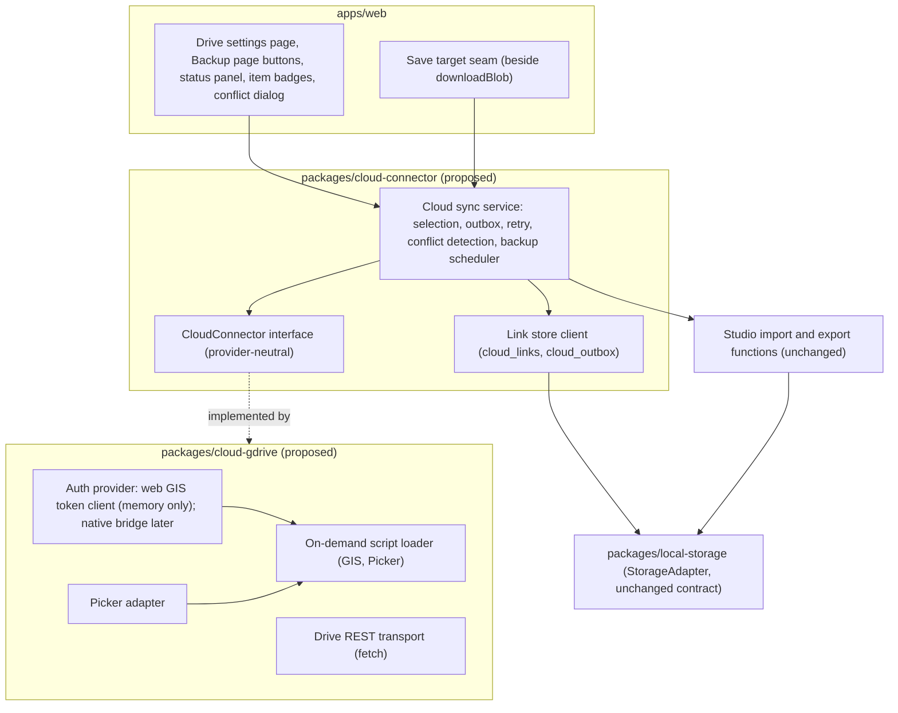
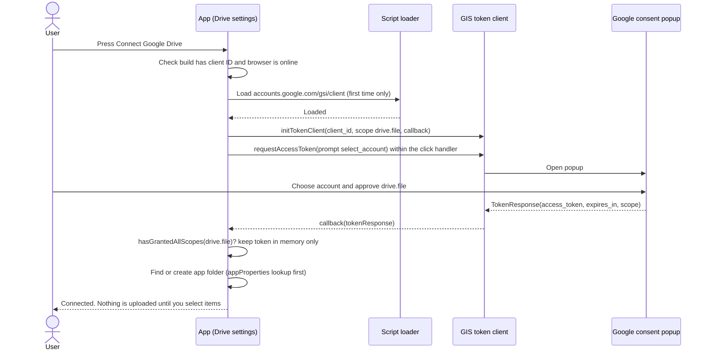
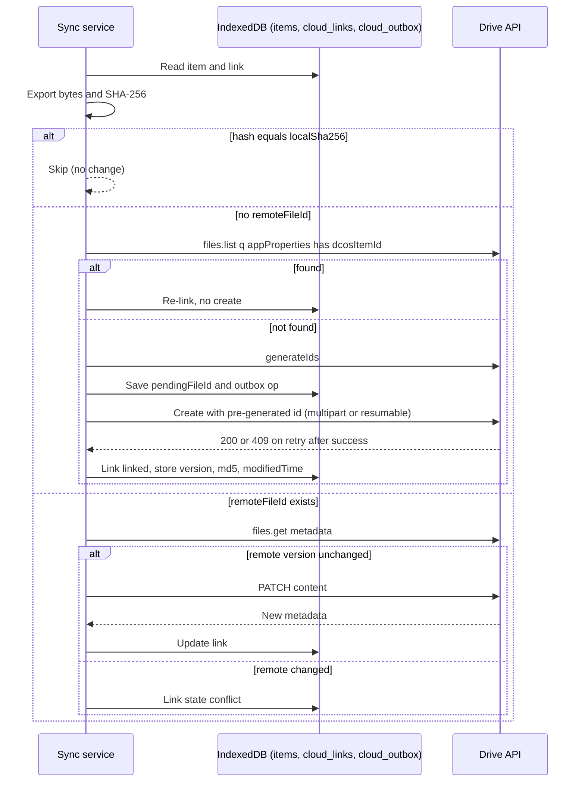
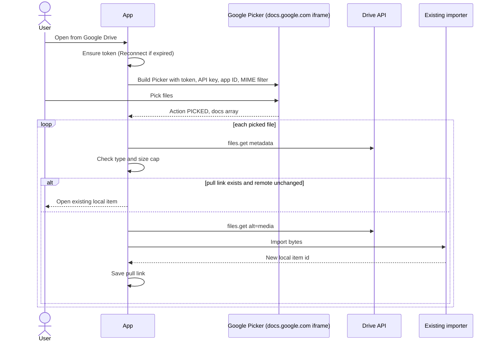
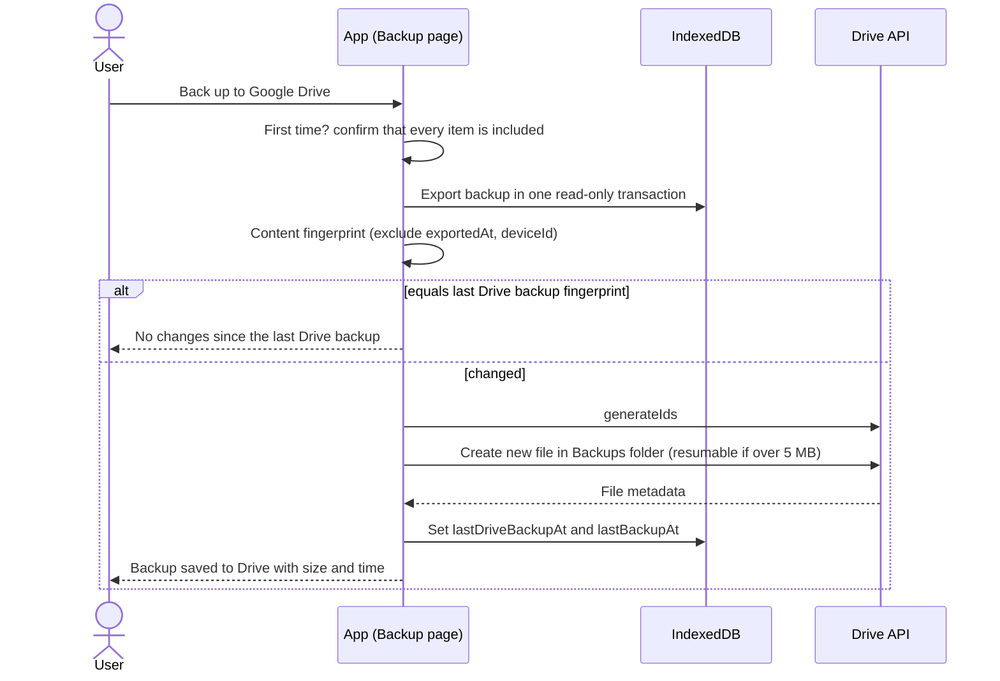
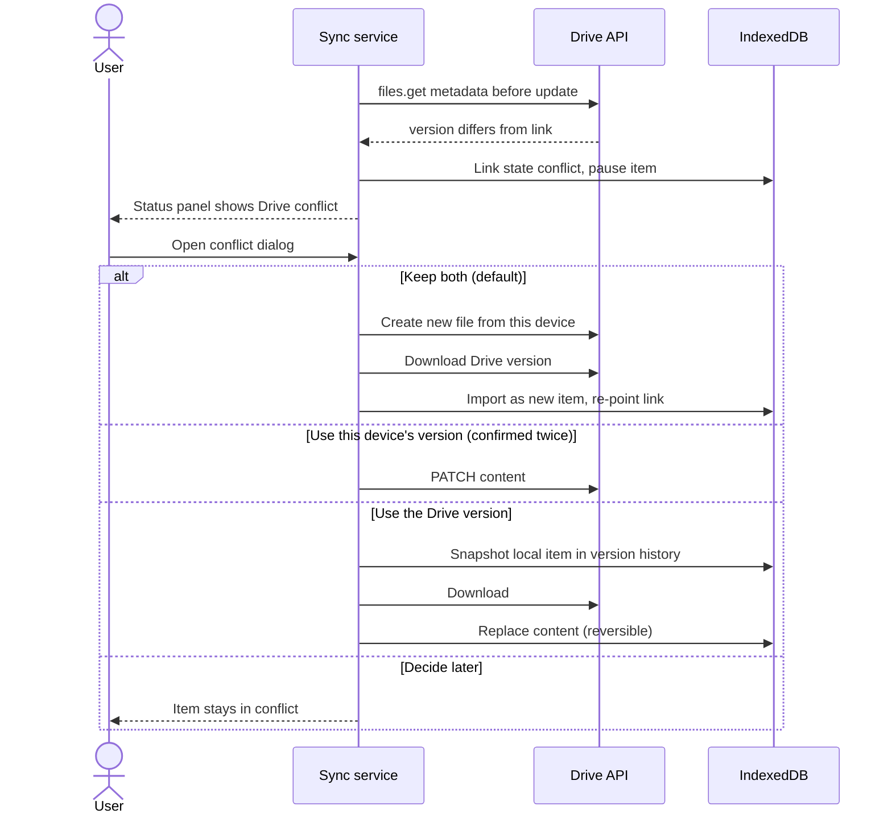

# Google Drive integration plan (GDR)

**Purpose.** This plan answers the owner's request of 2026-11-15 to add an optional Google Drive integration to Digital Classroom OS. It audits the current architecture, proposes an architecture, justifies the OAuth scopes, reviews security and privacy, splits the work into phases with approval gates, and lists the tests, the Google Cloud setup and the owner decisions needed before any code is written.

**Status: plan approved by the owner on 2026-11-15; no code yet. Coding still waits for decisions D-54 and D-55 and the GDR phase approvals.** Nothing in this document changes application code, tests, configuration or git state. No Google Cloud project, client ID or API key has been created.

**Related documents:** [README.md](README.md) (index and ID rules) · [ADVANCED_EDITION_PRODUCT_ROADMAP.md](ADVANCED_EDITION_PRODUCT_ROADMAP.md) · [SYSTEM_ARCHITECTURE.md](SYSTEM_ARCHITECTURE.md) · [DATABASE_AND_SYNC_ARCHITECTURE.md](DATABASE_AND_SYNC_ARCHITECTURE.md) · [SECURITY_AND_PRIVACY_PLAN.md](SECURITY_AND_PRIVACY_PLAN.md) · [DEPENDENCY_AND_LICENCE_PLAN.md](DEPENDENCY_AND_LICENCE_PLAN.md) · [MODULE_08_FILE_MANAGER_PRD.md](MODULE_08_FILE_MANAGER_PRD.md) · [RISK_REGISTER.md](RISK_REGISTER.md) · [ACCEPTANCE_CRITERIA.md](ACCEPTANCE_CRITERIA.md) · [../adr/0002-identity-ownership-privacy.md](../adr/0002-identity-ownership-privacy.md) · [../adr/0007-backup-format.md](../adr/0007-backup-format.md) · [../DEPLOYMENT.md](../DEPLOYMENT.md)

**Conventions.**

- Repository facts cite `path:line` from the repository root. Planning-document lines cite `docs/advanced-edition/<FILE>.md:line`.
- Google facts cite the official pages listed in §0.1, written as [G01] … [G35]. Every page was fetched on 2026-11-15 during the research step for this plan. Quotations are short; where Google's own wording uses US spelling ("authorization") it is kept inside quotation marks.
- Statements that could not be confirmed from Google's pages are marked **(not confirmed)** and collected in §11.
- New identifiers use the prefix **GDR** (unused anywhere in the repository today) and follow the README mirroring rule: FR n → AC n; NFR n → AC 500 + n; UX n → AC 700 + n; IF n → AC 900 + n (`docs/advanced-edition/README.md:78-79`).

### 0.1 Google sources

| Key | Page |
|---|---|
| G01 | GIS token model: https://developers.google.com/identity/oauth2/web/guides/use-token-model |
| G02 | Choose an authorisation model: https://developers.google.com/identity/oauth2/web/guides/choose-authorization-model |
| G03 | How user authorisation works: https://developers.google.com/identity/oauth2/web/guides/how-user-authz-works |
| G04 | GIS JavaScript reference: https://developers.google.com/identity/oauth2/web/reference/js-reference |
| G05 | Android authorisation (Google's Android developer site): https://developer.android.com/identity/authorization |
| G06 | OAuth 2.0 for client-side web apps (implicit flow): https://developers.google.com/identity/protocols/oauth2/javascript-implicit-flow |
| G07 | GIS code model: https://developers.google.com/identity/oauth2/web/guides/use-code-model |
| G08 | OAuth 2.0 for web server apps: https://developers.google.com/identity/protocols/oauth2/web-server |
| G09 | Get a Google API client ID: https://developers.google.com/identity/oauth2/web/guides/get-google-api-clientid |
| G10 | OAuth 2.0 overview: https://developers.google.com/identity/protocols/oauth2 |
| G11 | Testing publishing status: https://support.google.com/cloud/answer/15549945?hl=en |
| G12 | Drive API scopes: https://developers.google.com/workspace/drive/api/guides/api-specific-auth |
| G13 | Application data folder: https://developers.google.com/workspace/drive/api/guides/appdata |
| G14 | Unverified apps: https://support.google.com/cloud/answer/7454865 |
| G15 | When verification is needed: https://support.google.com/cloud/answer/13463073 |
| G16 | Verification exemptions: https://support.google.com/cloud/answer/13464323?hl=en |
| G17 | Security assessment: https://support.google.com/cloud/answer/13465431?hl=en-GB |
| G18 | Restricted-scope verification: https://developers.google.com/identity/protocols/oauth2/production-readiness/restricted-scope-verification |
| G19 | Web Picker guide: https://developers.google.com/workspace/drive/picker/guides/web-picker?hl=en |
| G20 | Picker sample: https://developers.google.com/workspace/drive/picker/guides/sample |
| G21 | `PickerBuilder.setAppId`: https://developers.google.com/workspace/drive/picker/reference/picker.pickerbuilder.setappid |
| G22 | `DocsView`: https://developers.google.com/workspace/drive/picker/reference/picker.docsview |
| G23 | Picker overview: https://developers.google.com/workspace/drive/picker/guides/overview |
| G24 | Picker for desktop and mobile apps: https://developers.google.com/workspace/drive/picker/guides/desktop-mobile-picker?hl=en |
| G25 | API keys: https://docs.cloud.google.com/docs/authentication/api-keys |
| G26 | Manage uploads: https://developers.google.com/workspace/drive/api/guides/manage-uploads |
| G27 | Files resource (v3): https://developers.google.com/workspace/drive/api/reference/rest/v3/files |
| G28 | v2 to v3 reference: https://developers.google.com/workspace/drive/api/guides/v2-to-v3-reference |
| G29 | Custom file properties: https://developers.google.com/workspace/drive/api/guides/properties |
| G30 | Search query terms: https://developers.google.com/workspace/drive/api/guides/ref-search-terms |
| G31 | Retrieve changes: https://developers.google.com/workspace/drive/api/guides/manage-changes |
| G32 | Handle errors: https://developers.google.com/workspace/drive/api/guides/handle-errors |
| G33 | Usage limits: https://developers.google.com/workspace/drive/api/guides/limits |
| G34 | Trash or delete files: https://developers.google.com/workspace/drive/api/guides/delete |
| G35 | OAuth 2.0 for native apps: https://developers.google.com/identity/protocols/oauth2/native-app |

[G01]: https://developers.google.com/identity/oauth2/web/guides/use-token-model
[G02]: https://developers.google.com/identity/oauth2/web/guides/choose-authorization-model
[G03]: https://developers.google.com/identity/oauth2/web/guides/how-user-authz-works
[G04]: https://developers.google.com/identity/oauth2/web/reference/js-reference
[G05]: https://developer.android.com/identity/authorization
[G06]: https://developers.google.com/identity/protocols/oauth2/javascript-implicit-flow
[G07]: https://developers.google.com/identity/oauth2/web/guides/use-code-model
[G08]: https://developers.google.com/identity/protocols/oauth2/web-server
[G09]: https://developers.google.com/identity/oauth2/web/guides/get-google-api-clientid
[G10]: https://developers.google.com/identity/protocols/oauth2
[G11]: https://support.google.com/cloud/answer/15549945?hl=en
[G12]: https://developers.google.com/workspace/drive/api/guides/api-specific-auth
[G13]: https://developers.google.com/workspace/drive/api/guides/appdata
[G14]: https://support.google.com/cloud/answer/7454865
[G15]: https://support.google.com/cloud/answer/13463073
[G16]: https://support.google.com/cloud/answer/13464323?hl=en
[G17]: https://support.google.com/cloud/answer/13465431?hl=en-GB
[G18]: https://developers.google.com/identity/protocols/oauth2/production-readiness/restricted-scope-verification
[G19]: https://developers.google.com/workspace/drive/picker/guides/web-picker?hl=en
[G20]: https://developers.google.com/workspace/drive/picker/guides/sample
[G21]: https://developers.google.com/workspace/drive/picker/reference/picker.pickerbuilder.setappid
[G22]: https://developers.google.com/workspace/drive/picker/reference/picker.docsview
[G23]: https://developers.google.com/workspace/drive/picker/guides/overview
[G24]: https://developers.google.com/workspace/drive/picker/guides/desktop-mobile-picker?hl=en
[G25]: https://docs.cloud.google.com/docs/authentication/api-keys
[G26]: https://developers.google.com/workspace/drive/api/guides/manage-uploads
[G27]: https://developers.google.com/workspace/drive/api/reference/rest/v3/files
[G28]: https://developers.google.com/workspace/drive/api/guides/v2-to-v3-reference
[G29]: https://developers.google.com/workspace/drive/api/guides/properties
[G30]: https://developers.google.com/workspace/drive/api/guides/ref-search-terms
[G31]: https://developers.google.com/workspace/drive/api/guides/manage-changes
[G32]: https://developers.google.com/workspace/drive/api/guides/handle-errors
[G33]: https://developers.google.com/workspace/drive/api/guides/limits
[G34]: https://developers.google.com/workspace/drive/api/guides/delete
[G35]: https://developers.google.com/identity/protocols/oauth2/native-app

---

## 1. Summary and recommendation

**What exists today.** No Google or Drive code or plan exists: a search of `apps/web/src`, `apps/desktop/src-tauri`, `apps/android`, `packages/*/src`, `docs`, `e2e` and `backend/api` for `googleapis`, `gapi.`, `accounts.google` and `GDR-` found nothing. The app is local-first: all data lives in IndexedDB (`packages/local-storage/src/indexeddb.ts:46`), the live site is a static GitHub Pages build with no server (`docs/DEPLOYMENT.md:15`, `.github/workflows/pages.yml:30,33`), and an end-to-end test fails if any request leaves the app's own origin (`e2e/privacy.spec.ts:8-55`).

**Recommendation.**

1. **Treat Drive as an optional, off-by-default adapter** behind a provider-neutral cloud connector interface. Local storage stays the source of truth; Drive only ever holds copies the user chose to send. With Drive disconnected the app behaves exactly as today, and the existing privacy test passes unchanged.
2. **Scope: `https://www.googleapis.com/auth/drive.file` only, with the Google Picker.** Google lists it under "Non-sensitive scopes", which it says "are recommended for most use cases", and it is the scope Google uses with the Picker [G12][G19]. Do not request `drive`, `drive.readonly` or `drive.metadata.readonly`, which are Restricted [G12]; no feature in this plan needs them (§5). Do not request `drive.appdata` in v1 (§5.2).
3. **Web (GitHub Pages): GIS token model** (`initTokenClient` / `requestAccessToken`). It needs no backend and no client secret [G02][G01]. Access tokens are held **in memory only**; when one expires the user presses "Reconnect" [G01]. Google rates this model's user security as "Least" and recommends the code model, which needs a backend [G02][G03]; the plan records that trade-off as an owner decision (D-65) and leaves a backend code flow as a later option (§4.1).
4. **Desktop (Tauri) and Android (Capacitor): deferred** to AE-P14 (D-60). The designs are recorded in §4.2 and §4.3 so the connector interface does not block them: desktop uses a loopback redirect with PKCE and the system browser [G35]; Android uses `AuthorizationClient` with `DRIVE_FILE` [G05]. Native refresh tokens, where they exist, go to the OS keychain, never to IndexedDB (SYN-017, `docs/advanced-edition/DATABASE_AND_SYNC_ARCHITECTURE.md:388`).

**v1 of the integration (web only) contains:**

- connect, reconnect after expiry, disconnect and revoke;
- a Drive folder created by the app ("Digital Classroom OS") as the default destination;
- per-item selection for upload ("Keep a copy in Drive"), nothing selected by default;
- upload and update of documents (`.dcosdoc`) and diagrams (`.dcosdiagram`) as round-trip files, plus one-way exports (DOCX, PDF, PPTX, PNG, SVG) on request;
- open from Drive through the Picker, always importing as a **new** local item;
- manual workspace backup to Drive and restore from Drive, reusing the existing backup format and the existing never-overwrite import;
- optional automatic backup (off by default; daily or weekly), which on the web runs only while a valid token is held (§3.9);
- a durable local outbox with retry and backoff, resumable uploads above 5 MB, duplicate prevention, conflict detection with "keep both" as the default, and a persistent status panel;
- no automatic remote deletion, ever.

**Not in v1:** native platforms; presentations as a round-trip format (D-57); downloading PDFs into the app (D-58, needs the AE-P8 `pdf` kind); local folder selection (folders do not exist locally yet, §3.5); two-way background sync of remote edits; encrypted Drive backups unless the owner decides they are a precondition (D-61).

**Policy conflicts to settle first.** The integration conflicts with five existing commitments: DEPENDENCY §4.4 rule 2 ("Optional network features … run on self-hosted, free software", `docs/advanced-edition/DEPENDENCY_AND_LICENCE_PLAN.md:158-160`), SEC-002 ("No … third-party runtime assets", `docs/advanced-edition/SECURITY_AND_PRIVACY_PLAN.md:327`), SYN-003 and D-15 ("No paid SaaS either way", `docs/advanced-edition/ADVANCED_EDITION_PRODUCT_ROADMAP.md:509`), AC-SEC-001 (`docs/advanced-edition/ACCEPTANCE_CRITERIA.md:126`) and ADR 0002 Decision 3 ("No code path sends documents, diagrams or backups anywhere", `docs/adr/0002-identity-ownership-privacy.md:14`). The plan cannot proceed to code until D-54 and D-55 are decided (§10.2).

---

## 2. Current-state audit

### 2.1 Touchpoints

| Area | Evidence | Consequence for Drive |
|---|---|---|
| Item kinds | `'document' \| 'diagram' \| 'presentation'` (`packages/local-storage/src/types.ts:5-7`); no `pdf` or generic file kind | A PDF picked in Drive has no local kind to land in (D-58) |
| Item id | UUID v4 (`packages/local-storage/src/ids.ts:2-11`); backup imports keep ids (`docs/adr/0002-identity-ownership-privacy.md`, Decision 1) | Stable key for the Drive mapping |
| Item version | Integer incremented on every content or title change, used for optimistic concurrency (`packages/local-storage/src/types.ts:14-15`); counts on one device only (`docs/advanced-edition/DATABASE_AND_SYNC_ARCHITECTURE.md:125`) | Records which local version a Drive copy came from |
| `updatedAt` | Moves only on content or title changes; favourite and trash do not move it (`packages/local-storage/src/types.ts:17-18`, `packages/local-storage/src/indexeddb.ts:826-840`) | Metadata-only changes do not trigger re-upload |
| Soft and hard delete | `deletedAt` set by trash (`types.ts:19-20`, `indexeddb.ts:818-819`); purge is a hard delete with no tombstone (`indexeddb.ts:842-866`) | Nothing propagates deletes; fits requirement 18 |
| Device id | Random, stored in `meta` (`indexeddb.ts:661-678`); `ownerDeviceId` set at creation (`types.ts:21-22`, `indexeddb.ts:709,720`) | Not a durable identity: key Drive state by item id |
| Idempotent restore | `restoredFrom` (`types.ts:27-28`); a copy restored earlier is skipped (`indexeddb.ts:951-967`) | Restoring the same Drive backup twice is already safe |
| Conflicts | `save(..., expectedVersion)` throws `ConflictError` (`types.ts:169-170`, `indexeddb.ts:735-750`, `packages/local-storage/src/errors.ts:4-14`); UI offers "Keep my edits as a copy" or "Discard mine, load latest" (`apps/web/src/components/EditorFrame.tsx:283-297`) | Wording and actions to reuse for Drive conflicts |
| Version history | `listVersions` / `restoreVersion` (`types.ts:184-185`); restore keeps a 'restore' version first (`indexeddb.ts:894-896`) | "Use Drive version" can be made reversible |
| `meta` store | `getMeta` / `setMeta` (`types.ts:196-197`, `indexeddb.ts:1047-1053`); holds `lastBackupAt` (`apps/web/src/lib/storage.ts:283-288`) | Non-secret Drive settings; never tokens (SYN-017) |
| DB version | `SCHEMA_VERSION = 3` (`indexeddb.ts:46`); append-only migrations (`indexeddb.ts:240-274`) run only after a verified safety copy of the database (`indexeddb.ts:505-548`) | New stores need a version bump (§3.3) |
| Adapter contract | `StorageAdapter` (`types.ts:162-209`); native shells replace the factory (`apps/web/src/lib/platform.ts:18-31`) | Drive code sits above the adapter, not inside it |
| Backup format | `BACKUP_FORMAT_VERSION = 2` (`packages/local-storage/src/backup.ts:6`); `BackupFile` type (`types.ts:115-136`); export in one read-only transaction (`indexeddb.ts:913-928`), file built by `buildBackup` (`indexeddb.ts:141-171`) | A Drive backup uploads the same bytes |
| Backup validation and restore | All-or-nothing validation (`backup.ts:58-142`); newer formats and newer content refused (`backup.ts:63,65,82,108`); restore adds, skips or adds a "(restored)" copy, never overwrites (`indexeddb.ts:930-1008`); UI reports counts in a toast (`apps/web/src/pages/settings/SettingsPages.tsx:246-265,282-284`) | Restore from Drive calls `importBackup` unchanged |
| Backup UI | One `JSON.stringify` string saved as a download named `classroom-os-backup-<stamp>.json` (`SettingsPages.tsx:234-244`, name at `:237`) | Large backups need resumable upload and memory care |
| Attachments | SHA-256 dedup through the unique `by_sha256` index (`types.ts:85-96`, `indexeddb.ts:256,276-279,1010-1039`); aliasing on import (`indexeddb.ts:943-949`) | Same hashing for upload duplicate checks |
| Export | Every export ends in `downloadBlob` (`packages/ui/src/download.ts:11-20`, `safeFileName` at `:2-5`); document and presentation exports return Blob or ExportResult (`packages/presentation-studio/src/export/index.ts:12-28`) | A "save target" seam is needed beside `downloadBlob` (SVC-PLAT, `docs/advanced-edition/SYSTEM_ARCHITECTURE.md:296`) |
| Import | Documents: DOCX, ODT, `.dcosdoc` sniffed, always a new document (`packages/document-studio/src/import/index.ts:20,23-43`; `apps/web/src/components/ImportDocument.tsx:12-15,36-40`); diagrams: new diagram (`apps/web/src/components/DiagramFiles.tsx:8-10,27-40`, `packages/diagram-studio/src/native.ts:15-26,230`); presentations: none; PDF: none (`packages/pdf-studio/README.md:1-4`) | Downloads from Drive reuse these importers |
| Settings | HashRouter (`apps/web/src/App.tsx:1,22,37-45`); Settings navigation (`apps/web/src/navigation.tsx:49-56`); `Section` card (`apps/web/src/pages/settings/SettingsLayout.tsx:33-43`); Backup page (`SettingsPages.tsx:229-303`); Storage page (`SettingsPages.tsx:64-227`) | A "Google Drive" settings page and Backup page buttons |
| Preferences | localStorage `dcos.preferences`, per device, not synced (`apps/web/src/lib/preferences.ts:3-13,44-52`) | Holds auto-backup frequency; never tokens |
| Status UI | Toasts only `info \| success \| error`, auto-dismissed (`packages/ui/src/toast.tsx:6,71-75,90`); banners (`apps/web/src/components/SystemBanners.tsx:7-22`) | A persistent status and progress component is new work |
| Online state | `useOnline` (`storage.ts:338-347`); "Offline — everything still saves on this device" (`apps/web/src/components/AppShell.tsx:78-87`); "Saved on this device" (`EditorFrame.tsx:49`) | Labels must never imply a Drive copy exists |
| Cross-tab | `BroadcastChannel('dcos-storage')` (`storage.ts:172-180`); Web Locks (`indexeddb.ts:373-374`, `storage.ts:568-578`) | Automatic backup must hold a Web Lock |
| Scheduler | `scheduleDailyCleanUp`: setTimeout plus `requestIdleCallback`, last run in meta (`storage.ts:219-254`) | Pattern for automatic backup |
| Service worker | Precache `**/*.{js,css,html,svg,woff2}`, `navigateFallback: 'index.html'`, no runtime caching (`apps/web/vite.config.ts:22-42`) | Google scripts are not cached; Drive is unavailable offline; popup flow avoids redirect handling |
| CSP | None on the web (`apps/web/index.html:1-22`, inline script `:9-16`; TD-29, R-025 at `docs/advanced-edition/SECURITY_AND_PRIVACY_PLAN.md:42`); proposed CSP has `connect-src 'self'` and no `frame-src` (`SECURITY_AND_PRIVACY_PLAN.md:209-223`, D-23); Tauri `connect-src 'self' ipc: http://ipc.localhost` (`apps/desktop/src-tauri/tauri.conf.json:16-18`) | Drive needs Google hosts added, decided with D-23 |
| Hosting | `https://yaswanthvaddi21-collab.github.io/digital-classroom-os/` (`docs/DEPLOYMENT.md:15`); `base: './'` (`apps/web/vite.config.ts:12-13`); no `import.meta.env` or `VITE_` use; `.env*` ignored except `.env.example` (`.gitignore:30-33`) | OAuth origin is the shared `github.io` host; IDs need a build-time injection path |
| Native shells and backend | Tauri has no plugins (`apps/desktop/src-tauri/src/lib.rs:1-6`, `Cargo.toml:15-18`, `apps/desktop/README.md:1-3`); Capacitor not built (`apps/android/capacitor.config.json:1-8`, `apps/android/README.md:3`); FastAPI stub with `/health` and `/api/v1/info` (`backend/api/main.py:46-54`), CORS without the Pages origin (`:25-30`), not deployed (`docs/DEPLOYMENT.md:17`) | Web Drive must not depend on the backend; native is separate work |

### 2.2 Gaps

- No field or store for a Drive file id, remote revision, remote modified time, content hash or sync state.
- Items have no content hash; only attachments are hashed (`packages/local-storage/src/types.ts:85-96`).
- No progress or persistent-status UI component (`packages/ui/src/toast.tsx:6`).
- No presentation native file and no presentation import (D-19; FIL-FR-013 at `docs/advanced-edition/MODULE_08_FILE_MANAGER_PRD.md:113`).
- No local folders (DB v4 plan; FIL at `MODULE_08_FILE_MANAGER_PRD.md:112-116`), so "choose folders" can only apply to Drive folders until local folders exist.

### 2.3 What must not change

1. **Local-first.** Every create, edit, trash and restore keeps working with Drive disconnected, offline, or with Google unreachable. Drive operations never block a local save.
2. **Privacy test default.** `e2e/privacy.spec.ts:8-55` must pass unchanged on a build that contains the Drive code, as long as the user has not pressed "Connect". No Google script is loaded at start-up or when the Settings page opens.
3. **Backup format rules.** Drive backups upload the current backup format produced by the existing exporter; the plan invents no new backup format. Import stays all-or-nothing and never overwrites (`packages/local-storage/src/backup.ts:58-142`, `packages/local-storage/src/indexeddb.ts:930-1008`). Format 3 (`.dcosbackup` ZIP, `docs/advanced-edition/DATABASE_AND_SYNC_ARCHITECTURE.md:277-296`) replaces format 2 on Drive when it ships. Drive link state is **not** added to the backup file (§3.3).
4. **Import creates new items.** Every import from Drive goes through the existing importers and creates a new item (`packages/document-studio/src/import/index.ts:20`).
5. **No tokens in persistent browser storage.** This extends SYN-017 (`docs/advanced-edition/DATABASE_AND_SYNC_ARCHITECTURE.md:388`), which keeps classroom-host session tokens out of script-readable web storage (HttpOnly cookie) and in OS secure storage on native.
6. **Honest labels.** "Saved on this device" (`apps/web/src/components/EditorFrame.tsx:49`) stays; Drive state is shown separately and only when true.

---

## 3. Architecture plan

### 3.1 Components

| Component | Responsibility | Notes |
|---|---|---|
| `CloudConnector` interface | `connect()`, `reconnect()`, `disconnect({revoke})`, `status()`, `pickFiles(opts)`, `pickFolder()`, `ensureAppFolder()`, `create(meta, bytes, {fileId})`, `update(fileId, bytes, {expected})`, `getMetadata(fileId)`, `download(fileId)`, `findByAppProperty(key, value)`, `generateIds(n)`; errors normalised to `AuthExpired`, `RateLimited`, `QuotaFull`, `NotFound`, `Offline`, `Transient`, `Fatal` | Drive is one adapter; a self-hosted adapter (the classroom host, AE-P9) can implement the same interface later. The interface has **no delete method** (§3.13) |
| Cloud sync service | Owns selection, the outbox, retry, duplicate checks, conflict detection, backup and the scheduler; writes only to `cloud_*` stores and calls existing import functions | Sits above `StorageAdapter` (`packages/local-storage/src/types.ts:162-209`) |
| Link store client | Typed access to `cloud_links` and `cloud_outbox` | Same IndexedDB database; see §3.3 |
| `cloud-gdrive` adapter | GIS token client, Picker, Drive REST calls with `fetch` | No Google npm SDK is proposed; GIS and Picker can only be loaded from Google [G19][G20]. Any library added later goes through DEPENDENCY review |
| On-demand loader | Inserts `https://accounts.google.com/gsi/client` and `https://apis.google.com/js/api.js` [G19] only after the user presses "Connect" or an action that needs them | Keeps the privacy test default (§6.3) |
| Save target seam | Lets an export produce a Blob and hand it to "Download" or "Save to Drive" | Extends SVC-PLAT (`docs/advanced-edition/SYSTEM_ARCHITECTURE.md:296`) and SVC-IO (`SYSTEM_ARCHITECTURE.md:289`) |
| Native auth bridge (later) | Desktop loopback + PKCE in Rust; Android `AuthorizationClient` through a Capacitor plugin; refresh tokens in the OS keychain where they exist | AE-P14 (D-60); SEC-042/043 "native tokens live in OS secure storage" (`docs/advanced-edition/SECURITY_AND_PRIVACY_PLAN.md:160,350-351`) |

**Configuration.** The web client ID, the Picker API key and the app ID (the Cloud project number [G20]) are public values injected at build time. A build without them hides every Drive control and shows "Google Drive is not configured in this build" on the Drive settings page, so forks and local builds work with no Google project.

### 3.2 Token handling

- **Web:** the access token lives in a module-scoped variable inside `cloud-gdrive`. It is never written to `localStorage`, `sessionStorage`, IndexedDB, the `meta` store, the service worker cache, logs or error reports. Closing the tab forgets it. The token's expiry is computed from `expires_in` [G04]; the service treats the token as expired a safety margin (proposed 5 minutes) before that time.
- **Granted scopes** are checked after every token response with `hasGrantedAllScopes(tokenResponse, DRIVE_FILE)` [G04]. If the user unticked the scope, the app stays disconnected and says so.
- **Non-secret state** that may persist: `gdrive.enabled` (the user once connected on this device), the app folder id, `lastDriveBackupAt`, the auto-backup frequency (preferences), and link mappings. None of these grant access.
- **Native (later):** desktop refresh tokens in the OS keychain (macOS Keychain, Windows Credential Manager) through a Tauri plugin chosen in AE-P14; Android stores no refresh token, as Google instructs ("Don't store refresh tokens on the device") and calls `authorize()` again for a fresh token [G05].

### 3.3 Data model

Two new IndexedDB stores, both device-local and excluded from backups.

**`cloud_links`** (key: `linkId`; indexes: `by_item` on `[provider, itemId, representation]` unique, `by_remote` on `[provider, remoteFileId]`, `by_state`):

| Field | Type | Meaning |
|---|---|---|
| `linkId` | UUID | Local key |
| `provider` | `'gdrive'` | Leaves room for other connectors |
| `itemId` | UUID | Local item id (`packages/local-storage/src/ids.ts:2-11`); `null` for workspace backups |
| `kind` | `'document' \| 'diagram' \| 'presentation' \| 'backup'` | Local kind or backup |
| `representation` | `'native' \| 'docx' \| 'odt' \| 'pdf' \| 'pptx' \| 'png' \| 'svg' \| 'drawio' \| 'backup'` | Which file on Drive this link is; an item can have several one-way exports and one native link |
| `direction` | `'push' \| 'pull'` | `push` for uploads, `pull` for items imported from Drive |
| `selected` | boolean | Only `true` links are synchronised; default `false` (§3.5) |
| `localVersion` | integer | Item `version` at the last successful sync (`packages/local-storage/src/types.ts:14-15`) |
| `localUpdatedAt` | ISO time | Item `updatedAt` at the last sync |
| `localSha256` | hex | SHA-256 of the exact bytes last uploaded or downloaded |
| `remoteFileId` | string | Drive file id |
| `remoteParentId` | string | Drive folder id ("A file can only have one parent folder" [G27]) |
| `remoteVersion` | string | Drive `version`, "A monotonically increasing version number for the file" [G27] |
| `remoteHeadRevisionId` | string \| null | Available only for binary content [G27] |
| `remoteMd5` | string \| null | `md5Checksum`, binary content only [G27] |
| `remoteSha256` | string \| null | `sha256Checksum` where returned [G27] |
| `remoteModifiedTime` | RFC 3339 | `modifiedTime`, "modified by anyone" [G27] |
| `remoteName` | string | Name at last sync (display only) |
| `lastSyncAt` | ISO time | |
| `state` | `'linked' \| 'pending' \| 'conflict' \| 'local-deleted' \| 'remote-missing' \| 'error'` | Drives the status UI |
| `lastErrorCode` | string \| null | Normalised error code, no message bodies, no tokens |
| `pendingFileId` | string \| null | Pre-generated Drive id for an unfinished create (§3.10) |

**`cloud_outbox`** (key: `opId`; index `by_next` on `nextAttemptAt`):

| Field | Meaning |
|---|---|
| `opId` | UUID, also the idempotency key (SYN-012 pattern) |
| `linkId` | Target link |
| `op` | `'create' \| 'update' \| 'backup'` |
| `createdAt`, `attempts`, `nextAttemptAt` | Backoff state that survives restarts (SYN-007, SYN-011) |
| `baseRemoteVersion` | Remote version the operation was based on, for conflict checks |
| `lastErrorCode` | Normalised code |

The outbox stores no file bytes and no tokens: bytes are regenerated from the current local item when the operation runs, and the hash of what was actually sent is recorded on success. No `delete` operation type exists.

**DB version impact and migration rules.**

- Adding stores needs a schema bump above `SCHEMA_VERSION = 3` (`packages/local-storage/src/indexeddb.ts:46`). DB v4 is planned for AE-P3, and `sync_outbox`, `sync_state` and `sync_conflicts` for v7 (`docs/advanced-edition/DATABASE_AND_SYNC_ARCHITECTURE.md:143-144,204-206`).
- Proposal: the `cloud_*` stores are added in the first schema bump made by the GDR implementation phase, after AE-P3's v4, with the version number assigned by the DATABASE_AND_SYNC owner at that time.
- The migration is additive only: new empty stores, no change to existing stores, appended to the migration list (`indexeddb.ts:240-274`) and preceded by the existing safety copy (`indexeddb.ts:505-548`).
- When the general sync stores arrive at v7, `cloud_outbox` either stays separate or migrates into `sync_outbox`; that is decided in AE-P9 and recorded in DATABASE_AND_SYNC.
- **Backups exclude `cloud_*` stores.** Link state is device- and account-specific. After a restore on another device the user reconnects; duplicate detection by `appProperties` (§3.10) re-links existing Drive files instead of creating copies.

**`appProperties` on each uploaded Drive file** (private to the app [G27]; at most 30 private properties per file from any one app, and 124 bytes per property string, key and value together, in UTF-8 [G29]):

| Key | Value |
|---|---|
| `dcosItemId` | Local item UUID (36 characters) |
| `dcosKind` | Kind |
| `dcosRep` | Representation |
| `dcosVer` | Local version at upload |
| `dcosSha` | First 32 hex characters of the SHA-256 of the uploaded bytes (fits the 124-byte limit) |

### 3.4 File formats on Drive per kind

| Kind | Round-trip file (selected items) | One-way exports (on request) | Download into the app |
|---|---|---|---|
| Document | `.dcosdoc`, `application/vnd.dcos.document+json`, attachments embedded (`packages/document-studio/src/export/dcosdoc.ts:22-40`) | DOCX, ODT, TXT; PDF only once a Blob-producing PDF export exists (today document PDF goes through the browser's print dialog, `packages/document-studio/src/export/print.ts:202,245`) | `.dcosdoc`, DOCX, ODT through `importDocumentFile` as a new document (`packages/document-studio/src/import/index.ts:20-43`) |
| Diagram | `.dcosdiagram`, `application/vnd.dcos.diagram+json`, 64 MB cap (`packages/diagram-studio/src/native.ts:20-26`) | PNG, SVG, PDF (`packages/diagram-studio/src/export.ts:109-134`), `.drawio` | `.dcosdiagram` through `readDiagramFile` as a new diagram (`apps/web/src/components/DiagramFiles.tsx:27-40`) |
| Presentation | **None** (no native file exists; D-57) | PPTX, PDF, PDF with notes (`packages/presentation-studio/src/export/index.ts:12-28`) | Not in v1. Presentations round-trip only inside a workspace backup |
| PDF | n/a (output only) | Produced by the kinds above | Not in v1 (`packages/pdf-studio/README.md:1-4`); needs the AE-P8 `pdf` kind or the D-43 generic file kind (D-58) |
| Workspace backup | Current backup format (format 2 JSON today, `packages/local-storage/src/backup.ts:6`) | n/a | Restore through `importBackup` |

Files are uploaded **without conversion** to Google Docs, Sheets or Slides formats: conversion would lose fidelity, and Google's safe-retry rule for pre-generated IDs does not apply to uploads that convert formats [G26].

### 3.5 Selection model

- **Nothing is synchronised unless selected** (SYN-001, `docs/advanced-edition/DATABASE_AND_SYNC_ARCHITECTURE.md:372`). Connecting an account uploads nothing.
- **Per item:** the item menu and editor header gain "Keep a copy in Google Drive" (creates a `cloud_links` row with `selected: true`) and "Stop keeping a copy" (sets `selected: false`; the Drive file is left untouched).
- **Per kind (bulk):** the Drive settings page lists all items with checkboxes and filters by kind; "Select all documents" is an explicit action, never a default.
- **One-way exports** ("Save to Drive" in an export menu) upload once and create a link with `selected: false`, so later edits are not pushed unless the user selects the item.
- **Drive destination folder:** default is an app-created folder "Digital Classroom OS" with subfolders "Documents", "Diagrams", "Presentations", "Backups", created with `drive.file` (files the app creates are within that scope [G12]). The user can instead pick an existing Drive folder with the Picker (`setIncludeFolders`, `setSelectFolderEnabled` [G22]). Whether the app can then create files inside a picked folder, and whether picking a folder grants access to its existing contents under `drive.file`, is **not confirmed** (§11, O-3); a spike decides this, and if it fails the app-created folder is the only option in v1.
- **Local folders:** none exist today. When AE-P3/AE-P11 add folders (ADR-0016, DB v4), "Keep folder in Drive" selects a local folder: items moved into it later become selected; items moved out stop being selected but their Drive copies stay.
- **Private items stay private.** An item never reaches Drive unless it is individually selected, inside a selected folder, or explicitly exported to Drive. Workspace backups are the exception by nature: the backup screen states that a backup contains **every** item, including unselected ones, and asks for confirmation the first time (requirement 17).

### 3.6 Upload flow (push)

1. Trigger: the user selects an item, presses "Save to Drive now", or a selected item changes and the debounce (proposed 30 s after the last save) expires.
2. The service exports the item's round-trip bytes, computes SHA-256, and compares it with `localSha256`. Equal → no upload, state stays `linked` (duplicate prevention).
3. If no link has a `remoteFileId`: look up `appProperties has { key='dcosItemId' and value='<id>' }` with `trashed = false` [G30]. A match re-links instead of creating a second file.
4. Create: obtain a pre-generated id with `generateIds` [G27], store it as `pendingFileId`, then create with that id (multipart for ≤ 5 MB, resumable above [G26]). A retry after an indeterminate failure returns `409 Conflict` if the first attempt succeeded [G26], which the service treats as success and confirms with `getMetadata`.
5. Update: `getMetadata` first. If `md5Checksum` or `headRevisionId` (content fields, binary files only [G27]) differ from the link, the remote content changed since the last sync → conflict (§3.11); if only `version` changed, the change may be metadata only (a rename, for example) and the link's metadata is refreshed without a conflict; otherwise `PATCH` [G26]. Drive v3 file resources have no ETag ("n/a" [G28]) and Google documents no conditional write (O-4), so there is a short window between the check and the write in which a remote edit could be overwritten. The service narrows it (check immediately before writing) and detects it afterwards: the `PATCH` response's `md5Checksum` must equal the hash of the bytes sent, and the previous head revision must be the one recorded on the link. On any mismatch the item is marked `conflict` and the user is told at once, naming the Drive file. This is detection after the fact, not prevention; how far `version` advances per write and whether the overwritten content stays recoverable from Drive's revision history are not confirmed (O-4, spike S1), so R-119 stays open.
6. On success: update link fields from the response; state `linked`; status panel entry.

### 3.7 Download, pick and import flow (pull)

1. "Open from Google Drive" opens the Picker with `setOAuthToken`, `setDeveloperKey`, `setAppId` [G20][G21], filtered with `setMimeTypes` to the supported types [G22].
2. On `google.picker.Action.PICKED` the callback reads the `docs` array [G19].
3. For each file: `getMetadata`, size check against the existing caps (50 MB documents, 100 MB `.dcosdoc`, `apps/web/src/components/ImportDocument.tsx:12-15`; 64 MB diagrams, `packages/diagram-studio/src/native.ts:20-26`), then download.
4. The bytes go through the existing importer for that type, which creates a **new** item (`packages/document-studio/src/import/index.ts:20`). A `pull` link records the Drive file and the new item id.
5. If a `pull` link already exists for that Drive file and the remote `version` is unchanged, the app opens the existing local item instead of importing a duplicate. If the remote changed, the user chooses "Import as a new copy" or "Update my copy" (the latter snapshots the local item first through version history, `packages/local-storage/src/indexeddb.ts:894-896`).
6. Picked files of unsupported types (for example PDF in v1) are refused with a message naming the reason.

"Import" and "export" in the owner's test list map to these flows: **export** = one-way "Save to Drive" from an export menu; **import** = "Open from Google Drive" creating a new item; **upload/download** = the round-trip native file for selected items.

### 3.8 Manual backup and restore

- **Back up to Google Drive** (Backup page, `apps/web/src/pages/settings/SettingsPages.tsx:229-303`): build the backup with the existing exporter (`packages/local-storage/src/indexeddb.ts:913-928`), compute a **content fingerprint** (SHA-256 over items, versions and attachments, excluding `exportedAt` and `deviceId`, which change every time) and skip the upload with "No changes since the last Drive backup" if it equals the last one. Otherwise upload as a **new** file in "Digital Classroom OS/Backups" named with the date and time; existing backups are never overwritten. Record `lastDriveBackupAt` in `meta`; the existing `lastBackupAt` reminder (`apps/web/src/lib/storage.ts:283-288`, `apps/web/src/pages/Dashboard.tsx:24-28,40`) is also updated, because a Drive backup is a real backup.
- **Size:** backups over 5 MB use resumable upload [G26]. The current exporter builds one string in memory (`SettingsPages.tsx:234-244`); format 3 (ZIP) will make streaming possible. Memory limits remain a risk (R-024, R-117).
- **Retention:** no automatic pruning in v1, because pruning would be automatic remote deletion. The Drive page lists app-created backups with size and date, and the user can move old ones to Drive's trash by an explicit action (`files.update` with `trashed:true`, reversible [G34]). D-63 decides whether a later version offers opt-in retention.
- **Where:** a user-visible folder rather than the hidden application data folder, so the user can see, download and remove backups with Google's own tools; the application data folder is hidden from the user and deleted when the app is uninstalled [G13], and it needs the extra `drive.appdata` scope (§5).
- **Encryption:** SEC-060 to SEC-062 and D-34 cover backup encryption (`docs/advanced-edition/SECURITY_AND_PRIVACY_PLAN.md:256-267,359-361`). A Drive backup places the full workspace with a third party, so v1 either requires passphrase encryption or shows a clear disclosure before the first upload; owner decision D-61.
- **Restore from Google Drive:** the user picks a backup from the app's list (files the app created are accessible under `drive.file` [G12]) or through the Picker. The file is downloaded, validated all-or-nothing (`packages/local-storage/src/backup.ts:58-142`) and passed to `importBackup` unchanged; the result message reuses the added, skipped, copied and unsupported counts that the file restore shows in a toast today (`SettingsPages.tsx:255-261`). Restoring the same backup twice adds nothing (`indexeddb.ts:951-967`).

### 3.9 Automatic backup

- Preference `driveAutoBackup: 'off' | 'daily' | 'weekly'`, default `'off'`, stored per device in `dcos.preferences` (`apps/web/src/lib/preferences.ts:3-13`).
- Scheduler follows `scheduleDailyCleanUp` (`apps/web/src/lib/storage.ts:219-254`): check on start-up and on a timer; last run in `meta`.
- Exactly one tab runs it, holding a Web Lock named `dcos-drive-backup` (pattern at `storage.ts:568-578`).
- **Web limitation:** the token model has no refresh token; a new token needs `requestAccessToken()` from a user action [G01], and no Google page confirms a silent refresh without a user gesture (§11, O-6). So on the web an automatic backup runs only if a valid in-memory token exists when it is due. Otherwise the status panel and a banner (`apps/web/src/components/SystemBanners.tsx:7-22` pattern) say "Automatic Drive backup is due. Reconnect to run it", and pressing Reconnect runs it. The owner should accept this as the web behaviour or fund a backend (D-65). Desktop and Android can run unattended with their native token mechanisms (§4.2, §4.3).
- Skips when offline, when the content fingerprint is unchanged, or when another backup is in progress.

### 3.10 Duplicate prevention

Layered, cheapest first:

1. **Link lookup** by `[provider, itemId, representation]` (unique index).
2. **Content hash**: unchanged bytes are never re-uploaded (§3.6 step 2); unchanged workspace content is never re-backed-up (§3.8).
3. **`appProperties` search** before any create (`has` operator [G30]), which also re-links after a restore on a new device.
4. **Pre-generated ids**: `generateIds` then create with that id; a retried create returns `409` if the first succeeded [G26]. The id is stored in `pendingFileId` before the first attempt.
5. **Single runner**: the outbox and automatic backup run under Web Locks, so two tabs cannot upload the same operation.
6. **Imports**: picking the same Drive file again opens the existing local item if nothing changed (§3.7 step 5).

### 3.11 Conflict detection and resolution

A conflict exists when **both** sides changed since `lastSyncAt`: local `version` > `localVersion` **and** the remote content changed, shown by `md5Checksum` or `headRevisionId` differing from the link [G27]. A remote `version` change with unchanged content fields is treated as metadata only. The app never resolves a conflict silently.

| Choice in the dialog | Effect | Default |
|---|---|---|
| **Keep both** | Upload the local version as a **new** Drive file named "… (from this device, <date>)"; import the Drive version as a new local item "… (from Drive)". The original link points to the new upload | Yes (focused button) |
| Use this device's version | Overwrite the Drive file with a new revision after a second confirmation naming the file and the time it was changed in Drive | No |
| Use the Drive version | Snapshot the local item (version history keeps a 'restore' version first, `packages/local-storage/src/indexeddb.ts:894-896`), then replace its content with the Drive version; reversible from version history | No |
| Decide later | Link stays `conflict`; nothing is uploaded for that item until resolved | — |

Wording follows the existing editor conflict dialog ("Keep my edits as a copy" / "Discard mine, load latest", `apps/web/src/components/EditorFrame.tsx:283-297`). Remote edits are only detected when the app checks metadata (before an upload, on opening a linked item, or on a manual "Check Drive for changes"); the Changes API (`changes.getStartPageToken`, `changes.list` [G31]) is a later option because its behaviour under `drive.file` is not confirmed (§11, O-9).

### 3.12 Retry and offline queue

- Every remote write is an outbox operation persisted before it is attempted (SYN-011).
- **Backoff:** Google's formula `min((2^n) + random_number_milliseconds, maximum_backoff)` with maximum backoff of 32 or 64 seconds [G33] for retries within a session, and SYN-007's 1 s to 5-minute cap across restarts (`docs/advanced-edition/DATABASE_AND_SYNC_ARCHITECTURE.md:378`).
- **Retryable:** 403 `userRateLimitExceeded` / `rateLimitExceeded`, 429, 500, 502, 503, 504 [G32]; network failure.
- **Not retryable:** 401 `authError` → state "Reconnect needed", outbox paused [G32]; 403 `storageQuotaExceeded` → "Your Google Drive is full" [G32]; 403 `dailyLimitExceeded` → project-level cap, paused until the next day [G32]; 404 → link becomes `remote-missing` [G32]; other 4xx → `error` with the code shown.
- **Resumable uploads:** chunks in multiples of 256 KB; after an interruption, query progress with an empty `PUT` and `Content-Range: bytes */<size>`: `308` → continue from the `Range` header, `200`/`201` → done, `404` → session expired, restart [G26]. The session URI expires after one week [G26]. It is held in memory only (it is a capability URL); after a restart the operation starts a new session and relies on the pre-generated id to avoid a duplicate. Whether resumable uploads work from a browser origin (CORS) is **not confirmed** (§11, O-12); spike S1 decides, and the fallback is multipart with a size limit.
- **Offline:** `useOnline` (`apps/web/src/lib/storage.ts:338-347`) pauses the outbox; local saves continue; the badge keeps its current text and the Drive status says "Waiting for connection (n changes queued)". Google scripts are not precached (`apps/web/vite.config.ts:22-42`), so Picker and Connect are disabled offline with an explanation.

### 3.13 Remote deletion rule

- The `CloudConnector` interface has no delete method, and the GDR code never calls `files.delete` (permanent, "without moving it to the trash") or `emptyTrash` [G27]. A unit test and a CI grep enforce this.
- Local trash or purge (`packages/local-storage/src/indexeddb.ts:818-819,842-866`) sets the link to `local-deleted` and cancels its pending outbox operations; the Drive file stays. The status panel says "Deleted on this device; the Drive copy was kept". Restoring the item from local trash restores the link.
- Remote deletion or trashing never deletes anything locally: the link becomes `remote-missing` and the user may "Upload again as a new file" or "Unlink".
- The only remote state change other than create and update is "Move to Drive trash" for app-created backups, offered as an explicit user action with confirmation, and reversible for 30 days [G34].

### 3.14 Status, progress and errors

- **Drive settings page** ("Google Drive", added to `apps/web/src/navigation.tsx:49-56`, using `Section` cards from `apps/web/src/pages/settings/SettingsLayout.tsx:33-43`): connection state (Not configured / Not connected / Connected / Reconnect needed / Offline), destination folder, selected items, automatic backup, last backup, queue length, recent activity, Disconnect.
- **Status panel** (new persistent component; toasts auto-dismiss, `packages/ui/src/toast.tsx:71-75`): current operation, byte progress for uploads (from resumable `Range` responses or `fetch` progress), queued count, errors with "Retry" and "Details".
- **Per-item badge** next to "Saved on this device": "In Drive", "Drive copy pending", "Drive conflict", "Drive copy kept (deleted here)", "Drive file missing". Nothing is shown for unlinked items.
- **Activity log:** last 100 entries, local only, holding time, item title, action and normalised error code; never tokens or file contents. Clearable.
- **Accessibility:** status changes announced through `role="status"`; errors through `role="alert"` (pattern at `packages/ui/src/toast.tsx:90`).

### 3.15 Disconnect and revocation workflow

1. User presses **Disconnect Google Drive**. A dialog explains: "Access will be revoked. Files already in your Drive stay there. Nothing on this device is deleted."
2. Options: **Keep link records** (default; reconnecting later resumes without duplicates) or **Forget link records** (clears `cloud_links` and `cloud_outbox`; Drive files remain and are re-linked by `appProperties` if the user reconnects).
3. The outbox is paused and pending operations are cancelled (listed so the user knows what was not sent).
4. If a valid token is held, call `google.accounts.oauth2.revoke(accessToken, done)`, which removes consent for all scopes granted to the app [G04][G01]. The raw revoke endpoint does not support CORS [G06], so the GIS function is used.
5. If no valid token is held (expired), the app explains that revocation needs a fresh token and offers "Reconnect to revoke" (one popup, then revoke), or tells the user to remove the app's access in their Google Account's third-party access settings (exact page not confirmed, §11, O-14).
6. The in-memory token is cleared, the Google scripts stay loaded until the tab closes (they cannot be unloaded), and `gdrive.enabled` is cleared.
7. Native (later): Android `revokeAccess()` [G05]; desktop removes the keychain entry and calls the revocation endpoint from Rust, where CORS does not apply.

### 3.16 Sequence diagrams

**Connect (web)**

**Upload a selected item**

**Open from Drive (Picker)**

**Manual backup to Drive**

**Conflict**

---

## 4. OAuth flow per platform

### 4.1 Web (GitHub Pages)

| Topic | Plan | Source |
|---|---|---|
| Flow | GIS token model: `initTokenClient`, `requestAccessToken()` inside a click handler | "A user gesture must start the token flow" [G01] |
| Backend | None | The token model needs no backend; the code model "Requires backend platform: Yes" [G02] |
| Client secret | None exists in this flow; only the client ID ships | [G01][G02] |
| Refresh | None. On expiry the user presses Reconnect, which calls `requestAccessToken({prompt: ''})` | No refresh tokens in the token model [G01]; `''` prompts "only the first time" [G04] |
| First connect | `prompt: 'select_account'` (GIS default) so the user sees which account they are connecting, important on shared devices | [G04] |
| Popup, not redirect | Avoids the service worker's `navigateFallback` and HashRouter (`apps/web/vite.config.ts:22-42`, `apps/web/src/App.tsx:1,22`) | — |
| Revocation | `google.accounts.oauth2.revoke` | [G04] |
| Security trade-off | Google rates the token model's user security "Least" and recommends the code flow, which "avoids in-browser token handling risks" [G02][G03]. Google calls the raw implicit grant "insecure for browser-based single-page applications" [G06]; GIS `initTokenClient` remains documented and supported [G01] | Mitigations in §6 |
| Why not the code flow now | It needs a backend to exchange the code and store refresh tokens [G07]; the backend is a stub and not deployed (`backend/api/main.py:46-54`, `docs/DEPLOYMENT.md:17`). Whether a web client can exchange a code without a secret from a static site is not confirmed (§11, O-7) | — |
| Later option | If the owner deploys a backend (AE-P9 classroom host or other), switch to `initCodeClient` with the backend holding refresh tokens; this would enable unattended automatic backup on the web. Needs the `X-Requested-With` check in popup mode [G07] and a free, self-hostable backend to respect the no-paid-services rule | [G07][G08] |

**Origins:** authorised JavaScript origins are scheme and host only, no path, no wildcard, HTTPS except localhost [G09][G06]: `https://yaswanthvaddi21-collab.github.io` for production, and `http://localhost` plus `http://localhost:<port>` for each dev and preview port [G09]: today the dev server uses 5173 (`apps/web/vite.config.ts:45`) and the e2e preview uses 4173 (`playwright.config.ts:3`). The production origin is shared with every other Pages project site of that GitHub account (R-113, D-59).

**Headers:** popup flows need `Cross-Origin-Opener-Policy: same-origin-allow-popups` [G09]. Whether GitHub Pages can send this header is not a Google matter and was not checked (§11, O-13); spike S1 verifies that the popup flow works on the live Pages origin.

### 4.2 Desktop (Tauri, deferred to AE-P14)

- Client type "Desktop app"; redirect to a loopback address `http://127.0.0.1:<random port>` or `http://[::1]:<port>` [G35].
- "Always use PKCE", S256, verifier 43 to 128 characters [G35].
- Use the system browser; embedded webviews get `disallowed_useragent` [G35]. The Tauri webview must not host the consent screen.
- Desktop apps "are public clients and cannot keep secrets confidential"; `client_secret` is listed as "Optional" in the exchange [G35], and "the client secret is obviously not treated as a secret" for installed apps [G10]. The plan omits it and relies on PKCE; only if the GDR-9 spike shows Google's token endpoint rejects a Desktop-client exchange without it is it injected into the desktop build, never into the web build or the repository (§4.4, §9.3).
- Refresh tokens are returned to installed apps [G35]; stored in the OS keychain (SEC-043). Up to 100 refresh tokens per account per client [G10].
- Picker: not in a webview [G23]; use `trigger_onepick=true` on the OAuth URL so the Picker opens in the system browser; returns `picked_file_ids`; `allow_multiple=true`, `allow_folder_selection=true`; "only the `drive.file` scope is permitted for these apps and it can't be combined with any other scope" [G24].
- Tauri CSP (`apps/desktop/src-tauri/tauri.conf.json:16-18`) does not need Google hosts if all Drive calls are made from Rust; SEC-013 (native least privilege, `docs/advanced-edition/SECURITY_AND_PRIVACY_PLAN.md:333`) and the §5.5 rule "Tauri `connect-src` widened only to the paired host" (`SECURITY_AND_PRIVACY_PLAN.md:205`) are amended either way.

### 4.3 Android (Capacitor, deferred to AE-P14)

- Credential Manager for sign-in where needed and `AuthorizationClient` for the Drive scope; Google's example uses `DriveScopes.DRIVE_FILE` [G05].
- Android OAuth client with package name and SHA-1 fingerprint; a Web client ID only for server auth codes [G05].
- Later sessions call `authorize()` again for a fresh token "without any user interaction"; `clearToken()` for an invalid cached token; `revokeAccess()` revokes all scopes [G05].
- No refresh tokens on the device [G05].
- Loopback redirects are deprecated for Android clients [G35]; the Picker uses the `AuthorizationResult` path with `drive.file` only [G24].
- Requires `play-services-auth` and Google Play services [G05]: devices without Play services cannot use Drive, which is acceptable for an optional feature (R-125).

### 4.4 Public versus secret values

| Value | Public? | Where it lives | Notes |
|---|---|---|---|
| Web OAuth client ID | Public | Build-time variable, visible in the bundle | Identifies the app; origins limit where it works [G09] |
| Picker API key | Public | Build-time variable | Must be restricted to the site origins **and** `https://docs.google.com/*`, and to the Picker API (plus Drive API if used) [G19]; "Unrestricted API keys are insecure" [G25]; an API key "doesn't authenticate a principal" [G25] |
| App ID (project number) | Public | Build-time variable | Same project as the client ID [G20][G21] |
| Desktop client ID and "secret" | Treated as public by Google [G10][G35] | Client ID: build-time injection for the desktop build. "Secret": omitted (optional with PKCE [G35]); if required, desktop build only; never committed, never in the web build | |
| Android client | Public (package + SHA-1) | Cloud Console | |
| Access tokens | **Secret** | Memory only (web); never logged | |
| Refresh tokens (native desktop) | **Secret** | OS keychain only | |
| Resumable session URIs | **Secret** (grant upload) | Memory only | |
| Web-server client secret | **Secret** | Not created; only if a backend code flow is adopted, then only on the server | "Don't store the client_secret.json file in a publicly-accessible location" [G08] |

---

## 5. OAuth scope justification

### 5.1 Candidate scopes

| Scope | Google class [G12] | What it enables | Decision | Reason |
|---|---|---|---|---|
| `drive.file` | Non-sensitive (the group Google says "are recommended for most use cases") | "Create new Drive files, or modify existing files, that you open with an app or that the user shares with an app while using the Google Picker API or the app's file picker" | **Chosen (only scope)** | Covers every v1 flow: create the app folder and files, update files the app created, open files the user picks, back up and restore app-created backups. It is the only scope allowed for the desktop and mobile Picker [G24] |
| `drive.appdata` | Non-sensitive (same group) | Hidden per-app folder, "hidden from the user and from other Google Drive apps" [G13] | **Rejected for v1** (D-56 may revisit) | Backups the user cannot see or manage with Google's tools; deleted when the app is uninstalled [G13]; cannot be combined with `drive.file` for the native Picker [G24]; a second scope with no feature that needs it |
| `drive.install` | Non-sensitive | "Open with" and "New" menus in Drive | Rejected | Not needed; would need a Drive UI integration listing |
| `drive.apps.readonly` | Sensitive | Read the user's installed Drive apps | Rejected | No requirement uses it; sensitive scopes trigger verification [G14] |
| `drive.metadata.readonly` | Restricted | Read metadata of all Drive files | Rejected | Not needed; restricted |
| `drive.readonly` | Restricted | Read all Drive files | **Rejected** | See §5.2 |
| `drive` | Restricted | Full read, write and delete of all Drive files | **Rejected** | See §5.2 |

Sign-in scopes (`openid`, `email`, `profile`) are not requested. The app does not need the user's identity; the account the user chose is shown by Google in the consent popup and the Picker. Whether the app can show the connected account's address without an identity scope is an open question (§11, O-10).

### 5.2 Why not full `drive` or `drive.readonly`

- **No demonstrated technical requirement.** Every owner requirement is met with app-created files plus Picker-selected files. Requirement 7 says files are selected "through Google Picker", which is exactly what `drive.file` is designed for; Google recommends switching to the Picker rather than building a custom picker [G12].
- **Restricted-scope cost.** Restricted scopes are limited to certain app categories [G12]; apps must explain why narrower scopes are not enough, the process "can potentially take several weeks" [G18], and a security assessment (CASA, OWASP ASVS based) applies to an app that "has the ability to access data from or through a third-party server", repeated "at least every 12 months" [G17][G18]; restricted scopes need re-verification every year [G15]. The assessment's cost is not stated on Google's pages (§11, O-2). This would conflict with "no mandatory paid services" and with the project's capacity.
- **Least privilege.** A stolen `drive.file` token reaches only files the app created or the user picked; a stolen `drive` token reaches the whole Drive, including deletion.
- **Known limitation accepted:** the app cannot browse or synchronise arbitrary existing Drive folders. Files the user wants in the app must be picked. Folder contents access under `drive.file` is unconfirmed (§11, O-3).

### 5.3 Verification consequences

- With non-sensitive scopes only, verification is not mandatory; showing the app's name and logo on the consent screen needs the lighter brand verification [G15].
- While the project is in **Testing** status: at most 100 test users, and "Authorizations by a test user will expire seven days from the time of consent" [G11]. Development and testing use is exempt from verification but still shows the warning and the 100-user cap [G16].
- Whether a `drive.file`-only app in production shows the "unverified app" screen without brand verification is implied but not stated explicitly (§11, O-11). The unverified-app screen and 100-new-user cap are documented for sensitive and restricted scopes [G14].
- If any restricted scope were added later, the CASA assessment and annual re-verification would apply [G15][G17]; this plan forbids that without a new owner decision.

---

## 6. Security and privacy review

### 6.1 Threat model

New trust boundary: the browser ↔ Google (accounts.google.com, apis.google.com, docs.google.com, the Drive API). SEC-086 requires a threat-model review "whenever a trust boundary is added" and SEC-085 a security review per networked phase (`docs/advanced-edition/SECURITY_AND_PRIVACY_PLAN.md:371-372`).

| # | Threat | Impact | Controls |
|---|---|---|---|
| T1 | **Token theft through XSS.** Any script in the page can read an in-memory token | Attacker reads or overwrites the user's app-accessible Drive files for up to the token lifetime | Ship the web CSP (D-23) before or with GDR (no `'unsafe-inline'` scripts beyond hashed ones, `apps/web/index.html:9-16`); `drive.file` limits reach; short-lived tokens (Google's Android page states one hour [G05]; Google's web guide says lifetimes "are set by Google" and "may vary" [G03]); no token in storage; existing importers treat files as data |
| T2 | **Third-party scripts** (GIS, Picker) run with the app's privileges | Supply-chain compromise of Google-hosted scripts | Load only after Connect; exact URLs in CSP `script-src` [G09][G19]; no other third-party script; D-55 records acceptance; no SRI possible for unversioned Google scripts (§11, O-15) |
| T3 | **CSP gaps.** No CSP exists today (TD-29, R-025, `docs/advanced-edition/SECURITY_AND_PRIVACY_PLAN.md:42`) | T1 and T2 harder to contain | Proposed additions: `script-src https://accounts.google.com/gsi/client https://apis.google.com` (the latter for `api.js` [G19]); `frame-src https://accounts.google.com/gsi/ https://docs.google.com` (Picker iframe on docs.google.com [G19]); `connect-src https://accounts.google.com/gsi/` [G09] plus the Drive API host. Google publishes no CSP list for the Picker and the Drive API host list was not confirmed (§11, O-8); spike S1 records the exact list. A meta-tag CSP has limits on Pages (unnumbered SECURITY §11 risk) |
| T4 | **Malicious files from Drive** (crafted DOCX, `.dcosdoc`, oversized files, shared by someone else) | Parser crashes, memory exhaustion, script injection through content | Size caps before download (§3.7); type sniffing by existing importers (`packages/document-studio/src/import/index.ts:23-43`); backup validation all-or-nothing (`packages/local-storage/src/backup.ts:58-142`); attachment bytes re-hashed (`indexeddb.ts:933-934`); no file is executed; file names sanitised (`packages/ui/src/download.ts:2-5`, SEC-032 at `SECURITY_AND_PRIVACY_PLAN.md:344`) |
| T5 | **Overwrite and data loss** | Lost work on either side | Never overwrite without conflict check (§3.11); "Keep both" default; local snapshot before replacing; imports create new items; backups are new files; no delete method (§3.13); Drive keeps trash for 30 days [G34] |
| T6 | **Scope creep** | Restricted-scope verification, larger blast radius | Scope list is a constant checked by a unit test (`['https://www.googleapis.com/auth/drive.file']`); any change requires an owner decision and updates §5 |
| T7 | **Shared devices** | Next person uses the previous user's Drive | Token in memory only, gone when the tab closes; `select_account` on first connect each session; visible "Connected" state with Disconnect; link records show Drive file ids, not access. The browser's own Google session remains a risk the app cannot control; documented in the user help |
| T8 | **Revocation fails or is skipped** | App keeps access the user thinks is gone | Disconnect always calls revoke when a token is held (§3.15); explains the manual route otherwise; revocation removes all scopes for the project [G06] |
| T9 | **Logs and error reports** | Tokens or content leak | Normalised error codes only; no request bodies, headers or URLs with tokens in logs; activity log local; no telemetry exists or is added |
| T10 | **Shared `github.io` origin** | Another Pages site of the same GitHub account is also an authorised origin for the client ID | Custom domain or a dedicated GitHub account/organisation for hosting (D-59, R-113) |
| T11 | **API key abuse** | Quota used by others; charges if quotas become billable later in 2026 [G33] | Application and API restrictions [G19][G25]; no billing account attached unless required; monitor quota in Cloud Console |
| T12 | **Data sent to a third party** | Workspace contents (possibly student data) stored in Google | Only selected items and explicit backups; disclosure before first upload; encryption option (D-61); the data goes to the user's own Drive, not to any project server |

### 6.2 Controls summary

- **SEC additions (proposed IDs SEC-087 onwards, assigned by the SECURITY plan owner):** opt-in only; scripts loaded on demand; `drive.file` only; tokens in memory (web) or OS keychain (desktop); no delete calls; CSP with an explicit Google allow-list; Drive-specific privacy e2e test; disclosure before first upload or backup.
- **Supersede ADR 0002 Decision 3** with ADR-0026 "Optional user-initiated cloud copies", naming Drive as a disclosed opt-in exception.
- **Amend** AC-SEC-001 (`docs/advanced-edition/ACCEPTANCE_CRITERIA.md:126`), SEC-001/002/004 (`SECURITY_AND_PRIVACY_PLAN.md:326-329`), SYS-014 (`docs/advanced-edition/SYSTEM_ARCHITECTURE.md:387`), SYN-003 and DEPENDENCY §4.4 rule 2 (`DEPENDENCY_AND_LICENCE_PLAN.md:158-160`), each pending D-54.

### 6.3 Privacy test change

- `e2e/privacy.spec.ts` stays unchanged and must pass on the build containing Drive code. It proves zero third-party requests by default (`e2e/privacy.spec.ts:9-17`), including with the Drive settings page open (a new step added to a **new** spec, not to the existing one, so the existing assertions are untouched).
- New `e2e/drive-privacy.spec.ts` (proposed) intercepts Google hosts with `page.route` and asserts:
  1. no Google request before the user presses Connect;
  2. after Connect, requests go only to an allow-list of Google hosts;
  3. only items the user selected (or an explicit backup) are uploaded, checked by inspecting request bodies against item ids;
  4. after Disconnect, no further Google requests.
  This mirrors AC-COL-017 ("requests go only to that host and only for shared items", `docs/advanced-edition/SECURITY_AND_PRIVACY_PLAN.md:294`). SECURITY §6 item 4 requires an owner decision for any new exception (`SECURITY_AND_PRIVACY_PLAN.md:290-297`): D-54.

### 6.4 Data minimisation

- Only the bytes of selected items, explicit exports and explicit backups leave the device.
- `appProperties` hold an item id, kind, representation, version and a truncated hash; no titles, content or device ids.
- File names on Drive are the item title (sanitised); the user is told that titles are visible in Drive.
- No identity scope; no account e-mail stored.
- Link records stay on the device and are excluded from backups.

### 6.5 Student data note

Classroom content may include students' personal data (SECURITY §7 "Student data protection", `docs/advanced-edition/SECURITY_AND_PRIVACY_PLAN.md:303`). Uploading it to a personal or school Google account moves it under that account's terms and the school's policies. The plan therefore: keeps Drive off by default; discloses what a backup contains; offers encryption (D-61); and adds help text advising teachers to follow their institution's data policy. Whether Google Workspace for Education administrators can block or restrict third-party apps using `drive.file` was not checked against Google's pages (§11, O-16).

---

## 7. Implementation phases

Each phase ends with the standard gate: tests green, privacy spec green, owner review and explicit approval before the next phase. No phase starts without approval of this plan and decisions D-54, D-55, D-56, D-59 and D-62.

| Phase | Scope | Exit criteria | Gate |
|---|---|---|---|
| **GDR-0 Decisions and documents** | Owner decides D-54 to D-66; ADR-0026 drafted; SEC, SYN, SYS, AC and DEPENDENCY amendments drafted; risks numbered in RISK_REGISTER | All blocking decisions recorded; documents consistent | Owner approval |
| **GDR-1 Google project and spike** | Owner (or delegate) creates the Cloud project (§9); a throwaway spike branch, not merged, on localhost and the Pages origin confirms: popup flow and COOP on Pages (O-13), CSP host list (O-8), resumable upload CORS (O-12), picked-folder behaviour (O-3), `appProperties` search, token lifetime | Spike report with evidence; open questions O-3, O-8, O-12, O-13 closed or re-planned | Owner approval of the spike report |
| **GDR-2 Connector core (no network)** | `packages/cloud-connector` interface, sync service, `cloud_links` and `cloud_outbox` stores with migration, fake Drive transport, unit tests for duplicate, conflict, retry and deletion rules | Unit and migration tests pass; no Google script or host referenced outside `cloud-gdrive`; privacy spec unchanged and green | Owner approval |
| **GDR-3 Connect and disconnect (web)** | `packages/cloud-gdrive` auth, on-demand loader, Drive settings page, build-time configuration, CSP additions (with D-23), `drive-privacy.spec.ts`, fake GIS | Connect, reconnect, disconnect with revoke work against fakes and a real test account; tokens never persisted (test inspects storage) | Owner approval |
| **GDR-4 Picker and import** | Picker adapter, "Open from Google Drive", pull links, size and type checks | Import and download tests pass; unsupported types refused | Owner approval |
| **GDR-5 Upload, export, duplicates, conflicts** | Save-target seam, per-item selection, uploads with dedup, conflict dialog, status panel and badges | Upload, export, duplicate and conflict tests pass; no delete calls (grep test) | Owner approval |
| **GDR-6 Backup and restore** | Back up to Drive, restore from Drive, backup list with trash action, disclosure, encryption if D-61 requires it | Backup and restore tests pass, including restoring twice | Owner approval |
| **GDR-7 Outbox, offline and automatic backup** | Persistent outbox, backoff, resumable resume, offline pause, Web Lock, auto-backup scheduler with reconnect prompt | Offline, interruption, token-expiry and multi-tab tests pass | Owner approval |
| **GDR-8 Hardening and documentation** | Accessibility pass, threat-model review (SEC-085/086), user help, Google setup guide, manual test with a real test account, Cloud project moved to production with brand verification if D-59 says so | Manual test record; security review signed off; documentation complete | Owner approval to release |
| **GDR-9 Native (AE-P14)** | Desktop loopback + PKCE + keychain; Android `AuthorizationClient`; native Picker via `trigger_onepick` | Platform tests per PLT matrix | Owner approval |

**Placement in the AE roadmap (owner decision D-62).** No AE phase covers a cloud provider (`docs/advanced-edition/ADVANCED_EDITION_PRODUCT_ROADMAP.md:246-261`). Options:

1. **After AE-P3, alongside AE-P11 (proposed).** GDR-0 and GDR-1 can run any time; GDR-2 onward needs AE-P3's DB v4, migration rules and the CSP decision D-23. GDR-6 overlaps AE-P11's backup work (D-34, FIL-FR-014 to 016, `docs/advanced-edition/MODULE_08_FILE_MANAGER_PRD.md:114-116`), so backup format 3 and encryption should be settled once for both.
2. **Optional parallel track** that does not block any AE-P gate and ships behind the "not configured" default.
3. **After v1.0.0 Stable** as a v1.1 feature, keeping the 1.0 privacy story unchanged.

---

## 8. Test plan, requirements and acceptance criteria

### 8.1 How Google is mocked

- **Unit:** a `FakeDriveTransport` implementing the transport interface in memory (files with ids, `version`, `md5Checksum`, `modifiedTime`, `appProperties`, parents, trashed), with fault injection: 401, 403 rate limit, 403 quota, 404, 429, 5xx, network abort, `409` on a repeated pre-generated id, resumable `308` with partial `Range`, session-expired `404`. A `FakeAuth` provides tokens with controllable expiry and scope grants.
- **E2E (Playwright, production build):** `page.route` serves a **fake GIS script** at `https://accounts.google.com/gsi/client` defining `google.accounts.oauth2.initTokenClient`, `hasGrantedAllScopes` and `revoke` with scripted outcomes (approve, deny, partial scopes, expired token), and a **fake Picker** at `https://apis.google.com/js/api.js` that returns scripted `docs`. A **fake Drive server** implemented as `page.route` handlers on the Drive API host shares the unit fake's logic. CI never contacts Google.
- **Manual:** a real Google test account (listed as a test user, project in Testing) on localhost and on the Pages origin, following a written checklist; results recorded with date, browser and build.

### 8.2 Owner's tests mapped

| Test | Unit | Integration (service + fake transport) | E2E (fakes) | Manual (real test account) |
|---|---|---|---|---|
| T-GDR-01 Connect account | Scope check, token kept in memory | Folder find-or-create | Connect, scripts loaded only after click, storage contains no token | Consent screen shows app name and `drive.file` only |
| T-GDR-02 Disconnect account | Revoke called with token; links kept or cleared | Outbox cancelled | No Google request after disconnect | Access removed in Google Account; files remain in Drive |
| T-GDR-03 Upload | Hash skip, create with pre-generated id | Multipart and resumable | Selected item appears in fake Drive; unselected never sent | File visible in Drive folder |
| T-GDR-04 Download | Size and type checks | Pull link created | Picked `.dcosdoc` and `.dcosdiagram` open as new items | Pick a real file, open it |
| T-GDR-05 Import | Importer dispatch | DOCX and ODT import as new | Re-picking unchanged file opens existing item | Import a DOCX created elsewhere |
| T-GDR-06 Export | Save target returns Blob | One-way link `selected:false` | DOCX, PDF, PPTX, PNG, SVG saved to fake Drive | Exports open in Google's viewer |
| T-GDR-07 Backup | Fingerprint excludes `exportedAt` | New file per backup; skip when unchanged | Backup page flow with disclosure | Backup visible in "Backups" |
| T-GDR-08 Restore | — | `importBackup` unchanged; second restore adds nothing | Counts message matches | Restore on a second browser profile |
| T-GDR-09 Duplicate handling | Link and hash checks | `appProperties` re-link; `409` treated as success; two tabs, one upload | Retry after forced timeout yields one file | Disconnect, forget links, reconnect, re-upload: no duplicate |
| T-GDR-10 Conflict handling | Detection rule | Each resolution choice | Dialog default is Keep both; no silent overwrite | Edit in Drive (upload new revision), edit locally, sync |
| T-GDR-11 Offline operation | Outbox pause | Backoff schedule, survives reload | Offline: local saves work, Drive actions disabled with message, queue drains on reconnect | Airplane mode during a large upload; resume |
| T-GDR-12 Token expiry and reauthorisation | Expiry margin | 401 pauses outbox | Fake token expires: banner, Reconnect resumes queue; auto-backup due prompt | Leave connected beyond token lifetime; Testing-status 7-day expiry noted [G11] |
| T-GDR-13 No remote deletion (added) | Interface has no delete | Local trash and purge keep Drive file | Fake Drive receives no DELETE or emptyTrash | — |
| T-GDR-14 Privacy default (added) | — | — | `e2e/privacy.spec.ts` unchanged and green; `drive-privacy.spec.ts` green | — |

### 8.3 Requirements (GDR-FR) mapped to the owner's 20 requirements

| ID | Requirement | Owner req. |
|---|---|---|
| GDR-FR-001 | Drive integration is optional, off by default, hidden when the build has no client ID, and the app works fully without it | 1 |
| GDR-FR-002 | Local storage remains the source of truth; no Drive operation blocks or replaces a local save; `cloud_*` stores are additive | 2 |
| GDR-FR-003 | Web uses the GIS token model in a popup started by a user gesture; desktop uses loopback + PKCE in the system browser; Android uses `AuthorizationClient` | 3 |
| GDR-FR-004 | The only OAuth scope requested is `drive.file`; granted scopes are verified after every token response | 4 |
| GDR-FR-005 | No client secret, access token, refresh token or session URI appears in source, the web build output, logs or persistent browser storage; the desktop "secret", which Google does not treat as confidential, appears at most in the desktop build (§4.2) | 5 |
| GDR-FR-006 | The user can connect, reconnect and disconnect a Google account from the Drive settings page | 6 |
| GDR-FR-007 | The user selects Drive files and folders through the Google Picker | 7 |
| GDR-FR-008 | Upload and download: documents and diagrams round-trip; presentations and PDFs upload as exports; downloads import supported types as new items | 8 |
| GDR-FR-009 | Manual "Back up to Google Drive" and "Restore from Google Drive" using the existing backup format and import | 9 |
| GDR-FR-010 | Optional automatic backup (off, daily, weekly), one tab at a time, with a reconnect prompt when no token is held | 10 |
| GDR-FR-011 | Persistent status, progress and error display with retry | 11 |
| GDR-FR-012 | Duplicate uploads prevented by link lookup, content hash, `appProperties` search and pre-generated ids; no overwrite without a conflict check | 12 |
| GDR-FR-013 | Each link records the local item id, kind, local version, `updatedAt` and SHA-256, and the Drive file id, `version`, `headRevisionId`, `md5Checksum`, `modifiedTime` and last sync time | 13 |
| GDR-FR-014 | Remote writes go through a durable outbox with exponential backoff and jitter; resumable uploads resume after interruption | 14 |
| GDR-FR-015 | Conflicts are detected and resolved in a dialog with Keep both (default), Use this device's version, Use the Drive version, Decide later | 15 |
| GDR-FR-016 | The user chooses which items, kinds and (when they exist) local folders are synchronised, and the Drive destination folder | 16 |
| GDR-FR-017 | Nothing is uploaded unless selected, exported to Drive or included in an explicit backup; backups disclose that they include everything | 17 |
| GDR-FR-018 | Local trash or purge never deletes, trashes or modifies the Drive copy; the app never calls `files.delete` or `emptyTrash` | 18 |
| GDR-FR-019 | Disconnect revokes access, cancels pending operations and optionally forgets link records, without deleting remote files | 19 |
| GDR-FR-020 | A setup and production deployment guide for the Google Cloud project is kept in the repository | 20 |
| GDR-FR-021 (new) | Remote deletion or trashing never deletes local data; the link is marked "Drive file missing" | 18 |
| GDR-FR-022 (new) | Picking an unchanged, already-imported Drive file opens the existing local item | 12 |

| ID | Non-functional requirement |
|---|---|
| GDR-NFR-001 | With Drive disconnected, `e2e/privacy.spec.ts` passes unchanged |
| GDR-NFR-002 | Google scripts load only after an explicit user action and only from the documented URLs |
| GDR-NFR-003 | Backoff follows `min(2^n + jitter, 64 s)` within a session and caps at 5 minutes across restarts |
| GDR-NFR-004 | A 50 MB upload survives a network interruption without restarting from zero when resumable upload is available |
| GDR-NFR-005 | All new UI meets the A11Y requirements; status changes are announced |
| GDR-NFR-006 | No paid service is required to build, run or use the app |

| ID | UX requirement |
|---|---|
| GDR-UX-001 | Item badges never imply a Drive copy exists when it does not |
| GDR-UX-002 | Conflict dialog focuses "Keep both" and names both modification times |
| GDR-UX-003 | Disconnect dialog states that Drive files stay and nothing local is deleted |
| GDR-UX-004 | First Drive backup asks for confirmation that every item is included |

| ID | Interface |
|---|---|
| GDR-IF-001 | `CloudConnector` interface (provider-neutral, no delete method) |
| GDR-IF-002 | Save-target seam beside `downloadBlob` |

### 8.4 Acceptance criteria

| ID | Criterion |
|---|---|
| AC-GDR-001 | A build without Drive configuration shows no Drive controls except the "not configured" notice, and every existing test passes |
| AC-GDR-002 | With Drive connected and the network blocked, creating, editing and trashing items succeed and nothing is lost |
| AC-GDR-003 | E2E shows the token request is made from a click handler in a popup; no redirect navigation occurs |
| AC-GDR-004 | A unit test asserts the requested scope list equals `drive.file` only; a denied or partial grant leaves the app disconnected |
| AC-GDR-005 | A repository scan finds no client secret or token; after connect, `localStorage`, `sessionStorage`, IndexedDB and Cache Storage contain no token |
| AC-GDR-006 | Connect, reconnect and disconnect work against fakes and against a real test account |
| AC-GDR-007 | Picker selections return file ids that the app downloads and imports |
| AC-GDR-008 | `.dcosdoc` and `.dcosdiagram` round-trip byte-identically through the fake Drive; DOCX, PDF, PPTX, PNG and SVG upload as one-way exports |
| AC-GDR-009 | Backup to Drive creates a new file; restore reports correct counts; restoring twice adds nothing |
| AC-GDR-010 | Auto-backup runs once per period in one tab; with no token it shows the reconnect prompt and runs after Reconnect |
| AC-GDR-011 | Uploads show progress; each error class shows its message and a Retry where retryable |
| AC-GDR-012 | Forced timeouts, retries and two open tabs never produce a second Drive file for the same item |
| AC-GDR-013 | After each sync the link holds all fields listed in GDR-FR-013 |
| AC-GDR-014 | Interrupted uploads resume or restart safely; the outbox survives reload |
| AC-GDR-015 | When both sides changed, no write happens until the user chooses; Keep both is the default |
| AC-GDR-016 | Only selected items are uploaded; changing selection takes effect on the next sync |
| AC-GDR-017 | `drive-privacy.spec.ts` shows unselected items are never sent |
| AC-GDR-018 | After local trash and purge, the fake Drive file is unchanged and no DELETE or emptyTrash request was made |
| AC-GDR-019 | Disconnect calls revoke when a token is held, cancels the outbox, and leaves Drive files in place |
| AC-GDR-020 | The setup guide (§9) exists and a second person can follow it to a working test project |
| AC-GDR-021 | A Drive file removed remotely shows "Drive file missing"; local data is unchanged |
| AC-GDR-022 | Re-picking an unchanged imported file opens the existing item |
| AC-GDR-501 … 506 | Each GDR-NFR-001 … 006 verified by the test named in §8.2 or a recorded check |
| AC-GDR-701 … 704 | Each GDR-UX-001 … 004 verified by e2e assertion or manual review |
| AC-GDR-901 | `CloudConnector` has no delete method (type test) |
| AC-GDR-902 | All Drive saves pass through the save-target seam |

---

## 9. Google Cloud setup and production deployment requirements

### 9.1 Step by step (web)

1. **Project.** Create one Google Cloud project owned by the account decided in D-59. Note the **project number**: it is the Picker app ID [G20][G21]. Do not attach a billing account; standard Drive API use is "available at no additional cost" [G33]. Google plans charges for exceeding quota limits later in 2026, with at least 90 days' notice, and usage under the 400,000,000 daily quota-unit threshold "doesn't incur extra charges" [G33].
2. **Enable APIs:** Google Drive API and Google Picker API [G19].
3. **OAuth consent screen:** user type External; app name; support e-mail; logo (requires brand verification to be shown [G15]); app home page, privacy policy and terms of service URLs on the Pages site (to be written; a privacy policy is needed whatever the verification route); authorised domains for those pages.
4. **Scopes:** add only `https://www.googleapis.com/auth/drive.file` [G12][G19].
5. **Test users:** while in Testing, add up to 100 test users; their authorisations expire seven days after consent [G11].
6. **OAuth client (Web application):** authorised JavaScript origins `https://yaswanthvaddi21-collab.github.io` (or the custom domain from D-59), `http://localhost`, `http://localhost:5173` and `http://localhost:4173` (dev and preview ports, §4.1) [G09]. No redirect URIs are needed for the popup token flow. Scheme and host only; no paths or wildcards [G06][G09].
7. **API key:** application restriction "Websites" listing the production origin, the localhost origins and `https://docs.google.com/*`, because the Picker "renders in an iframe on docs.google.com" [G19]; API restrictions limited to the Picker API, plus the Drive API only if Drive calls use the key [G19][G25].
8. **Client ID and app ID from the same project** [G20].
9. **Build configuration:** add the client ID, API key and project number as GitHub Actions repository variables and pass them to the build step in `.github/workflows/pages.yml` (today there is no injection path, `.github/workflows/pages.yml:30,33`); for local development use a git-ignored `.env.local` (`.gitignore:30-33`) and document placeholders in `.env.example`.
10. **Response headers:** confirm the popup flow on the live origin (COOP `same-origin-allow-popups` [G09]; O-13).
11. **Publishing:** stay in Testing for GDR-1 to GDR-7. Before release (GDR-8), move to "In production". With `drive.file` only, full verification is not mandatory; apply for brand verification if the name and logo should appear [G15]. Personal use with fewer than 100 users is an exemption route [G16].
12. **Quotas:** note the per-minute limits (1,000,000 units per project, 325,000 per user per project) and per-call costs (`files.create`/`update` 50, `files.list` 100, download 200) [G33]; set alerts in the console.

### 9.2 Native (AE-P14)

- **Desktop:** OAuth client type "Desktop app" [G35]; a separate client ID per platform for the native Picker [G24].
- **Android:** Android OAuth client with package name and SHA-1 of the signing certificate [G05]; one per signing key (debug and release).

### 9.3 Where secrets never go

- Not in the repository, `.env.example`, the built bundle (other than the public client ID, API key and project number), GitHub Actions logs, issues or pull requests.
- No `client_secret.json` is downloaded for the web client; if one ever exists for a backend, it lives only on that server [G08].
- No service-account keys are created; the integration acts only as the signed-in user.
- Tokens never go to `localStorage`, `sessionStorage`, IndexedDB, `meta`, preferences, service worker caches, logs or crash reports.
- The desktop client "secret", though not confidential by Google's definition [G10][G35], is not used unless Google's token endpoint requires it; if it is, it is injected into the desktop build only and never committed or placed in the web build.

---

## 10. Risks and owner decisions

### 10.1 Risks

Numbering note: RISK_REGISTER reserves R-105 onwards for eight unnumbered plan risks, to be numbered at the AE-P2 audit, and says "Any later risk also takes the next number from R-105" (`docs/advanced-edition/RISK_REGISTER.md:238`). Those eight would take R-105 to R-112, so the numbers below start at R-113. They are proposed; the register owner may renumber them when adding them, never reusing a number.

| ID | Risk | L | I | Phase | Mitigation | Trigger | Status |
|---|---|---|---|---|---|---|---|
| R-113 | The shared `yaswanthvaddi21-collab.github.io` origin makes every Pages site of that account an authorised origin for the client ID | M | M | GDR-1 | Custom domain or dedicated hosting account (D-59) | Client ID created | Open |
| R-114 | In-browser tokens can be stolen by XSS; Google rates the token model "Least" for user security [G02] | M | H | GDR-3 | CSP first (D-23), `drive.file` only, memory-only tokens, short lifetimes | Any XSS finding | Open |
| R-115 | Google-hosted scripts (GIS, Picker) run with app privileges and cannot be pinned | L | H | GDR-3 | On-demand load, CSP allow-list, D-55 | Script change by Google | Open |
| R-116 | Drive backups place unencrypted workspace data, possibly student data, with a third party | M | H | GDR-6 | Disclosure, encryption option (D-61, SEC-060 to 062) | First Drive backup | Open |
| R-117 | Large backups built as one string exceed memory or the 5 MB multipart limit [G26] | M | M | GDR-6 | Resumable upload; format 3 streaming; size warning (R-024) | Workspace over 50 MB | Open |
| R-118 | Without a refresh token, automatic backup on the web silently does not run | H | M | GDR-7 | Visible "due, reconnect" banner; local reminder unchanged; D-65 | Token expired at schedule | Open |
| R-119 | No conditional update in Drive v3 (no ETag [G28]) leaves a race between check and write | L | H | GDR-5 | Check immediately before write, re-check after, conflict on mismatch | Concurrent editors | Open |
| R-120 | Picked folders may not grant access to their contents under `drive.file` (O-3), limiting requirement 16 | M | M | GDR-1 | Spike; fall back to app-created folders | Spike result | Open |
| R-121 | Resumable uploads may not work from the browser (CORS, O-12) | M | M | GDR-1 | Spike; multipart fallback with size limit | Spike result | Open |
| R-122 | Popup flow fails on GitHub Pages because COOP cannot be set (O-13) | L | H | GDR-1 | Spike on the live origin; custom domain with headers | Spike result | Open |
| R-123 | Testing-status authorisations expire after 7 days and cap at 100 users [G11]; brand verification delays | H | L | GDR-8 | Move to production with brand verification before release | Release planning | Open |
| R-124 | Quota overage charges planned for later in 2026 [G33]; abuse of the public API key | L | M | GDR-1 | Key restrictions, no billing account, quota alerts | Google billing notice | Open |
| R-125 | Android Drive needs Google Play services [G05]; Picker not allowed in webviews [G23] | M | L | AE-P14 | Feature optional; system-browser Picker | Native work starts | Open |
| R-126 | Policy conflict with DEPENDENCY §4.4, SEC-002, SYN-003 and ADR 0002 left unresolved | M | H | GDR-0 | D-54, ADR-0026, document amendments | Any GDR code | Open |
| R-127 | The user cannot see which Google account is connected without an identity scope (O-10), causing mix-ups on shared devices | M | M | GDR-3 | `select_account` on first connect; spike checks Drive metadata options | Shared-device use | Open |

### 10.2 Owner decisions

| ID | Decision | Proposed answer | Blocks |
|---|---|---|---|
| D-54 | Allow an optional third-party cloud provider (Google Drive), amending DEPENDENCY §4.4 rule 2, SEC-001/002/004, SYN-003/D-15, SYS-014, AC-SEC-001 and superseding ADR 0002 Decision 3 with ADR-0026 | Allow, opt-in only | All GDR code |
| D-55 | Accept Google scripts (GIS, Picker) loaded on demand, and the CSP allow-list that follows; decide with D-23 | Accept; CSP ships first | GDR-3 |
| D-56 | Scopes: `drive.file` only; `drive.appdata` not in v1; never `drive`, `drive.readonly` or `drive.metadata.readonly` without a new decision | As proposed | GDR-1 |
| D-57 | Presentation round-trip: create a native presentation file, or backup only | Backup only in v1 | GDR-5 scope |
| D-58 | PDFs from Drive: wait for the AE-P8 `pdf` kind or D-43 generic file kind | Wait | GDR-4 scope |
| D-59 | Who owns the Cloud project, client IDs and verification; shared `github.io` origin or custom domain | Owner's account; custom domain before production | GDR-1 |
| D-60 | Web first; native Drive deferred to AE-P14 | Yes | GDR-9 |
| D-61 | Drive backups: encryption required, optional, or disclosure only (extends D-34) | Optional encryption, disclosure mandatory; required if D-34 lands first | GDR-6 |
| D-62 | Roadmap placement: after AE-P3 alongside AE-P11, a parallel optional track, or after v1.0.0 | After AE-P3 alongside AE-P11 | Scheduling |
| D-63 | Backup retention: no automatic pruning (v1) or opt-in pruning by trash later | No automatic pruning | GDR-6 |
| D-64 | Disconnect default: keep link records or forget them | Keep, with option to forget | GDR-3 |
| D-65 | Accept the web token model and its automatic-backup limitation, or require a backend code flow first | Accept for v1; revisit with AE-P9 | GDR-3, GDR-7 |
| D-66 | Inject public Google IDs through GitHub Actions repository variables at build time | Yes | GDR-3 |

---

## 11. Open questions and facts not confirmed

| ID | Question | Why it matters | How to close |
|---|---|---|---|
| O-1 | Picker pricing and quotas: no official page found | Cost rule | Watch Cloud Console during GDR-1 |
| O-2 | CASA assessor fees: only third-party figures found; Google's pages state no fee | Only relevant if restricted scopes were requested (they are not) | None needed unless D-56 changes |
| O-3 | Does picking a folder under `drive.file` grant access to its contents, and can the app create files inside it? No Google page says either way | Requirement 16 | Spike S1 |
| O-4 | Do `If-Match` / `412` conditional updates work on Drive v3 files? Google lists file `etag` as "n/a" [G28] and the page says nothing about conditional requests. Also: how far `version` advances per write, and whether an overwritten binary revision stays recoverable | Overwrite race (R-119) | Spike; design assumes no conditional write |
| O-5 | How third-party cookie restrictions and FedCM affect the GIS token client | Connect may fail in some browsers | Test in Chrome, Firefox, Safari in GDR-1 |
| O-6 | Can a token be obtained without a user gesture in the token model? `prompt: ''` or `'none'` still opens a popup | Automatic backup on the web (R-118) | Spike; design assumes no |
| O-7 | Can a Web-application client exchange a code with PKCE and no secret from a static site? | Safer web flow without a backend | Spike or Google support; design assumes no |
| O-8 | Exact CSP host list for the Picker and the Drive API | CSP (D-23, D-55) | Record from network trace in spike |
| O-9 | Does `changes.list` work under `drive.file` limited to accessible files, and with `spaces=appDataFolder`? | Remote-change detection | Later spike; v1 polls metadata |
| O-10 | Can the app show the connected account without an identity scope? Google's Android page says an authorisation response "does not contain any information about the user account" and points to sign-in or the `openid`/`profile` scopes for that [G05]; no web page was found saying otherwise | Shared devices (R-127) | Spike; if the answer is no, any identity scope needs a new decision under D-56 |
| O-11 | Does a `drive.file`-only production app show the unverified-app screen before brand verification? | Release (R-123) | Observe in GDR-8 |
| O-12 | Do Drive resumable uploads support CORS from a browser origin? | Large backups (R-121) | Spike S1 |
| O-13 | Can GitHub Pages serve COOP `same-origin-allow-popups`, and is it needed in practice? | Connect on Pages (R-122) | Spike on live origin |
| O-14 | The exact Google Account page where users remove third-party access. Google's Android page names the "Third-party apps & services screen" at `https://myaccount.google.com/connections` [G05]; a support.google.com help article for end users was not fetched | Revocation help text | Confirm the help article on support.google.com before GDR-3 |
| O-15 | Whether Google publishes versioned or SRI-capable GIS and Picker script URLs | Supply-chain control (R-115) | Check Google docs in GDR-3 |
| O-16 | Whether Workspace for Education administrators can block or restrict `drive.file` apps. Google's exemptions page confirms only that "An administrator can add a third-party app to the list of trusted apps in the Google Admin console" [G16]; blocking was not checked | School deployments | Check support.google.com before GDR-8 |
| O-17 | Whether files in the application data folder count against the user's storage | Only if D-56 adds `drive.appdata` | Not needed for v1 |
| O-18 | Web access-token lifetime: Google's Android page says one hour [G05]; Google's web guide says "Token lifetimes are set by Google, as the issuer" and "the exact duration may vary" [G03] | Reconnect frequency | Measure in spike; code uses `expires_in` |
| O-19 | Does Google's token endpoint accept a Desktop-client code exchange with PKCE and no `client_secret`? The table says "Optional" [G35] | Whether any "secret" ships in the desktop build (§4.2) | GDR-9 spike |

**Repository facts checked at verification (2026-11-15):** dev server port 5173 (`apps/web/vite.config.ts:45`) and e2e preview port 4173 (`playwright.config.ts:3`); backup download name `classroom-os-backup-<stamp>.json` (`apps/web/src/pages/settings/SettingsPages.tsx:237`); the proposed CSP lists no Google host (`docs/advanced-edition/SECURITY_AND_PRIVACY_PLAN.md:209-223`).
