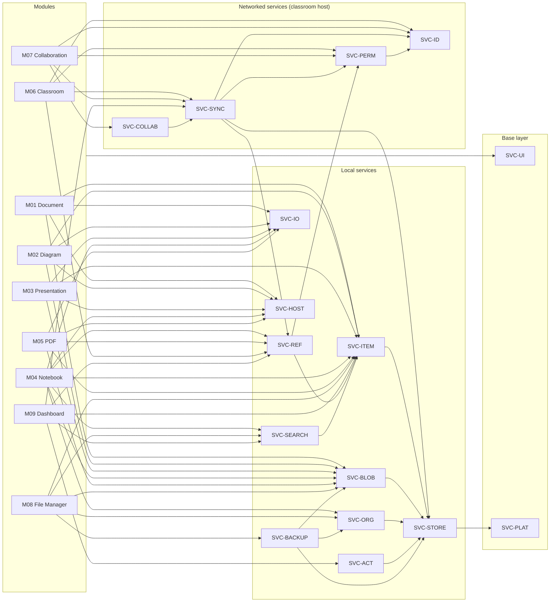
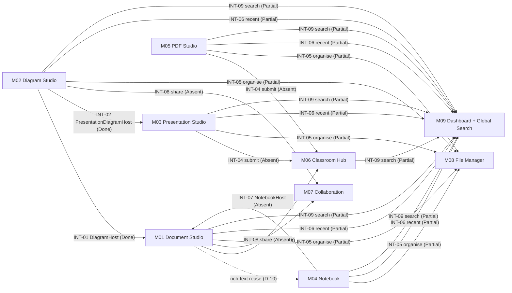

# Module Dependency Map

This document maps which of the nine Advanced Edition modules depends on which shared service (SVC-*) and on which other module, and owns the nine cross-module integration contracts INT-01 … INT-09 from brief §5. It gives the dependencies as tables and as mermaid graphs, sketches each integration contract as a TypeScript-style interface, derives the build order the dependencies imply, and checks that order against the 16 Advanced Edition phases (AE-P1 … AE-P16). Where the phase order and the dependency order disagree, it says so and proposes how to handle it; it does not change the phase plan, which the owner approves through the roadmap.

**Status: AE-P1 draft for owner approval (2026-11-15)**

Related documents in this folder:
[SYSTEM_ARCHITECTURE](SYSTEM_ARCHITECTURE.md) (service definitions, package boundaries) ·
[DATABASE_AND_SYNC_ARCHITECTURE](DATABASE_AND_SYNC_ARCHITECTURE.md) (stores, references, sync) ·
[ADVANCED_EDITION_PRODUCT_ROADMAP](ADVANCED_EDITION_PRODUCT_ROADMAP.md) (phase plan, D-NN decisions) ·
[ACCEPTANCE_CRITERIA](ACCEPTANCE_CRITERIA.md) (canonical AC-INT-01 … AC-INT-09 wording) ·
[DEPENDENCY_AND_LICENCE_PLAN](DEPENDENCY_AND_LICENCE_PLAN.md) (libraries) ·
[RISK_REGISTER](RISK_REGISTER.md) ·
Module PRDs: [M01](MODULE_01_DOCUMENT_STUDIO_PRD.md) · [M02](MODULE_02_DIAGRAM_STUDIO_PRD.md) · [M03](MODULE_03_PRESENTATION_STUDIO_PRD.md) · [M04](MODULE_04_DIGITAL_NOTEBOOK_PRD.md) · [M05](MODULE_05_PDF_STUDIO_PRD.md) · [M06](MODULE_06_CLASSROOM_HUB_PRD.md) · [M07](MODULE_07_COLLABORATION_PRD.md) · [M08](MODULE_08_FILE_MANAGER_PRD.md) · [M09](MODULE_09_DASHBOARD_PRD.md)

Conventions: status words Done, Partial, Stub, Absent, Unverified (canonical planning brief §0.2); "Done" is v0.2 Done and needs Advanced re-verification. AE-Pn is an Advanced Edition phase; "v0.2 Phase n" is the earlier programme. Libraries not installed are **candidates, licence to verify**.

---

## 1. Kinds of dependency

| Kind | Meaning | Enforced by | Example today |
|---|---|---|---|
| **Package import** | One `@dcos/*` package imports another | `tests/integration/boundaries.test.ts:10-17` (packages under `packages/` only; `apps/web` is not checked) | every studio imports `@dcos/ui` only |
| **Host composition** | The app shell builds a host object from one module or service and passes it to another module's editor | type checks; `tests/integration/presentation-hosts.test.ts` | `DiagramHost` (`packages/document-studio/src/extensions/diagramEmbed.tsx:61`) built by `useDiagramHost` (`apps/web/src/components/DiagramDialogs.tsx:105`) |
| **Data reference** | Stored content of one item refers to another item or attachment | attachment clean-up reference walk; SVC-REF (proposed) | diagram preview ids inside documents and slides |
| **Service use** | A module calls a shared service (directly in `apps/web`, or through a host) | review; SYS-004 | every editor saves through SVC-STORE via `useEditableItem` (`apps/web/src/lib/storage.ts:714`) |

Module-to-module dependencies are never package imports. They are host compositions or data references set up in `apps/web` (SYSTEM_ARCHITECTURE §6.2).

---

## 2. Modules and shared services

### 2.1 Matrix

Legend: **U** = uses today (with evidence in §2.2); **N** = needs (new work); **P** = provides something to the service (an extractor, a preview, a host); — = no dependency. The phase is where the dependency is first needed.

| Module | ITEM | STORE | BLOB | REF | ORG | SEARCH | ACT | HOST | IO | BACKUP | ID | PERM | SYNC | COLLAB | UI | PLAT |
|---|---|---|---|---|---|---|---|---|---|---|---|---|---|---|---|---|
| M01 Document Studio | U | U | U | N (P4/P12 provenance) | N (P11 via M08) | P (extractor, P4) | P (events) | U (DiagramHost); N (NotebookHost, P7) | U (DOCX/ODT/TXT/.dcosdoc; workers P4) | U | — | — | N (P10, shared docs) | N (P10, D-16) | U | U (print, save) |
| M02 Diagram Studio | U | U | U (previews) | N (provenance) | N (P11) | P (extractor, P5) | P | P (provides the diagram editor behind DiagramHost) | U (.drawio, .dcosdiagram, PNG/SVG/PDF) | U | — | — | N (P10, D-16) | N (if D-16) | U | U |
| M03 Presentation Studio | U | U | U (pictures, previews) | N (provenance) | N (P11) | P (extractor, P6) | P | U (PresentationDiagramHost, PresentationImageHost) | U (PPTX, PDF) | U | — | — | N (P10, D-16) | N (if D-16) | U | U (full screen, presenter window) |
| M04 Digital Notebook | N (new kind, P7) | N | N (pictures, ink) | N (INT-07) | N (subjects, P7) | N (first indexer, P7) | P | N (NotebookHost provider) | N (PDF export) | N | — | — | — | — | N | N |
| M05 PDF Studio | N (new kind, P8) | N | N (originals, ADR-0017) | N (INT-04) | N (P11) | P (pdf.js text, P8) | P | N (PdfHost for classroom submit, P9) | N (export, print) | N (format 3) | — | — | — | — | N | N (print, save, open) |
| M06 Classroom Hub | — (server entities are not kinds) | N (`classroom_cache`) | N | N (snapshot, link) | N (subject mapping) | P (cache extractor, P12) | N (host audit) | N (ClassroomHost) | — | N (D-34 encryption) | N | N | N (exchange, P9) | — | N | N (secure token storage) |
| M07 Collaboration | U (items) | N (`collab_updates`) | N | N (share refs) | — | — | P | N (ShareHost) | — | — | N | N | N | N (P10) | N | N (LAN, certificates) |
| M08 File Manager | U (`listAll`) | U | U (sizes, previews) | N (shortcuts = link) | N (owner of the UI, P11) | U (title filter today); N (P11/P12) | P | — | U (import entry points) | U (Settings backup) | — | — | — | — | U | N (drag-and-drop, file open) |
| M09 Dashboard | U (`listAll`) | U | — | N (tiles = link) | N (subject overview) | N (owner of global search, P12) | N (timeline, P12) | — | — | U (backup status card) | N (classroom panels) | N | N (cache) | — | U | — |

### 2.2 Evidence for "uses today"

| Dependency | Evidence |
|---|---|
| M01/M02/M03 → SVC-ITEM, SVC-STORE | `apps/web/src/modules.tsx:54-83`; `useEditableItem` `apps/web/src/lib/storage.ts:714` |
| M01 → SVC-BLOB (diagram previews) | `diagramEmbed.tsx:109-114` (`svgPreviewId`, a stored SVG preview attachment); ADR 0013 |
| M03 → SVC-BLOB | `apps/web/src/lib/presentationHosts.ts:8` (`putAttachment`, `getAttachment`) |
| M01 → M02 via SVC-HOST | `diagramEmbed.tsx:61`; `DiagramDialogs.tsx:105`; e2e `diagram-embed*.spec.ts` |
| M03 → M02 via SVC-HOST | `packages/presentation-studio/src/hosts.ts:40`; `apps/web/src/pages/EditorPage.tsx:25-28`; `tests/integration/presentation-hosts.test.ts` |
| M01/M02/M03 → SVC-IO | `document-studio/src/export/report.ts:17,112`; `diagram-studio/src/drawioFeatures.ts:48-87`; `presentation-studio/src/export/index.ts:19` (`exportPresentation`). Each studio has its own registry and report; no shared type exists (SVC-IO is Partial) |
| M08 → SVC-ITEM, SVC-SEARCH (title filter) | `apps/web/src/pages/ItemListPage.tsx:30-43`, `:34-35` |
| M09 → SVC-ITEM, SVC-BACKUP status | `apps/web/src/pages/Dashboard.tsx:22-58` (`DataSafetyCard`), `:81` (`useItems`), `:130-168` (recent list, ordered by `updatedAt` through `byNewest`, `indexeddb.ts:306`) |
| All editors → SVC-UI | `tests/integration/boundaries.test.ts:10-17` (only allowed import) |

### 2.3 Service-to-service dependencies

| Service | Depends on | Why |
|---|---|---|
| SVC-ITEM | SVC-STORE | items are persisted by the adapter |
| SVC-BLOB | SVC-STORE | attachments live in the same database (or app-data files on native) |
| SVC-BACKUP | SVC-STORE, SVC-BLOB, SVC-ORG | backups carry items, versions, attachments and (from v4) folders and tags |
| SVC-REF | SVC-ITEM, SVC-BLOB (snapshot), SVC-PERM (across hosts) | resolves and opens referenced items |
| SVC-ORG | SVC-ITEM, SVC-STORE | folders and tags are metadata on items plus their own stores |
| SVC-SEARCH | SVC-ITEM, SVC-STORE, per-kind extractors, SVC-PERM (classroom data) | index updated after saves |
| SVC-ACT | SVC-STORE | capped local store |
| SVC-SYNC | SVC-STORE (outbox), SVC-ID, SVC-PERM, SVC-REF, SVC-BLOB | exchange and item sync with the classroom host |
| SVC-COLLAB | SVC-SYNC (sharing state), SVC-ID, SVC-PERM, SVC-STORE | live co-editing of shared items |
| SVC-PERM | SVC-ID | grants are per user |
| SVC-HOST | every service a host wraps | built in `apps/web` |
| SVC-PLAT | — | lowest layer, per shell |
| SVC-UI | — | lowest layer |

### 2.4 Graph: modules to services



---

## 3. Module-to-module dependencies

| Consumer | Provider | Mechanism | Contract | State today | Phase |
|---|---|---|---|---|---|
| M01 Document | M02 Diagram | host composition (DiagramHost) + embed-copy | INT-01 | Done (650cf63; ADR 0013) | provenance AE-P4/AE-P12 |
| M03 Presentation | M02 Diagram | host composition (PresentationDiagramHost) + embed-copy | INT-02 | Done (edc2672; ADR 0014) | provenance AE-P6/AE-P12 |
| M01 Document | M04 Notebook | host composition (NotebookHost, proposed) + link or embed-copy | INT-07 | Absent | AE-P7 |
| M04 Notebook | M01 Document | shared rich-text extensions (package import of `rich-text`, or of `document-studio` if D-10 allows) | — (code reuse, not an INT) | Absent | AE-P3 (extraction) / AE-P7 |
| M06 Classroom | M01, M03, M05 (and any kind) | data reference (`snapshot`, `link`) through SVC-REF; ClassroomHost | INT-03, INT-04 | Absent | AE-P9 |
| M07 Collaboration | M01, M02 (M03 if D-16) | ShareHost; SVC-SYNC/SVC-COLLAB bound into the editor | INT-08 | Absent | AE-P10 |
| M08 File Manager | all kinds | SVC-ITEM, SVC-ORG; per-kind preview provider | INT-05 | Partial (flat list of 3 kinds) | AE-P11 |
| M09 Dashboard | all kinds, M06 cache | SVC-ITEM, SVC-ACT, SVC-REF links | INT-06 | Partial (recent by `updatedAt`) | AE-P12 |
| M09 Dashboard (global search owner) | all kinds, M06 cache | SVC-SEARCH with per-kind extractors | INT-09 | Partial (title filter) | AE-P7 (first indexer), AE-P12 |
| M05 PDF Studio | — | standalone; M01 and M03 produce PDFs through their own export paths and do not depend on M05 | — | — | — |

### 3.1 Graph: integration contracts



Arrows point from the provider to the consumer that owns the contract.

---

## 4. Integration contracts INT-01 … INT-09

The brief asks for "shared document references, attachment handling and permission checks". These are SVC-REF, SVC-BLOB and SVC-PERM; every contract below uses them and none defines its own. The acceptance criteria AC-INT-01 … AC-INT-09 are worded canonically in ACCEPTANCE_CRITERIA; the "must show" column is a summary of what they need to cover.

### 4.1 Contract table

| ID | Brief example | Owning module | Provider(s) | Shared services | State today | Remaining | Phase | AC-INT must show (summary) |
|---|---|---|---|---|---|---|---|---|
| INT-01 | Insert editable diagrams into documents | M01 | M02 | SVC-HOST (DiagramHost), SVC-BLOB (previews), SVC-REF (provenance) | Done (650cf63; ADR 0013; `diagramEmbed.tsx`; e2e `diagram-embed*`) | `sourceRef` provenance and "update from source"; external Word/LibreOffice check (TD-53) | AE-P4 (external checks), AE-P12 (provenance) | insert, edit, round trip through DOCX/ODT/.dcosdoc keeps the diagram editable; offline; provenance action; dated external check |
| INT-02 | Insert diagrams into presentations | M03 | M02 | SVC-HOST (PresentationDiagramHost), SVC-BLOB | Done (edc2672; `hosts.ts:40`; `tests/integration/presentation-hosts.test.ts`) | as INT-01; PPTX checked in a real application | AE-P6, AE-P12 | as INT-01 for PPTX/PDF; dated real-application check |
| INT-03 | Attach documents to assignments | M06 | M01 (and any kind) | SVC-REF (snapshot/link), SVC-BLOB, SVC-ID, SVC-PERM, SVC-SYNC | Absent | everything | AE-P9 | teacher attaches materials (link to a host copy); student attaches work (snapshot); permissions enforced on the host; offline queueing |
| INT-04 | Submit presentations and PDFs to classrooms | M06 | M03, M05 | as INT-03 | Absent | everything; depends on AE-P8 | AE-P9 | submission snapshot is immutable and grade refers to it; large PDF upload resumes after a network cut |
| INT-05 | Organise all files through File Manager | M08 | all kinds | SVC-ITEM, SVC-ORG, SVC-BLOB (sizes) | Partial (flat list of 3 kinds; `ItemListPage.tsx:30-43`) | folders, tags, previews, bulk operations, new kinds | AE-P3 (data), AE-P11 (UI) | every kind appears, moves, tags, trashes and restores through one UI; backup round trip keeps folders |
| INT-06 | Open recent work from the dashboard | M09 | all kinds | SVC-ITEM (`lastOpenedAt`), SVC-ACT | Partial (recent by `updatedAt`, `Dashboard.tsx:130-168`) | `lastOpenedAt`, per-kind sections, open tabs | AE-P3 (field), AE-P12 | opening any kind updates "recent" without changing its version; per-kind sections; open tabs offered |
| INT-07 | Attach notebook content to documents | M01 (consumer) / M04 (provider) | M04 | SVC-REF (link or embed-copy), SVC-HOST (NotebookHost, proposed), rich-text vocabulary | Absent | everything | AE-P7 | insert a notebook page or selection into a document as a copy with provenance or as a link; export keeps the content |
| INT-08 | Share documents and diagrams through Collaboration | M07 | M01, M02 | SVC-ID, SVC-PERM, SVC-SYNC, SVC-COLLAB | Absent | everything | AE-P10 | share with view/comment/edit, revoke, co-edit with presence; personal items stay private until shared |
| INT-09 | Search all content through Global Search | M09 | all kinds, M06 cache | SVC-SEARCH, per-kind extractors, SVC-PERM (classroom data) | Partial (title filter, `ItemListPage.tsx:34-35`) | index, extractors, global entry point | AE-P7 (first indexer), AE-P12 | content search over every kind, trash excluded by default (D-17), results open the item at the match, classroom results respect permissions, PERF-011 |

### 4.2 Contract sketches (proposed; existing ones cited)

```ts
// INT-01 / INT-02 (existing): DiagramHost — packages/document-studio/src/extensions/diagramEmbed.tsx:61
//                             PresentationDiagramHost — packages/presentation-studio/src/hosts.ts:40
// Proposed additive extension (AE-P12, both hosts, kept structurally equal):
interface EmbeddedDiagramProvenance { sourceRef?: ItemRef /* mode 'embed-copy' */; copiedAtVersion?: number }
interface DiagramHostProvenance {
  sourceStatus?(sourceRef: ItemRef, copiedAtVersion: number): Promise<'same' | 'newer' | 'missing' | 'forbidden'>;
  updateFromSource?(current: EmbeddedDiagram): Promise<EmbeddedDiagram | null>; // never automatic; user action only
}

// INT-03 / INT-04: ClassroomHost (built in apps/web from sync-engine; passed to packages/classroom and assignments).
// Contract: CLS-IF-004 (MODULE_06 §9); the classroom client service is CLS-IF-001
interface ClassroomHost {
  pickItems(filter: { kinds: string[]; multiple: boolean }): Promise<string[]>;          // File Manager picker (INT-05)
  snapshotForSubmission(itemId: string): Promise<SubmissionPartDraft>;                 // SVC-REF 'snapshot': flush, version 'submitted', digest
  openReadOnly(part: { kind: string; schemaVersion: number; content: unknown; attachments: Map<string, Blob> }): void; // studio protected view
  createItemFrom(ref: ItemRef | null, kind: string, title: string): Promise<string>;    // SVC-ITEM ("Start work")
  putAttachment(bytes: Blob, mimeType: string): Promise<{ id: string; sha256: string }>; // SVC-BLOB
}
// Attaching material and submitting go through the classroom client (CLS-IF-001), which queues them in SVC-SYNC

// INT-05: per-kind preview provider registered by each module with the app (File Manager uses it).
// Same contract as MODULE_08 §9.4; results cached as SVC-BLOB attachments in the `previews` store, keyed by kind, item id and version
interface PreviewProvider<C = unknown> {
  kind: ItemKind;
  render(content: C, opts: { width: number; height: number; theme: 'light' | 'dark' }): Promise<Blob | null>; // pure; no network
}

// INT-06: recent items
interface RecentQuery { by: 'opened' | 'edited' /* D-32 */; kinds?: ItemKind[]; limit: number }
// served from item_index (by_lastOpened index, DATABASE_AND_SYNC_ARCHITECTURE §3.3); openTabs from apps/web/src/lib/openTabs.ts

// INT-07: NotebookHost, given to Document Studio by the app; M04 is the provider (NBK-IF-003 uses this contract)
interface NotebookHost {
  pickPage(): Promise<{ ref: ItemRef; pageId: string; doc: JSONContent /* shared document vocabulary */; title: string } | null>;
  open(ref: ItemRef): void;
  sourceStatus?(ref: ItemRef, copiedAtVersion: number): Promise<'same' | 'newer' | 'missing'>;
}

// INT-08: ShareHost, given to editors that support sharing: a thin app-side wrapper over SharingService (COL-IF-001)
// and CollabSession (COL-IF-002) in MODULE_07 §9, with the same names, roles and modes
interface ShareHost {
  shareInfo(ref: ItemRef): Promise<ShareInfo | null>;      // null = private
  share(ref: ItemRef, grants: Array<{ subject: string /* 'user:<id>' or 'workspace:<id>' */; role: 'view' | 'comment' | 'edit' }>, mode?: 'live' | 'item-sync'): Promise<ShareInfo>;
  revoke(ref: ItemRef, subject: string): Promise<void>;
  collaboration?(ref: ItemRef): CollabSession | null;      // SVC-COLLAB session for live items (AE-P10, D-16)
}

// INT-09: SearchService (SVC-SEARCH; contract DSH-IF-001, MODULE_09 §9.1, summarised in SYSTEM_ARCHITECTURE §5.1) with one TextExtractor per kind,
// plus a classroom-cache extractor that only indexes entities the signed-in user may see.
```

### 4.3 Rules every contract follows

1. Content crossing a module boundary is either a copy with provenance (`embed-copy`), an immutable `snapshot`, or a `link`. Live links are never used inside exported files (DOCX/PPTX/PDF), because they break offline export and round trips (ADR-0018).
2. A dangling reference shows a "missing item" state; it never crashes and is never removed silently.
3. Binary parts go through SVC-BLOB and are deduplicated by SHA-256.
4. Anything that leaves the device is checked by SVC-PERM on the classroom host; client checks are for display only.
5. A module that lacks a host (for example no classroom host configured) hides the related controls; it never shows a control that does nothing (SYS-011).

---

## 5. Build order implied by the dependencies

### 5.1 Dependency layers

| Layer | Contents | Must exist before |
|---|---|---|
| L0 Safety baseline | green CI including Firefox, gated deploy, verified repo backup (AE-P2) | any change that migrates live data |
| L1 Foundations | SVC-UI tokens and components; SVC-PLAT interface; SYS-010 conformance suite; DB v4 (metadata, folders, tags, tombstones, activity, `lastOpenedAt`); SVC-REF, SVC-ORG, SVC-SEARCH interfaces; backup format 3 design; rich-text extraction if D-10 | every module phase |
| L2 Existing studios to Advanced | M01, M02, M03 (each also adds its SVC-SEARCH extractor as a pure, tested function) | INT-07 consumer side, INT-03/04 providers, INT-08 providers |
| L3 New local kinds | M04 (needs L1 rich-text, SVC-ORG subjects, first SVC-SEARCH index); M05 (needs SVC-BLOB extensions, backup format 3) | INT-04 (PDF submissions), INT-07 |
| L4 Networked | SVC-ID, SVC-PERM, SVC-SYNC part 1 with M06; then SVC-COLLAB with M07 | INT-03, INT-04, INT-08; dashboard classroom panels |
| L5 Organising and unifying | M08 UI over SVC-ORG for all five kinds; M09 dashboard, global search, activity timeline, all INT end-to-end | release |
| L6 Hardening and platforms | security and performance pass; native shells and native storage (D-12) | release candidate |

### 5.2 Match with the 16 phases

| Phase | Delivers | Prerequisites from the map | Satisfied by earlier phases? |
|---|---|---|---|
| AE-P1 | 18 planning documents | — | yes |
| AE-P2 | L0 | — | yes |
| AE-P3 | L1 | L0 | yes |
| AE-P4 | M01 Advanced; INT-01 external checks | L1 (SVC-IO `LossReport` type, SVC-BLOB size cap and MIME sniffing for D-08 pictures); the import workers themselves are built in AE-P4 (TD-40) | yes |
| AE-P5 | M02 Advanced; long ids (R-015) | L1 | yes |
| AE-P6 | M03 Advanced; INT-02 real-application check | L1 | yes |
| AE-P7 | M04; INT-07; first SVC-SEARCH indexer; subjects | L1 rich-text (D-10), SVC-ORG data (AE-P3), M01 (AE-P4) as INT-07 consumer | yes, with note A |
| AE-P8 | M05; backup format 3 implemented | SVC-BLOB extensions and format 3 design (AE-P3) | yes |
| AE-P9 | M06; SVC-ID, SVC-PERM, SVC-SYNC part 1; INT-03, INT-04 | M01, M03 (AE-P4, AE-P6), M05 (AE-P8), SVC-REF snapshot | yes |
| AE-P10 | M07; SVC-COLLAB; INT-08 | SVC-ID/PERM/SYNC (AE-P9), long diagram ids (AE-P5) | yes |
| AE-P11 | M08 UI; INT-05 | SVC-ORG data (AE-P3), all five kinds (AE-P8) | yes, with note B |
| AE-P12 | M09; INT-06, INT-09; end-to-end INT-01 … INT-09; provenance | all modules, extractors, classroom cache | yes |
| AE-P13 | security and performance pass | all features | yes, with note C |
| AE-P14 | platforms; native storage | SVC-PLAT interface (AE-P3), D-12 design (AE-P3) | yes, with note D |
| AE-P15 | release candidate | all | yes |
| AE-P16 | v1.0.0 | AE-P15 | yes |

The brief's phase order is consistent with the dependency order: no phase needs a module or service that a later phase delivers. Four points need care:

- **Note A (INT-07 reopens M01).** INT-07's consumer is Document Studio, but its provider (M04) arrives in AE-P7, after M01's phase. Adding an unused `NotebookHost` slot in AE-P4 would be a non-functional control (SYS-011), so the M01 side of INT-07 is built in AE-P7. AE-P7 must therefore re-run the AC-DOC regression set for anything it changes in `packages/document-studio`.
- **Note B (folder UI before File Manager).** Notebook subjects (AE-P7) need a way to choose and create subject folders four phases before the File Manager UI (AE-P11). Proposed: AE-P3 provides one shared folder picker component on top of SVC-ORG, used by AE-P7 and extended in AE-P11, so there is never a second folder UI.
- **Note C (security is not deferred).** AE-P13 is a review and measurement pass. Authentication, authorisation and input validation for the classroom host are built and accepted in AE-P9 (AC-SEC for that phase); CSP and import caps start in AE-P2/AE-P3/AE-P4/AE-P5. The map does not allow networked endpoints without auth before AE-P13 (R-005).
- **Note D (native storage decided early, built late).** D-12 shapes the data model (SYS-050) and the conformance suite (SYS-010), so its design is settled in AE-P3 even though the adapters are built and verified in AE-P14.

Search extractors: SVC-SEARCH's interface exists from AE-P3, so AE-P4, AE-P5 and AE-P6 each add their studio's extractor as a pure function with unit tests. AE-P7 adds the index store and wires it; AE-P12 adds the global entry point. This avoids a large extractor backlog in AE-P12 without shipping an unused index.

### 5.3 Critical path

AE-P2 (green CI, gated deploy) → AE-P3 (DB v4, conformance suite, interfaces, design system) → AE-P8 (PDF kind, backup format 3) → AE-P9 (identity, permissions, sync, classroom) → AE-P10 (co-editing) → AE-P12 (integration) → AE-P14 (native) → AE-P15 → AE-P16. AE-P4 to AE-P7 and AE-P11 are off the networked path but are executed in brief order on one maintainer machine (R-021, R-037), so the plan has no parallel tracks.

### 5.4 Deferral impact (for D-36 scope cuts)

| If deferred after 1.0 | Contracts affected | Effect on the map |
|---|---|---|
| OCR | none | M05 only |
| WebRTC, remote sync (D-15) | INT-08 over the internet | LAN-only collaboration; map unchanged |
| Co-editing of diagrams and presentations (D-16) | INT-08 for M02 | INT-08 covers M01 live, M02 by exchange only |
| Multiple diagram pages | INT-01, INT-02 | embeds keep one page |
| Animation timeline, citations | none | module-local |
| Classroom Hub | INT-03, INT-04, INT-09 classroom data, M09 panels | removes L4 part 1; M07 would then need SVC-ID/PERM on its own phase |

---

## 6. Test strategy for the map

| Check | Evidence type | Phase |
|---|---|---|
| Package boundaries match SYSTEM_ARCHITECTURE §6.2 | `tests/integration/boundaries.test.ts` updated in each phase that adds a package | each |
| Host interfaces stay structurally compatible (DiagramHost vs PresentationDiagramHost; later NotebookHost) | `tests/integration/presentation-hosts.test.ts` pattern, one test per shared host | AE-P6, AE-P7, AE-P12 |
| Every kind is reachable from M08, M09 and SVC-SEARCH | integration test iterating `ITEM_KINDS` (like `kinds.test.ts`) | AE-P11, AE-P12 |
| Every INT works offline where it is local (INT-01, 02, 05, 06, 07, 09) | e2e with `context.setOffline` | each owning phase |
| Networked INT survive a network cut (INT-03, 04, 08) | e2e with a test host and network cut | AE-P9, AE-P10 |
| No module talks to the network outside SVC-SYNC/SVC-COLLAB | `e2e/privacy.spec.ts` extended to every kind; grep test for `fetch(` in feature packages | AE-P6 onwards |
| End-to-end run of AC-INT-01 … AC-INT-09 | e2e in Chromium, WebKit, Firefox | AE-P12 |

---

## 7. Known risks

From the register: R-021 (scope size: nine modules, three networked, one machine), R-022 (package boundary versus rich-text reuse), R-024 (large PDFs and backup format 2, which INT-04 depends on), R-005 (endpoints without auth), R-008 (sync correctness for INT-03/04/08), R-011 and R-017 (external compatibility of INT-01/02 outputs), R-015 (diagram ids for INT-08), R-028 (secure-context rules for INT-08 in browsers), R-029 (Yjs with Tiptap 3.33). Map-specific notes for the register owner: INT-07 makes AE-P7 change a package finished in AE-P4 (note A); and if Classroom Hub is cut (D-36), Collaboration loses the identity and permission services it was planned to reuse.
