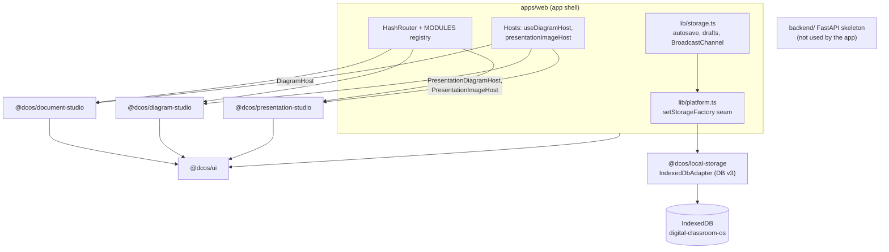
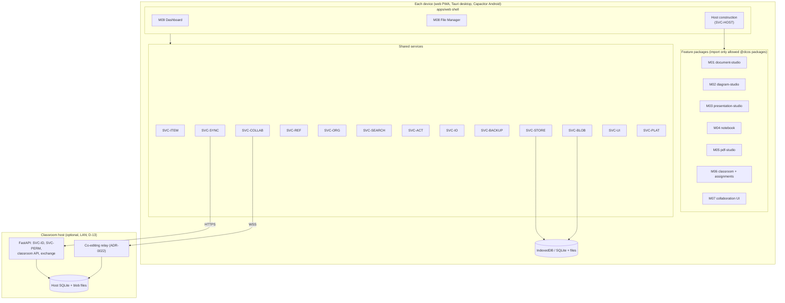

# System Architecture

This document describes how Digital Classroom OS is built today and how the Advanced Edition should be built across all nine modules and four platforms. It records the current architecture with evidence (packages, host injection, the kind registry, the app shell), defines the shared services (SVC-*) that every module must use instead of building its own, sets the architecture rules that come from the owner's brief §8 (code quality rules), and proposes the architecture decisions ADR-0015 to ADR-0025 for owner approval. It owns the SYS architecture and design-system requirements, the A11Y requirements and the definition of the PERF targets. It does not decide anything that is listed as an owner decision (D-NN); it points to them.

**Status: AE-P1 draft for owner approval (2026-11-15)**

Related documents in this folder:
[ADVANCED_EDITION_PRODUCT_ROADMAP](ADVANCED_EDITION_PRODUCT_ROADMAP.md) ·
[DATABASE_AND_SYNC_ARCHITECTURE](DATABASE_AND_SYNC_ARCHITECTURE.md) ·
[MODULE_DEPENDENCY_MAP](MODULE_DEPENDENCY_MAP.md) ·
[DEPENDENCY_AND_LICENCE_PLAN](DEPENDENCY_AND_LICENCE_PLAN.md) ·
[SECURITY_AND_PRIVACY_PLAN](SECURITY_AND_PRIVACY_PLAN.md) ·
[ACCEPTANCE_CRITERIA](ACCEPTANCE_CRITERIA.md) ·
[RISK_REGISTER](RISK_REGISTER.md) ·
[RELEASE_STRATEGY](RELEASE_STRATEGY.md) ·
Module PRDs: [M01](MODULE_01_DOCUMENT_STUDIO_PRD.md) · [M02](MODULE_02_DIAGRAM_STUDIO_PRD.md) · [M03](MODULE_03_PRESENTATION_STUDIO_PRD.md) · [M04](MODULE_04_DIGITAL_NOTEBOOK_PRD.md) · [M05](MODULE_05_PDF_STUDIO_PRD.md) · [M06](MODULE_06_CLASSROOM_HUB_PRD.md) · [M07](MODULE_07_COLLABORATION_PRD.md) · [M08](MODULE_08_FILE_MANAGER_PRD.md) · [M09](MODULE_09_DASHBOARD_PRD.md)

Conventions: status words are Done, Partial, Stub, Absent and Unverified as defined in the canonical planning brief §0.2. "Done" means done for v0.2 with a test file and the recorded run of 2026-11-15 (RELEASE_GAPS.md §11); it never means "Advanced-complete". AE-P1 … AE-P16 are the Advanced Edition phases; "v0.2 Phase n" is the earlier programme. Libraries not already installed are **candidates, licence to verify**, with no version numbers. Nothing in AE-P1 was built, run or tested; evidence is from reading the repository at HEAD `edc2672`.

---

## 1. Scope and ownership of IDs

| ID block | Topic | Defined here | Verified by |
|---|---|---|---|
| SYS-001 … SYS-029 | Architecture rules, shared services, package boundaries | §6, §7 | AC-SYS-001 … in ACCEPTANCE_CRITERIA |
| SYS-030 … SYS-059 | Data model, migrations, native storage | DATABASE_AND_SYNC_ARCHITECTURE | AC-SYS-030 … |
| SYS-060 … SYS-079 | Design system (SVC-UI) | §8 | AC-SYS-060 … |
| SYN-001 … | Sync | DATABASE_AND_SYNC_ARCHITECTURE | AC-SYN-… |
| A11Y-001 … | Accessibility | §9 | AC-A11Y-… |
| PERF-001 … PERF-014 | Performance targets (proposed) | §10 | AC-PERF-… |
| SVC-* | Shared services | §5 | per service, through the SYS requirements |
| ADR-0015 … ADR-0025 | Proposed decisions | §11 (summary); data and sync ADRs in detail in DATABASE_AND_SYNC_ARCHITECTURE | owner approval |

`ACCEPTANCE_CRITERIA.md` holds the canonical wording of every cross-cutting AC (module criteria are canonical in each PRD §10; ACCEPTANCE_CRITERIA §1.2); the requirement texts here are the source those criteria mirror.

---

## 2. Current architecture (evidence at `edc2672`)

### 2.1 Repository layout

| Path | What it is | Status | Evidence |
|---|---|---|---|
| `apps/web` | React 19 + Vite 8 app shell (HashRouter, PWA) | Done (Partial items in §2.5) | `apps/web/src/App.tsx:20-60`; `apps/web/vite.config.ts:22-43` |
| `packages/ui` | Design system: tokens, components, theme, toasts, `downloadBlob` | Partial | `packages/ui/src/index.ts:1-4`; `tokens.css`; `components.tsx` (381 lines) |
| `packages/local-storage` | StorageAdapter contract, IndexedDB adapter, backup, attachments | Done | `types.ts:162-209`; `indexeddb.ts` (1,259 lines); 109 tests |
| `packages/document-studio` | M01 editor (Tiptap 3) | Done/Partial per M01 PRD | `extensions/index.ts:34-74` |
| `packages/diagram-studio` | M02 editor (@xyflow/react 12.12.1) | Done/Partial per M02 PRD | `DiagramEditor.tsx` (287 lines) |
| `packages/presentation-studio` | M03 editor | Done/Partial per M03 PRD | `hosts.ts:40`, `:64` |
| `packages/notebook`, `pdf-studio`, `classroom`, `assignments`, `sync-engine` | README-only stubs, not npm workspaces | Stub | `package.json:7-14` lists only six workspaces; each folder holds one 4-line README |
| `apps/desktop` | Tauri 2 shell configuration | Stub (never built) | `src-tauri/tauri.conf.json`; `src-tauri/icons/` empty; no `Cargo.lock` |
| `apps/android` | Capacitor 7 configuration | Stub (no native project) | `apps/android/capacitor.config.json`; the folder holds only `README.md`, `capacitor.config.json` and `package.json` |
| `backend` | FastAPI skeleton | Stub | `backend/api/main.py:46` `GET /health`, `:51` `GET /api/v1/info`; `authentication/`, `classroom/`, `synchronization/` hold an empty `__init__.py` and a README |
| `tests/integration` | Cross-package tests, including the boundary test | Done | 16 files; `tests/integration/boundaries.test.ts` |
| `e2e` | Playwright specs (Chromium, Firefox, WebKit, mobile Chromium projects) | Partial (CI e2e red on main, R-001) | 51 specs |

### 2.2 Package boundaries (enforced)

`tests/integration/boundaries.test.ts:10-17` declares which `@dcos/*` packages each package may import:

| Package | May import |
|---|---|
| `ui` | nothing |
| `local-storage` | nothing |
| `document-studio` | `@dcos/ui` |
| `diagram-studio` | `@dcos/ui` |
| `presentation-studio` | `@dcos/ui` |

The test also fails when a package with a `src/` folder is missing from the table (`boundaries.test.ts:27-30`), so a new package cannot go unchecked. Studios never import storage, the app or each other; everything else reaches them through hosts. The test covers only folders under `packages/`; `apps/web` is not checked (it is the composition point). Cost of the rule: documented duplication, for example the diagram PNG writer exists in both document-studio and presentation-studio; `tests/integration/presentation-export.test.ts:21-27` checks that both use the same keyword, version and size limit, and `:29-48` that document-studio's reader accepts the PNG that presentation-studio writes. It does not compare the two writers' bytes.

### 2.3 Host injection (SVC-HOST)

The app builds host objects and passes them to editors through `EditorProps` (`apps/web/src/modules.tsx:10-28`):

| Host | Defined in | Built in | Used for |
|---|---|---|---|
| `DiagramHost` | `packages/document-studio/src/extensions/diagramEmbed.tsx:61` | `useDiagramHost` (`apps/web/src/components/DiagramDialogs.tsx:105`) | INT-01: edit, pick from library, import .drawio, load preview, render preview, settle |
| `PresentationDiagramHost` | `packages/presentation-studio/src/hosts.ts:40` | the same `useDiagramHost` (structurally equal; `tests/integration/presentation-hosts.test.ts`) | INT-02 |
| `PresentationImageHost` | `hosts.ts:64` | `apps/web/src/lib/presentationHosts.ts:8` (wraps `storage.putAttachment/getAttachment`) | slide pictures as attachments |
| Preferences (authorName, spellcheck) | `EditorProps` fields | `apps/web/src/lib/preferences.ts` | document review features |

Decisions: ADR 0013 (document–diagram integration), ADR 0014 (presentation studio). Status: Done for these hosts.

### 2.4 Kind registry (SVC-ITEM)

A "kind" is a type of workspace item with content, versions, trash, backup and an editor. Adding one touches these places today:

| Place | Evidence | What it holds |
|---|---|---|
| `ItemKind`, `ITEM_KINDS` | `packages/local-storage/src/types.ts:5-7` | closed union `'document' \| 'diagram' \| 'presentation'` |
| `STORES` (exhaustive record) | `packages/local-storage/src/indexeddb.ts:204-208` | item and version store per kind; a missing kind is a compile error |
| `MIGRATIONS` | `indexeddb.ts:245-274` | one append-only migration that creates the stores; `SCHEMA_VERSION` bump (`indexeddb.ts:46`) |
| `MAX_CONTENT_SCHEMA_BY_KIND` | `packages/local-storage/src/backup.ts:14` | newest content schema readable per kind |
| `MODULES` | `apps/web/src/modules.tsx:54-83` | route, labels, icon, templates, lazy `loadEditor` |
| Upgrade test store lists | `scripts/upgrade-test.mjs:64-65` (hard-coded) | must be edited by hand |
| Kind-wide tests | `packages/local-storage/src/kinds.test.ts` (`describe.each` over kinds) | every operation per kind |

Status: Done for three kinds (`kinds.test.ts`). The registry is the extension point for `notebook` (AE-P7) and `pdf` (AE-P8) under ADR-0015.

### 2.5 App shell

| Part | Status | Evidence / limits |
|---|---|---|
| Routing: dashboard, per-kind lists, files/recent/favorites/trash, six settings pages, editor routes, presenter route | Done | `App.tsx:20-60`; `e2e/navigation.spec.ts` |
| Module registry with lazy editors | Done | `modules.tsx:38-109`; `presentation-shell.test.tsx` |
| Upgrade gate before the app renders | Done | `apps/web/src/main.tsx:16-25`; `UpgradeRecovery.test.tsx` |
| Open-item tabs (max 12) | Done | `apps/web/src/lib/openTabs.ts:15`; `OpenTabs.test.tsx` |
| Error boundaries | Partial | one top-level boundary (`App.tsx:26`) plus one per editor (`EditorPage.tsx:83`); "Go to Dashboard" never resets the boundary (`ErrorBoundary.tsx:36`; RG-7/TD-23) |
| PWA (manifest, service worker, update prompt) | Partial | `vite.config.ts:22-43`; SVG icon only (TD-27); offline tested in Chromium only (`e2e/storage.chromium-only.spec.ts:7`); no platform detection, so the service worker would register in webviews (TD-31) |
| Mobile drawer | Partial | no Escape, focus trap or dialog role (TD-25); no skip link |
| Storage wiring | Done | `apps/web/src/lib/storage.ts` (1,315 lines: autosave, drafts, cross-tab channel, data safety, upgrade recovery) |

### 2.6 Current architecture diagram



### 2.7 Storage seam for other platforms

`apps/web/src/lib/platform.ts:15-32` lets a native shell replace the storage factory before first use (`setStorageFactory`, `:23-26`; it throws once storage exists, `:24`). Only `IndexedDbAdapter` implements `StorageAdapter`. The upgrade-recovery path is IndexedDB-specific: `apps/web/src/lib/storage.ts:319` sets `upgradeRecovery` to `null` for any other adapter. Details and the SQLite plan: DATABASE_AND_SYNC_ARCHITECTURE §5.

### 2.8 What is known to conflict with older documents

These are reported, not corrected (AE-P1 writes nothing outside this folder; AE-P2 fixes them): docs/DATABASE.md:43 and ADR 0006 §6 / ADR 0007 §2 give older content schema numbers (the code has document 3, diagram 3); docs/DATABASE.md:49-125 contains a stale SQLite DDL headed "Phase 5"; the `backend/api/main.py` docstring and CORS comment describe "Phase 3" in the old numbering; stub READMEs use old phase numbers (for example `packages/sync-engine/README.md` "Phase 3–4").

---

## 3. Target architecture overview

### 3.1 Principles (kept from v0.2; not up for change)

1. Local-first: every device keeps its own data; core editing never needs the network (ADR 0001).
2. IndexedDB on the web.
3. Optimistic concurrency, never a silent overwrite (ADR 0003).
4. Append-only migrations behind verified safety copies (ADR 0006).
5. A content schema per kind, with a protected read-only view for content from a newer build.
6. Package boundaries enforced by `tests/integration/boundaries.test.ts`.
7. Host injection for anything a module needs from outside itself.
8. No paid SaaS; no AI in this edition.
9. Network services only where genuinely required (brief §3): the classroom host for M06 and M07.

### 3.2 Layers

| Layer | Contents | Runs on |
|---|---|---|
| Platform shells | Web/PWA build; Tauri 2 desktop (macOS WKWebView, Windows WebView2); Capacitor 7 Android (system WebView) | each device |
| Platform adapters (SVC-PLAT) | storage factory, save dialog, print, share, file open, secure token storage, network permission | per shell |
| App shell (`apps/web`) | routing, module registry, host construction, settings, dashboard (M09), file manager (M08) | each device |
| Feature packages | M01 … M07 UI packages (studios, notebook, PDF studio, classroom, assignments, collaboration UI) | each device |
| Shared services | SVC-* in §5: some in packages (local-storage, ui, sync-engine, search), some as app-level wiring | each device |
| Local persistence | IndexedDB (web); webview IndexedDB or SQLite plus app-data files on native (D-12) | each device |
| Classroom host (optional) | FastAPI + SQLite on a teacher or school machine: accounts, roles, classrooms, exchange, LAN relay (ADR-0020, ADR-0022) | one machine per classroom (D-13) |

### 3.3 Target architecture diagram



Feature packages do not import services directly except where §6.2 allows it; the shell constructs hosts that call services and passes them in.

---

## 4. Platforms

Platform support levels and minimum versions are owned by RELEASE_STRATEGY (PLT-001 … PLT-008, decision D-30). This section covers only what the architecture must provide on each.

| Platform | Today | Target architecture | Blocking work and decisions |
|---|---|---|---|
| Web PWA (GitHub Pages) | Done in Chromium, WebKit, mobile Chromium; Firefox never green (R-001) | Same bundle; service worker with prompt-to-update (`vite.config.ts:24`); IndexedDB; meta CSP with a hash for the inline theme script (`apps/web/index.html:9-16`) | D-02 deploy gating, D-23 CSP; PNG icons (TD-27) |
| macOS and Windows desktop (Tauri 2) | Stub: never built; icons missing; no lock file (TD-30) | Same web build inside WKWebView/WebView2; SVC-PLAT adapters for save, print, open, share; storage per D-12; service worker not registered (TD-31); native secure storage for host tokens (ADR-0020) | D-12, D-28 signing; Rust toolchain (R-032) |
| Android (Capacitor 7) | Stub: no native project | Same web build in the Android WebView; SVC-PLAT adapters (`<a download>` does not work there, TD-28); storage per D-12; network-security config for LAN host (ADR-0022) | D-12, D-14, D-28; Android SDK (R-032) |
| Classroom host (FastAPI) | Stub: two GET endpoints, no auth (`backend/api/main.py:46-54`) | Accounts, roles, classroom data, item exchange, LAN relay over HTTPS/WSS; SQLite on the host; Python pinned (D-37) | D-13, D-14, D-15, D-37 |

### 4.1 Secure-context constraint (shapes all networked design)

The app relies on APIs that browsers only provide in a secure context:

| API | Used at | Fallback today |
|---|---|---|
| `crypto.subtle.digest` (attachment SHA-256) | `packages/local-storage/src/indexeddb.ts:277` | none: attachments fail without it |
| `crypto.randomUUID` | `packages/local-storage/src/ids.ts:4`; `packages/presentation-studio/src/create.ts:17`; `packages/diagram-studio/src/editor/mutations.ts:13` | `ids.ts` falls back to `getRandomValues` (`ids.ts:1` names "non-secure LAN origins"); `create.ts:18` falls back to `Date.now` plus `Math.random` (not cryptographically random); `mutations.ts:13` falls back to `Date.now` plus a counter |
| Web Locks | `indexeddb.ts:373`; `apps/web/src/lib/storage.ts:568` | unguarded upgrades, save-time conflicts (ADR 0009) |
| Service worker | `vite.config.ts:22-43` | no offline, no PWA |

Consequence (ADR-0022): the web app must never be served to classroom devices over plain `http://<LAN-IP>`. Browser clients reach a classroom host only when it serves HTTPS with a certificate the devices trust (D-14), and the public HTTPS Pages build cannot call `http://`/`ws://` LAN addresses (mixed content). Native shells are the first-class LAN clients. This is unverified on real browsers and is the first task of the AE-P10 spike (R-028).

### 4.2 Platform adapter contract (SVC-PLAT, proposed)

```ts
// Proposed. Implemented once per shell; the web implementation wraps today's code.
interface PlatformAdapter {
  kind: 'web' | 'tauri' | 'capacitor';
  storageFactory: StorageFactory;                  // apps/web/src/lib/platform.ts
  saveFile(data: Blob, suggestedName: string): Promise<'saved' | 'cancelled'>; // web: downloadBlob (packages/ui/src/download.ts)
  openFiles(accept: string[], multiple: boolean): Promise<File[]>;              // replaces 4 duplicated pickers
  print(html: string, opts: PrintOptions): Promise<void>;                       // web: window.print path (document-studio export/print.ts)
  share?(data: Blob, name: string): Promise<void>;                              // Android share sheet (candidate plugin)
  registerServiceWorker: boolean;                                               // false in webviews (TD-31)
  secureStore?: { get(key: string): Promise<string | null>; set(key: string, v: string): Promise<void>; delete(key: string): Promise<void> };
}
```

The duplicated file pickers (`DiagramFiles.tsx:13-24`, `DiagramDialogs.tsx:26-37`, `ImportDocument.tsx:18-27`, `presentation-studio/src/elements/images.ts:104-113`) move behind `openFiles` in AE-P3 (SYS-008).

---

## 5. Shared services

Every module refers to these services by name and must not define a private copy (SYS-004). State values are from the canonical planning brief §4.5, with evidence.

| Service | Purpose | State today | Evidence | Target home | Delivered in |
|---|---|---|---|---|---|
| SVC-ITEM | Item model and kind registry | Done (3 kinds) | `types.ts:5-29`; `indexeddb.ts:204-208`; `modules.tsx:54-83` | `local-storage` + `apps/web/src/modules.tsx` | v4 fields AE-P3; notebook AE-P7; pdf AE-P8 |
| SVC-STORE | `StorageAdapter`: IndexedDB now, SQLite proposed | Done (IndexedDB) | `types.ts:162-209` | `local-storage` (+ native adapter package, D-12) | conformance suite AE-P3; native AE-P14 |
| SVC-BLOB | Content-addressed attachments | Done | `indexeddb.ts:1010`, `:1096`; ADR 0008 | `local-storage` | caps and MIME sniffing AE-P3; PDF use AE-P8 (ADR-0017) |
| SVC-REF | References between items | Absent (embeds are copies) | — | type in `local-storage`; resolver in `apps/web` | interface AE-P3; link AE-P11/P12; snapshot AE-P9 (ADR-0018) |
| SVC-ORG | Folders, tags, subjects | Absent | no field in `types.ts:9-29` | stores in `local-storage`; UI in `apps/web` (M08) | data AE-P3; subjects AE-P7; UI AE-P11 (ADR-0016) |
| SVC-SEARCH | Search index and per-kind text extractors | Absent (title filter `ItemListPage.tsx:34-35`) | — | proposed `packages/search`; extractors supplied by each module through a host | interface AE-P3; first indexer AE-P7; global AE-P12 |
| SVC-ACT | Local activity log | Absent | no store in `indexeddb.ts:58-72` | `local-storage` store (capped) | AE-P3 store; AE-P12 timeline |
| SVC-HOST | Host injection | Done | ADR 0013, 0014; §2.3 | `apps/web` | new hosts per module (NotebookHost AE-P7, ClassroomHost AE-P9) |
| SVC-IO | Import/export registries and the loss report | Partial, per studio | `document-studio/src/export/report.ts:17,112`; `diagram-studio/src/drawioFeatures.ts:48-87` | shared `LossReport` type; registries stay per studio | type AE-P3; workers AE-P4 (TD-40) |
| SVC-BACKUP | Backup and restore | Done (format 2) | `backup.ts:6`; ADR 0007 | `local-storage` | format 3 design AE-P3; needed AE-P8 (ADR-0017) |
| SVC-ID | Identity, accounts, sessions | Absent | ADR 0002 is a plan | classroom host + client in `sync-engine` | AE-P9 (ADR-0020) |
| SVC-PERM | Authorisation and roles | Absent | ADR 0002, Decision item 2 ("No permission model is implemented yet") | classroom host (authoritative); client checks for UI only | AE-P9/P10 |
| SVC-SYNC | Explicit sync: classroom exchange and item sync | Stub | `packages/sync-engine/README.md` | `packages/sync-engine` | AE-P9 (ADR-0021 part 1) |
| SVC-COLLAB | Live co-editing (CRDT provider, awareness) | Absent | no Yjs in the lockfile | proposed `packages/collab` | AE-P10 (ADR-0021 part 2, ADR-0022) |
| SVC-UI | Design system | Partial | `packages/ui/src/tokens.css` (14 colour tokens + font) | `packages/ui` | AE-P3 (ADR-0024) |
| SVC-PLAT | Platform adapters | Partial (`platform.ts` seam; TD-28) | `apps/web/src/lib/platform.ts:15-32` | `apps/web/src/platform/*` per shell | interface AE-P3; native AE-P14 |

### 5.1 Service contracts (proposed sketches)

These are interface sketches for AE-P3 to refine. Module PRDs reference them; they must not define their own variants. Two shared services have their full contract in the module PRD that builds their user interface, and the names below match it: **SVC-ORG** is FIL-IF-001 (`OrganisationService`, [MODULE_08 §9.1](MODULE_08_FILE_MANAGER_PRD.md)) and **SVC-SEARCH** is DSH-IF-001 (`SearchService`, `TextExtractor`, [MODULE_09 §9.1](MODULE_09_DASHBOARD_PRD.md)). Each studio's search extractor (DOC-IF-005, DGM-IF-009, PRS-IF-003, NBK-IF-002, PDF-IF-003) is a pure helper wrapped as one DSH-IF-001 `TextExtractor`; there is one extractor contract, not one per module. The SVC-ACT event vocabulary is owned here. Data-level details (stores, fields, migrations) are in DATABASE_AND_SYNC_ARCHITECTURE.

```ts
// SVC-ITEM: ItemKind grows by append only (ADR-0015).
type ItemKind = 'document' | 'diagram' | 'presentation' | 'notebook' | 'pdf';

// SVC-REF (ADR-0018)
interface ItemRef {
  itemId: string;
  kind: ItemKind;
  mode: 'link' | 'embed-copy' | 'snapshot';
  version?: number;          // snapshot: the exact version referred to
  attachmentId?: string;     // snapshot: packaged content (deduplicated through SVC-BLOB)
  hostId?: string | null;    // null = local item
  title: string;             // cached for display; never trusted for access decisions
}
interface RefResolver {
  resolve(ref: ItemRef): Promise<{ state: 'ok'; item: ItemSummary } | { state: 'missing' } | { state: 'forbidden' } | { state: 'offline' }>;
  open(ref: ItemRef): void;  // navigates; a dangling ref shows a "missing item" state, never crashes
}

// SVC-ORG (ADR-0016). Summary only; the contract is FIL-IF-001 (MODULE_08 §9.1)
type ItemKey = { kind: ItemKind; id: string };
interface OrganisationService {
  listFolders(opts?: { trashed?: boolean; role?: 'folder' | 'subject' }): Promise<Folder[]>;
  createFolder(input: { name: string; parentId: string | null; role?: 'folder' | 'subject' }): Promise<Folder>;
  moveItems(items: ItemKey[], folderId: string | null): Promise<void>;                 // one transaction, metadata only
  setTags(items: ItemKey[], change: { add?: string[]; remove?: string[] }): Promise<void>;
  listTags(): Promise<Tag[]>;
  markOpened(item: ItemKey, at?: string): Promise<void>;                               // lastOpenedAt only
  // plus rename, move, trash, restore and purge of folders and tag management: see FIL-IF-001
}

// SVC-SEARCH. Summary only; the contract is DSH-IF-001 (MODULE_09 §9.1)
interface TextExtractor<C = unknown> { kind: ItemKind; extractorVersion: number; extract(content: C): ExtractedField[] | Promise<ExtractedField[]> }
interface SearchService {
  registerExtractor(x: TextExtractor): void;
  indexItem(key: ItemKey): Promise<void>;     // after a successful save; idempotent
  removeItem(key: ItemKey): Promise<void>;    // on purge (tombstone)
  query(q: SearchQuery): Promise<{ hits: SearchHit[]; total: number; complete: boolean }>; // trash excluded by default (D-17)
  rebuild(opts?: { signal?: AbortSignal; onProgress?: (done: number, total: number) => void }): Promise<void>;
  status(): Promise<{ indexed: number; total: number; version: number; building: boolean }>;
}

// SVC-ACT. The one event vocabulary; MODULE_08 §9.6 and MODULE_09 §9.3 use these names
type ActivityType =
  | 'item.create' | 'item.edit' | 'item.open' | 'item.import' | 'item.export' | 'item.trash' | 'item.restore' | 'item.purge'
  | 'org.move' | 'org.tag' | 'backup.export' | 'backup.import'
  | 'class.submit' | 'class.grade' | 'class.announce' | 'share.grant' | 'share.revoke';
interface ActivityLog {
  record(e: { type: ActivityType; ref?: ItemRef; at?: string; detail?: Record<string, string | number> }): Promise<void>; // no content (SYS-046)
  list(opts: { since?: string; limit: number; types?: ActivityType[] }): Promise<ActivityEntry[]>; // capped store, oldest dropped first
}

// SVC-IO
interface LossReport { kept: string[]; approximated: Array<{ what: string; count: number; note: string }>; dropped: Array<{ what: string; count: number }> }
interface Importer<C> { accept: string[]; sniff(bytes: Uint8Array): boolean; maxBytes: number; run(file: File, signal: AbortSignal): Promise<{ title: string; content: C; report: LossReport }> } // runs in a worker (TD-40)
interface Exporter<C> { id: string; label: string; extension: string; run(content: C, ctx: ExportContext): Promise<{ blob: Blob; report: LossReport }> }

// SVC-PERM (client side; the host is authoritative)
type Grant = 'view' | 'comment' | 'edit';
interface PermissionView { can(action: 'open' | 'comment' | 'edit' | 'share' | 'submit' | 'grade', ref: ItemRef): boolean } // UI gating only
```

`SVC-STORE`, `SVC-BLOB` and `SVC-BACKUP` keep the existing `StorageAdapter` contract (`types.ts:162-209`) and grow additively (DATABASE_AND_SYNC_ARCHITECTURE §3). `SVC-SYNC` and `SVC-COLLAB` contracts are in DATABASE_AND_SYNC_ARCHITECTURE §7–§8. Host contracts for cross-module integration (`NotebookHost`, `ClassroomHost`, `ShareHost`) are owned by MODULE_DEPENDENCY_MAP.

---

## 6. Architecture rules

### 6.1 Requirements SYS-001 … SYS-029

| ID | Requirement | Current status | Evidence / gap | Phase |
|---|---|---|---|---|
| SYS-001 | Every package with source is listed in the boundary test, and imports only the `@dcos` packages its row allows (§6.2) | Done (5 packages under `packages/`; `apps/web` is not checked) | `boundaries.test.ts:10-17`, `:27-30` | each phase that adds a package |
| SYS-002 | Feature packages receive storage, other modules, dialogs and platform functions only through hosts (SVC-HOST) | Done for M01–M03 | §2.3 | AE-P4 onwards |
| SYS-003 | Adding an item kind follows one checklist: `ItemKind`/`ITEM_KINDS`, `STORES`, one append-only migration and `SCHEMA_VERSION` bump, `MAX_CONTENT_SCHEMA_BY_KIND`, `MODULES`, `scripts/upgrade-test.mjs:64-65`, `kinds.test.ts`, backup validation, search extractor, privacy and offline e2e | Partial | the first five are compile- or test-enforced; the upgrade-test lists, search and e2e are manual | AE-P3 (checklist and a test that derives the upgrade-test lists from the registry) |
| SYS-004 | Modules use the SVC-* services in §5 and define no private equivalent (no second search engine, attachment store, reference model or permission check) | Partial | ImportDocument, diagram import and the list search each work alone today | AE-P3 interfaces, then every module phase |
| SYS-005 | No new non-test source file over 500 lines; existing files over 500 lines are split along their responsibilities without behaviour change, starting with `apps/web/src/lib/storage.ts` (1,315) and `local-storage/src/indexeddb.ts` (1,259) | Partial | 20 files over 500 lines (canonical brief §1) | AE-P3 for the two storage files; each module phase for its own files |
| SYS-006 | Centralised error handling: one error taxonomy (`ConflictError`, `NotFoundError`, `MissingAttachmentError`, `UpgradeError`, `SafetyCopyError`, `InvalidBackupError` in `local-storage/src/errors.ts`, plus network and permission errors), route-level and widget-level boundaries that reset on navigation and offer a working way back | Partial | `ErrorBoundary.tsx:36` never resets (RG-7/TD-23); a shell crash removes navigation | AE-P3 |
| SYS-007 | No import-time side effects in new modules; storage, channels and timers start from explicit calls in `main.tsx` or hooks | Unverified | storage is created on first import of `lib/storage.ts` (`platform.ts` `created` flag); no systematic audit | AE-P3 (audit and rule), new code from AE-P3 |
| SYS-008 | One implementation per helper: file picking through SVC-PLAT `openFiles`; one XML/HTML escape module shared inside each package or through `@dcos/ui` | Partial | 4 pickers (§4.2) and 8 escape helpers found by grep: `diagram-studio/src/drawio.ts:64`, `:74`; `diagram-studio/src/editor/canvasModel.ts:713`; `document-studio/src/extensions/objectAttrs.ts:34`; `document-studio/src/export/print.ts:12`; `document-studio/src/export/odt/xml.ts:7`; `presentation-studio/src/export/xml.ts:10`; `presentation-studio/src/elements/chart.ts:337` | AE-P3 |
| SYS-009 | Automated lint and format run in CI for TypeScript and Python | Absent | no ESLint, Prettier, EditorConfig or ruff config | AE-P3 (D-24) |
| SYS-010 | A shared `StorageAdapter` conformance suite that every adapter (IndexedDB now; SQLite if D-12 chooses it) must pass: concurrency, safety copy before migration, upgrade recovery, attachment clean-up, never-overwrite import, metadata-only changes, purge atomicity | Absent | FINDINGS STOR-15; storage.ts:319 | AE-P3 |
| SYS-011 | No fake implementations: no control, endpoint or package that claims a capability it does not have; stubs are labelled "Not started" and are not npm workspaces | Partial | dead html-to-image export still public (TD-42, `diagram-studio/src/index.ts:6`); empty backend packages (TD-35); manifest text "classroom tools" (`vite.config.ts:29`) | AE-P3 (D-27) |
| SYS-012 | No unused production dependencies; checked automatically | Partial | html-to-image kept for dead code only | AE-P3 (removal per D-27), AE-P13 (automated check) |
| SYS-013 | Every architectural shortcut is recorded in an ADR or the technical-debt register with a reason | Done (v0.2) | ADRs 0001–0014; TD-38, TD-56 | every phase |
| SYS-014 | Network features are optional: with no classroom host configured, every local feature works and no network request is made | Done today by construction | `e2e/privacy.spec.ts` (documents and diagrams only) | AE-P6 adds presentations; AE-P9/P10 add host-off tests |
| SYS-015 | Each new kind has a content schema number, a frozen vocabulary per schema in its `compat.ts`, and a protected read-only view for newer or damaged content | Done for 3 kinds | document `migrate.ts:13`; diagram `types.ts:221`; presentation `types.ts:16`, `compat.ts:14` | AE-P7, AE-P8 |
| SYS-016 | Heavy parsing (DOCX, ODT, .drawio, PDF, OCR) runs in a Web Worker with input-size and decompression caps | Absent | imports on the main thread (TD-40); .drawio uncapped (`drawio.ts:280`) | AE-P4 (DOCX/ODT), AE-P5 (.drawio), AE-P8 (PDF) |
| SYS-017 | Editors are lazy-loaded chunks; the entry chunk size is recorded per build and compared against the AE-P3 baseline | Partial | lazy `loadEditor` (`modules.tsx:51`); entry chunk size not tracked | AE-P3 |
| SYS-018 | The shell knows its platform (SVC-PLAT `kind`) and does not register the service worker inside Tauri or Capacitor webviews | Absent | TD-31 | AE-P3 (detection), AE-P14 (verified) |
| SYS-019 | Route ids for existing modules are frozen; new modules add routes only | Done | `modules.tsx:40-41`; `e2e/navigation.spec.ts` | every phase |
| SYS-020 | Optional runtime assets (OCR language data, fonts, PDF worker) are bundled or self-hosted, never fetched from third-party CDNs at run time | Partial | `e2e/privacy.spec.ts:5-6` checks documents and diagrams only, not presentations; the Inter font is an npm dependency (`apps/web/package.json:17`); pictures pasted into documents with a remote address are still loaded from that address (`document-studio/src/extensions/remoteImages.ts:6-7`) | AE-P6 (presentations), AE-P8 (R-030) |
| SYS-021 | The classroom host is a separate, optional process; feature packages talk to it only through `sync-engine` hosts, never with direct `fetch` | Absent (no client) | — | AE-P9 |

Requirement numbers SYS-022 … SYS-029 are reserved for additions in AE-P3.

### 6.2 Target package boundaries (proposed; the boundary test is updated in the phase that creates each package)

| Package | May import | Phase | Note |
|---|---|---|---|
| `ui` | — | — | |
| `local-storage` | — | — | grows stores for SVC-ORG, SVC-ACT, tombstones (ADR-0015) |
| `rich-text` (proposed) | `ui` | AE-P3 if D-10 chooses extraction | Tiptap extension set extracted from document-studio without behaviour change |
| `document-studio` | `ui` (+ `rich-text` if extracted) | — | |
| `diagram-studio` | `ui` | — | |
| `presentation-studio` | `ui` | — | |
| `notebook` | `ui`, `rich-text` (or `document-studio` if D-10 says so) | AE-P7 | |
| `pdf-studio` | `ui` | AE-P8 | pdf.js and pdf-lib are candidates (ADR-0023) |
| `classroom`, `assignments` | `ui` | AE-P9 | host data through a `ClassroomHost` |
| `search` (proposed) | `local-storage` (types only) | AE-P3 interface, AE-P7 first use | extractors registered by the app |
| `sync-engine` | `local-storage` | AE-P9 | operation queue, host client, classroom cache |
| `collab` (proposed) | `local-storage` (types only) | AE-P10 | Yjs provider, awareness (candidates) |

Rule: no feature package imports `local-storage`, `sync-engine`, `collab`, `search` or another feature package. Only `apps/web` composes them. Exceptions need an ADR.

### 6.3 Brief §8 code quality rules: architecture mechanism and status

| Brief §8 rule | Mechanism | Status today | Requirement |
|---|---|---|---|
| 1 One file, one responsibility | file-size rule, AE-P3 split of the storage files | Partial | SYS-005 |
| 2 Small, focused components | same; components over 600 lines listed in the testing audit | Partial | SYS-005 |
| 3 Clear module boundaries | boundary test | Done | SYS-001, SYS-002 |
| 4 Typed interfaces | `tsconfig.json` strict; no `any` or `@ts-ignore` in non-test source (testing audit grep) | Done | — (keep) |
| 5 Reusable business logic | shared services, hosts | Partial | SYS-004 |
| 6 Centralised error handling | error taxonomy, resettable boundaries | Partial | SYS-006 |
| 7 No unnecessary duplicated code | SVC-PLAT pickers, shared escape helpers | Partial | SYS-008 |
| 8 No massive monolithic files | as rule 1 | Partial | SYS-005 |
| 9 No hidden side effects | explicit start-up | Unverified | SYS-007 |
| 10 No fake implementations | stub labelling, dead code removal | Partial | SYS-011 |
| 11 No unused dependencies | removal plus automated check | Partial | SYS-012 |
| 12 No unexplained shortcuts | ADRs and debt register | Done | SYS-013 |
| "Use automated formatting and linting where configured" | ESLint/Prettier/ruff (candidates) | Absent | SYS-009 |

---

## 7. Cross-cutting runtime design

### 7.1 Data flow for an edit (today, and kept)

Editor `onChange` → `useEditableItem` (`apps/web/src/lib/storage.ts:714`) → debounce 600 ms (`storage.ts:689`) → `StorageAdapter.save(kind, id, patch, expectedVersion)` in one transaction (`indexeddb.ts:735-776`) → `BroadcastChannel('dcos-storage')` notifies other tabs (`storage.ts:172`). On failure: retries at 1, 3 and 10 s (`storage.ts:690`), a quota retry at 2 s, and a draft. Target additions after a successful save: SVC-SEARCH `indexItem()`, SVC-ACT `record('item.edit')` (coalesced), and, for shared items, an SVC-SYNC outbox entry. None of these may block or fail the save: they run after it, and their failures are reported separately.

### 7.2 Cross-module references

Today a diagram in a document or slide is a copy (ADR 0013, 0014). The target keeps copies for embeds and adds provenance (`sourceRef`) and links for navigation (ADR-0018; MODULE_DEPENDENCY_MAP INT-01, INT-02, INT-07). A reference that crosses a host boundary is checked by SVC-PERM on the host.

### 7.3 Errors, logging and diagnostics

- User-facing errors say what was and was not changed. This is current practice in some places (`apps/web/src/pages/Dashboard.tsx:148` "Nothing has been changed or removed"; `ErrorBoundary.tsx:30` "Your saved work is safe on this device"), but not everywhere: list actions show the raw error message in a toast (`ItemRow.tsx:15-23`).
- No telemetry; no remote logging (privacy by default, ADR 0002). Host logs never contain content or passwords (SECURITY_AND_PRIVACY_PLAN).
- Proposed: a local, user-exportable diagnostics bundle (versions, schema numbers, storage info from `StorageAdapter.info()`) for bug reports. Not in any phase yet; candidate for AE-P13.

---

## 8. Design system (SVC-UI)

Current: 14 semantic colour tokens for light and dark plus a font family (`packages/ui/src/tokens.css:8-58`); components Button, IconButton, Input, Select, Card, Badge, Separator, Kbd, Dialog, Menu, EmptyState, Toast, Theme (`packages/ui/src/index.ts`); 51 arbitrary px font sizes across the source; dark danger button 2.77:1; warning and success badges 4.08:1 and 4.27:1 (recorded in `docs/audit/FEATURE_STATUS.md:197` and `docs/audit/PROJECT_AUDIT.md:170` WEB-7, first committed in 2ccff35 on 2026-11-13; not re-measured in AE-P1). Status: Partial.

| ID | Requirement | Status | Phase |
|---|---|---|---|
| SYS-060 | Tokens for type scale, spacing, radius, shadow, motion (with `prefers-reduced-motion`) and z-index, in light and dark | Absent (colour and font only) | AE-P3 (ADR-0024) |
| SYS-061 | Every token pair used for text meets WCAG 2.2 AA contrast; the dark danger button and the badges are fixed | Partial | AE-P3 (D-09) |
| SYS-062 | Components: Tabs, Tooltip, Checkbox, Switch, Popover, Skeleton/Spinner, DataTable/list with multi-select, Drawer (Escape, focus trap, dialog role), SkipLink, resettable ErrorBoundary | Absent | AE-P3 |
| SYS-063 | New screens use tokens and `@dcos/ui` components only; no arbitrary px sizes in new code; the 51 existing ones are replaced over time | Partial | AE-P3 rule; each module phase |
| SYS-064 | `cn()` resolves conflicting Tailwind classes (candidate `tailwind-merge`, licence to verify) | Absent (TD-48) | AE-P3 |
| SYS-065 | Empty, loading and error states exist for every list, panel and editor (skeletons rather than blank cards) | Partial (Dashboard recent card renders nothing while loading, `Dashboard.tsx:151-165`; `EditorPage.tsx:58` returns null) | AE-P3 components; module phases |
| SYS-066 | Own icon and lucide icons only; no other product's branding or proprietary assets | Done | every phase |
| SYS-067 | A visual change to the live app (token values, contrast fixes) needs D-09 approval and is listed in the phase report | Absent (no such rule is recorded today) | AE-P3 |

Requirement numbers SYS-068 … SYS-079 are reserved.

---

## 9. Accessibility (A11Y)

| ID | Requirement | Status | Evidence / gap | Phase |
|---|---|---|---|---|
| A11Y-001 | WCAG 2.2 Level AA is the standard for every screen (proposed) | Partial | known failures: dark danger 2.77:1, badges below 4.5:1 | AE-P3 baseline; every phase |
| A11Y-002 | Every feature has a keyboard-only path; focus is visible and never trapped except in modal dialogs | Partial | keyboard tests exist (`packages/ui/src/components.test.tsx`, `Ribbon.test.tsx`, `e2e/presentation-export.spec.ts`); drawer lacks Escape and focus trap (TD-25) | AE-P3; each module |
| A11Y-003 | `prefers-reduced-motion` is respected by the shell and every module | Partial | handled in diagram CSS (`diagramCss.ts:69`) and the slide show; not in `packages/ui` or `apps/web` | AE-P3 (motion tokens) |
| A11Y-004 | Automated axe checks run in e2e on every main route and editor | Absent | no axe in any package | AE-P3 if D-25 approves `@axe-core/playwright` (candidate; reported as MPL-2.0, licence to verify) |
| A11Y-005 | A screen-reader pass (VoiceOver on macOS, NVDA on Windows, TalkBack on Android) is recorded before the release candidate | Absent | — | AE-P15 (AE-P13 audit) |
| A11Y-006 | The shell has a skip link, landmark regions and labelled navigation | Partial | `nav aria-label='Main'` (`AppShell.tsx:26`); no skip link | AE-P3 |
| A11Y-007 | Dialogs use the native `<dialog>` pattern or an equivalent with focus return | Done (shared Dialog) | `packages/ui/src/components.tsx:157-201`; `components.test.tsx:268` | keep |
| A11Y-008 | Canvas editors (diagram, slides, PDF annotation, ink) provide non-pointer alternatives for create, select, move and connect | Partial | Quick Connect keyboard (`diagram-studio/src/editor/shortcuts.ts:46-53`); slide nudge and Tab (`Canvas.tsx:476`, `:494`) | AE-P5, AE-P6, AE-P7, AE-P8 |

---

## 10. Performance targets (PERF, proposed)

There are no measurements today (brief §10). All numbers below are **proposed targets, to be measured**. AE-P3 builds a measurement harness and records baselines on reference hardware agreed under D-29; every later phase reports before and after numbers for the targets it touches. The only existing timing evidence is pass/fail limits for diagrams (`tests/integration/large-diagram.test.ts:17-19`; `e2e/diagram-large.spec.ts`).

| ID | Metric | Proposed target | Brief §10 item | Phase that must first meet it |
|---|---|---|---|---|
| PERF-001 | Dashboard usable after a warm start (service worker cached), 1,000 items | ≤ 1.5 s p95 | Dashboard load time | AE-P3 baseline; AE-P12 |
| PERF-002 | Cold first load (network) | ≤ 4 s on the reference connection; entry chunk size tracked (a local `apps/web/dist/assets/index-*.js` dated 2026-11-15 18:56 is 479,352 bytes; the commit it was built from is not recorded, so this is Unverified as a baseline) | Dashboard load time | AE-P3 |
| PERF-003 | Document open, 50 pages with 20 images | ≤ 1.5 s to editable | Document open time | AE-P4 |
| PERF-004 | Keystroke latency on a 200-page document | ≤ 50 ms p95 | Large document editing | AE-P4 |
| PERF-005 | Autosave: last edit to durable write | ≤ 600 ms debounce + 250 ms p95 | Autosave latency | AE-P3 baseline |
| PERF-006 | Diagram with 1,000 shapes: pan/zoom; 2,000-shape diagram open | ≥ 30 fps; open ≤ 3 s | Diagram rendering | AE-P5 |
| PERF-007 | Presentation with 150 slides: open; slide switch | ≤ 3 s; ≤ 150 ms | Large presentation editing | AE-P6 |
| PERF-008 | JS heap with one document, one diagram and one presentation open | ≤ 500 MB, Chromium | Memory usage | AE-P13 |
| PERF-009 | DOCX import of 10 MB | ≤ 5 s, UI not blocked (worker) | File import/export | AE-P4 |
| PERF-010 | 300-page PDF: first page visible | ≤ 2 s; thumbnail grid progressive | File import/export | AE-P8 |
| PERF-011 | Global search over 5,000 items | ≤ 300 ms p95 | (search) | AE-P12 |
| PERF-012 | LAN co-editing update propagation, 30 clients on one host | ≤ 250 ms p95 | Collaboration latency | AE-P10 |
| PERF-013 | Offline recovery: restore of an unsaved draft after a crash | ≤ 2 s; no data loss | Offline recovery | AE-P3 baseline |
| PERF-014 | Upgrade migration v3→v4 on 1,000 items, safety copy included | ≤ 30 s, with progress shown | (migration) | AE-P3 |

Harness design (proposed): Playwright in Chromium against the production build, using the browser's `performance` marks added at known points (app ready, editor ready, save committed), generated fixtures (1,000 items; 50- and 200-page documents; 1,000/2,000-shape diagrams; 150-slide presentations; a 300-page PDF), at least 10 runs per metric with p50/p95 reported, and results committed as dated records. Runs are made alone on the machine, because a loaded shared machine has produced timeouts before (load 80–180 recorded, R-037).

---

## 11. Proposed architecture decisions (all Proposed, needs approval)

AE-P1 creates no files in `docs/adr`. Each ADR below becomes a file in the phase named, after approval. Libraries are candidates with licences to verify in DEPENDENCY_AND_LICENCE_PLAN.

| ADR | Title | Summary | Detailed in | Decisions | Phase |
|---|---|---|---|---|---|
| ADR-0015 | Kind registry and item metadata (DB v4) | `notebook`, `pdf` appended as kinds; organisation entities and server-authoritative entities are **not** kinds; v4 adds `metaUpdatedAt`, `lastOpenedAt`, `folderId`, `tagIds`, optional `ownerUserId`, tombstones, folders/tags, activity | DATABASE_AND_SYNC §3 | D-11, D-32, D-35 | AE-P3 |
| ADR-0016 | Organisation model (SVC-ORG) | Single-parent nested folders plus many-to-many tags; a subject is a folder with `role: 'subject'` | DATABASE_AND_SYNC §3.4 | D-11 | AE-P3 |
| ADR-0017 | Blob storage for PDFs and attachments | Keep ADR 0008 content addressing; PDF originals immutable; page operations create new attachments; size cap and MIME sniffing; backup format 3 as a ZIP container | DATABASE_AND_SYNC §3.6, §4.5 | D-08, D-34 | AE-P3 design, AE-P8 |
| ADR-0018 | Item references (SVC-REF) | `ItemRef` with `link`, `embed-copy`, `snapshot`; embeds stay copies with provenance | §5.1; MODULE_DEPENDENCY_MAP | — | AE-P3 interface |
| ADR-0019 | Native local storage | Option A (webview IndexedDB) vs Option B (SQLite adapters behind SYS-010) | DATABASE_AND_SYNC §5 | D-12 | AE-P3 design, AE-P14 |
| ADR-0020 | Identity, accounts, roles; auth on the classroom host only | No account for personal use; Argon2id (candidate `argon2-cffi`); opaque hashed session tokens; HttpOnly cookies for same-origin web, OS secure storage for native; deny by default | SECURITY_AND_PRIVACY_PLAN; DATABASE_AND_SYNC §6 | D-13, D-37 | AE-P9 |
| ADR-0021 | Sync architecture | Hybrid: item-level operation queue with `base_version` and conflict copies; Yjs only for items explicitly shared for co-editing | DATABASE_AND_SYNC §7–§9 | D-15, D-16, D-35 | AE-P9, AE-P10 |
| ADR-0022 | Collaboration transport and LAN design | LAN relay on the classroom host (candidates `pycrdt-websocket` or a `y-websocket`-compatible server); WebRTC and remote relay as alternatives; secure-context constraints (§4.1) | DATABASE_AND_SYNC §8 | D-14, D-15 | AE-P10 spike |
| ADR-0023 | PDF engine | Rendering with `pdfjs-dist` in a worker; page operations and form filling with `pdf-lib` (maintenance status to verify); OCR evaluation only (`tesseract.js`) | MODULE_05 PRD | D-20 | AE-P8 |
| ADR-0024 | Design system | §8 | §8 | D-09, D-25 | AE-P3 |
| ADR-0025 | Notebook content model | Ordered tree of sections, chapters, pages; Tiptap JSON using the document vocabulary; optional ink layer (candidate `perfect-freehand`); rich-text reuse via `@dcos/rich-text` or document-studio (D-10) | MODULE_04 PRD | D-10 | AE-P7 |

Other proposals owned here: lint and format (SYS-009, D-24); a web meta CSP (D-23, SECURITY_AND_PRIVACY_PLAN); off-main-thread imports (SYS-016); a layout engine for diagrams limited to licence-compatible candidates (`@dagrejs/dagre`, candidate, licence and maintenance to verify; or original code; elkjs and libavoid-js are reported to be under licences outside the current policy, to verify, and need a D-21 exception).

---

## 12. Test strategy for architecture requirements

| Requirement area | Evidence type |
|---|---|
| SYS-001, SYS-002 | `tests/integration/boundaries.test.ts` extended with each new package |
| SYS-003, SYS-015 | `kinds.test.ts` per kind; a new test that compares `scripts/upgrade-test.mjs` store lists with the registry; upgrade test in a real browser |
| SYS-004, SYS-008 | code review checklist plus a grep-based integration test for forbidden duplicates (file pickers outside SVC-PLAT, `fetch(` in feature packages) |
| SYS-005 | a script that lists non-test files over 500 lines, run in CI as a warning, then as an error for new files |
| SYS-006 | unit tests of the boundary reset; e2e that forces a widget error and returns to the dashboard |
| SYS-009 | lint job in CI |
| SYS-010 | the conformance suite runs against every adapter |
| SYS-014, SYS-020 | `e2e/privacy.spec.ts` extended to every kind and to the host-off case |
| SYS-016 | worker tests; oversized and decompression-bomb fixtures |
| SYS-060 … SYS-066 | unit tests of components; token contrast computed by a test from `tokens.css`; axe in e2e (D-25) |
| A11Y | axe, keyboard e2e per feature, recorded manual screen-reader runs |
| PERF | the harness in §10, dated records |

---

## 13. Known risks

From the register (RISK_REGISTER is canonical): R-001 (CI never green), R-003 (live migrations), R-005 (endpoints without auth on shared Wi-Fi), R-006 (design system lagging new modules), R-012 (stale SQLite DDL), R-016 (layout engines outside licence policy), R-021 (scope size), R-022 (package boundary versus rich-text reuse), R-025 (no web CSP), R-028 (secure-context and mixed-content rules), R-032 (native shells unbuilt), R-034 (no performance baselines), R-036 (accessibility debts inherited), R-037 (single loaded machine), R-039 (webview differences).

Architecture-specific notes for the register owner: splitting `storage.ts` and `indexeddb.ts` (SYS-005) touches the most safety-critical code in the project and must be done with no behaviour change and the full upgrade test; the proposed `search`, `collab` and `rich-text` packages each add a boundary-test row and must not become a back door for feature packages to reach storage.
